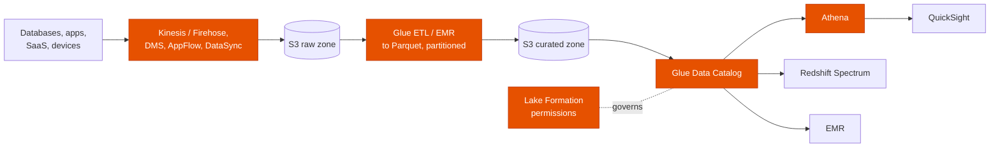
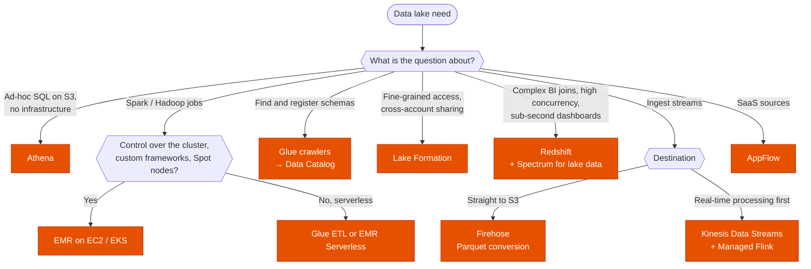

---
tags:
  - "Domain 2: New Solutions"
  - "Domain 3: Continuous Improvement"
  - Analytics
  - Athena
  - Glue
  - Lake Formation
---

# Data lake on S3: Glue, Athena, EMR, Lake Formation, Kinesis or Redshift?

**The question:** data from many sources must land in one place and be queried, transformed and governed. Which service ingests it, which catalogs and transforms it, which queries it, and which controls who sees what?

**Trigger keywords:** *"serverless SQL on S3"*, *"pay per query"*, *"reduce Athena cost"*, *"central metadata catalog"*, *"discover schemas automatically"*, *"Spark / Hadoop"*, *"control over the cluster"*, *"column-level / row-level permissions"*, *"share data with another account"*, *"near-real-time ingestion"*, *"SaaS data (Salesforce)"*, *"Apache Iceberg"*.

## Fundamentals

| Layer | Service | Role |
|---|---|---|
| **Ingest** | **Kinesis Data Streams / Firehose**, **MSK** | Streaming into S3 (Firehose can convert to Parquet) |
| | **DMS** | Databases (full load + CDC) into S3 |
| | **DataSync**, Transfer Family | Files from on-prem / SFTP partners |
| | **AppFlow** | SaaS (Salesforce, ServiceNow, Zendesk…) into S3 |
| **Store** | **S3** (raw → curated zones), **S3 Tables** | Columnar formats (**Parquet / ORC**), **partitions**, open table formats (**Iceberg**) for updates and time travel |
| **Catalog** | **Glue Data Catalog** + **crawlers** | Tables and schemas, shared by Athena, EMR, Redshift Spectrum, Glue |
| **Transform** | **Glue ETL** (serverless Spark), **EMR** (Spark, Hive, Presto on EC2, EKS or Serverless) | Clean, join, convert |
| **Query** | **Athena** (serverless SQL, pay per TB scanned), **Redshift Spectrum**, **EMR** | Ad-hoc SQL, warehouse joins with lake data |
| **Stream analytics** | **Managed Service for Apache Flink** | Real-time aggregations on streams |
| **Govern** | **Lake Formation** | Database / table / **column / row / cell** permissions, **LF-tags**, cross-account sharing |
| **Visualize / search** | **QuickSight**, **OpenSearch** | Dashboards / search and log analytics |

## Decision tree

## Why each branch

- **Athena** for serverless, ad-hoc SQL; cost and speed depend on **bytes scanned**, so use **Parquet**, **compression** and **partitioning** (and partition projection for many partitions).
- **Glue vs EMR:** Glue when serverless Spark with no tuning is fine; **EMR** when the team needs control (specific versions, frameworks like HBase or Presto, instance types, **Spot task nodes**). EMR Serverless sits between them.
- **Lake Formation** centralizes permissions in one place for Athena, Redshift Spectrum, EMR and Glue, down to row and cell level, and shares tables with other accounts. Bucket policies can't express column-level access.
- **Redshift** when the workload is a warehouse (heavy joins, many concurrent dashboard users); **Spectrum** to join warehouse tables with lake data without loading it. See [Redshift](redshift.md).
- **Iceberg / S3 Tables** when the lake needs updates, deletes, schema evolution or time travel.

## Exam traps

!!! warning "Athena on raw CSV / JSON for big tables"
    Scans everything: slow and expensive. Convert to **Parquet**, compress, **partition** by the filter columns.

!!! warning "Bucket policies for column-level access"
    S3 policies work at the object level. Column / row → **Lake Formation**.

!!! warning "EMR for the least operational overhead"
    Clusters need sizing and management. Serverless → **Glue** or **Athena** (or EMR Serverless).

!!! warning "Firehose for real-time per-record processing"
    Firehose **buffers** (seconds to minutes) and delivers. Per-record real-time logic → **Kinesis Data Streams** + Lambda / Flink.

!!! warning "Crawlers on every run"
    Crawlers discover schemas; they don't transform data. Schedule them sensibly, or use partition projection.

## Test yourself

??? question "1. Analysts run occasional SQL on 50 TB of logs in S3 and want no infrastructure; costs must drop."
    **Athena**, with data converted to **Parquet**, compressed and **partitioned** by date.

??? question "2. Data scientists need Spark 3 with custom libraries and Spot task nodes for nightly jobs."
    **EMR** on EC2 (core on On-Demand, **task nodes on Spot**).

??? question "3. The HR table must be readable by analysts except the salary column, through Athena and Redshift Spectrum."
    **Lake Formation** column-level permissions (data filters).

??? question "4. Salesforce data must land in S3 daily without custom code."
    **Amazon AppFlow.**

??? question "5. IoT events must be in S3 as Parquet within minutes, without servers."
    **Firehose** with **record format conversion** to Parquet (Glue Data Catalog schema).

## Related

- [Redshift](redshift.md)
- [Messaging: SQS, SNS, EventBridge, Kinesis](../integration/messaging.md)
- [Migration tools](../migration/migration-tools.md)
- [IoT services](../iot/iot-services.md)
- AWS docs: [Athena performance tuning](https://docs.aws.amazon.com/athena/latest/ug/performance-tuning.html)
- AWS docs: [Lake Formation permissions](https://docs.aws.amazon.com/lake-formation/latest/dg/lake-formation-permissions.html)
- AWS whitepaper: [Building a data lake on AWS](https://docs.aws.amazon.com/whitepapers/latest/building-data-lakes/building-data-lake-aws.html)
