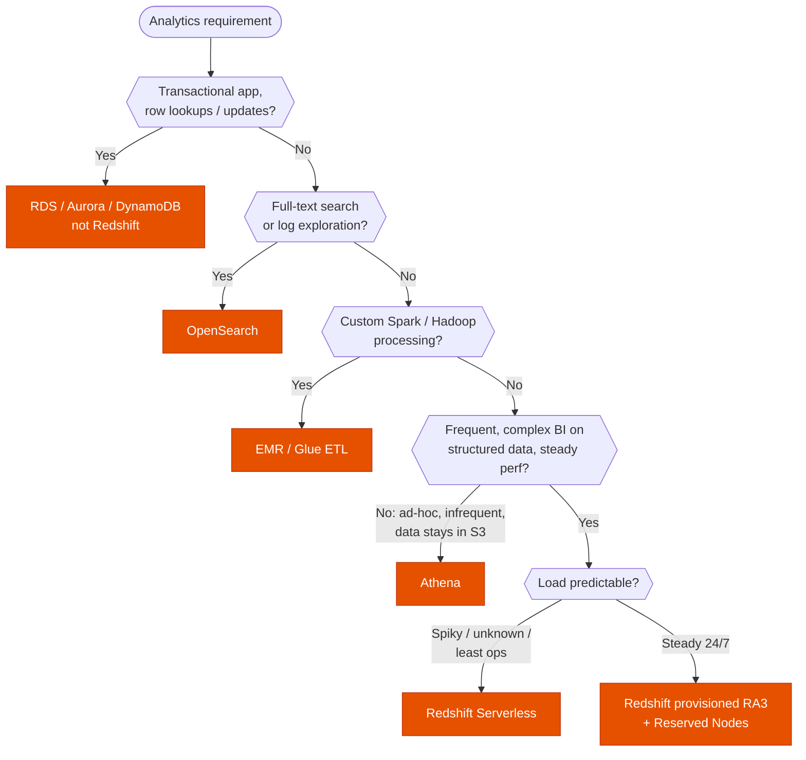
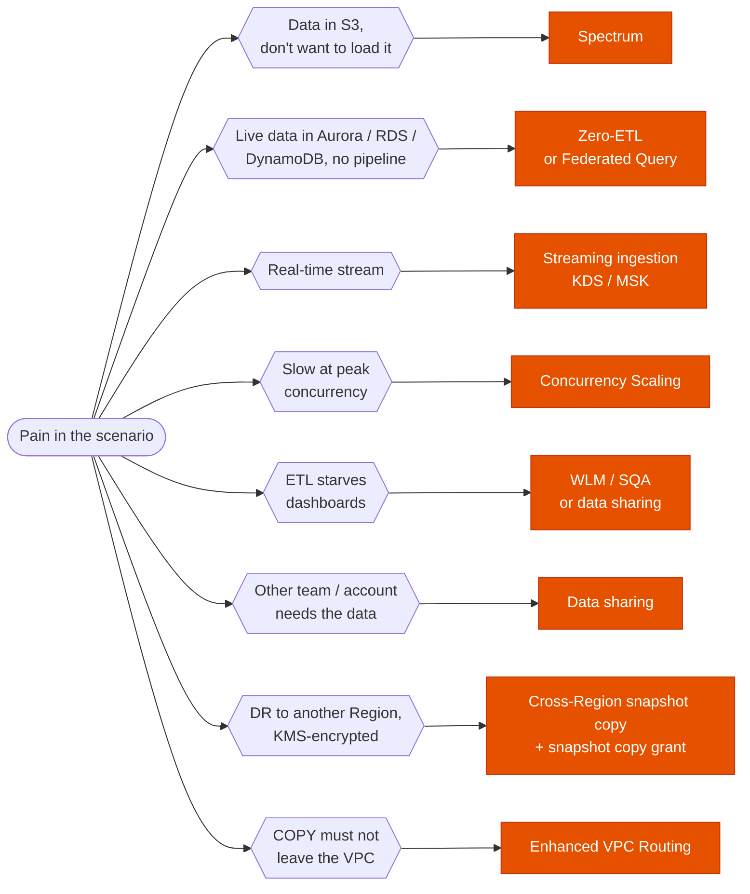

---
tags:
  - "Domain 2: New Solutions"
  - "Domain 3: Continuous Improvement"
  - Redshift
  - Analytics
---

# Redshift: is it the right engine, and which feature fixes the problem?

**The question:** a company needs analytics on large structured data. Is Redshift the answer (vs Athena, EMR, OpenSearch, RDS), and if so, which Redshift feature solves the scenario's pain: cost, concurrency, ingestion, sharing, DR or security?

**Trigger keywords:** *"data warehouse"*, *"BI dashboards / reporting"*, *"complex joins on petabytes"*, *"OLAP"*, *"query S3 without loading"*, *"near real-time analytics from Aurora / DynamoDB"*, *"spikes in concurrent queries"*, *"share data with another account without copying"*, *"COPY traffic must stay in the VPC"*, *"cross-Region DR for an encrypted cluster"*.

## Fundamentals

- **Columnar, MPP data warehouse** (PostgreSQL-based SQL). Built for OLAP: scans and aggregations over many rows. **Not OLTP.**
- **Provisioned:** one **leader node** (plans queries, aggregates results) + **compute nodes** (split into slices). **RA3** nodes keep data in **Redshift Managed Storage** (S3-backed, SSD cache), so storage and compute scale independently. DC2 is legacy.
- **Serverless:** capacity in **RPUs**, billed per second while queries run, no cluster to size. Best for spiky / unpredictable / dev workloads and "least operational overhead".

### Getting data in and out

| Path | Use |
|---|---|
| **`COPY` from S3** (also DynamoDB, EMR, SSH) | Fast parallel bulk load. Split into multiple compressed files (multiple of the slice count). |
| **Data Firehose → Redshift** | Near-real-time; Firehose stages in S3 then runs `COPY`. |
| **Streaming ingestion** | Kinesis Data Streams or MSK straight into a materialized view, seconds of latency, no S3 staging. |
| **Zero-ETL integration** | Aurora MySQL/PostgreSQL, RDS MySQL, DynamoDB → Redshift, near-real-time, **no pipeline to build**. |
| **Federated Query** | Query live RDS/Aurora PostgreSQL & MySQL from Redshift without moving data. |
| **Spectrum** | Query S3 (Parquet, ORC, CSV…) in place via external tables in the **Glue Data Catalog**; runs on a separate AWS fleet. |
| **SCT + DMS** (+ Snowball with SCT extraction agents) | Migrate an on-prem warehouse (Oracle, Teradata, Netezza…). |
| **`UNLOAD` to S3** | Export query results (Parquet) for a data lake. |

Row-by-row `INSERT` is the slow, wrong answer for bulk loads.

### Performance & cost levers

- **Concurrency Scaling:** transient extra clusters absorb bursts of concurrent queries; ~1 free hour per day accrues.
- **WLM** (auto or manual queues) + **Short Query Acceleration:** keep short dashboard queries from waiting behind long ETL.
- **Materialized views** (auto-refresh) for repeated dashboard aggregates; **result caching** is automatic.
- **Distribution style** (AUTO / KEY / EVEN / ALL) and **sort keys**: co-locate joins, prune blocks.
- **Elastic resize** (minutes, add/remove nodes) vs **classic resize** (hours, change node type).
- **Pause / resume** a provisioned cluster outside working hours; **Reserved Nodes** for steady 24/7 load.

### Sharing

- **Data sharing** (RA3 / Serverless): consumers query the producer's **live** data with their own compute: same account, **cross-account**, **cross-Region**, or via **AWS Data Exchange**. No copy, no ETL. Classic pattern: one ETL producer, separate BI consumer warehouses (workload isolation).

### Durability & DR

- **Automated snapshots:** incremental, to S3, roughly every 8 h or 5 GB/node of change. Retention **1 day by default, up to 35**.
- **Manual snapshots:** kept until deleted. **Restore = a new cluster** (or restore a single table).
- **Cross-Region snapshot copy:** cluster setting. For a **KMS-encrypted** cluster, create a **snapshot copy grant** in the **destination** Region so Redshift can use a KMS key there.
- **Multi-AZ** (RA3): standby capacity in a second AZ, automatic failover, same endpoint.
- **Cluster relocation** (RA3): move to another AZ when the AZ is impaired, same endpoint.
- Single-AZ cluster without these → AZ failure means restore from snapshot.

### Security

- Encryption at rest with **KMS** (or HSM); SSL in transit (`require_ssl`).
- **Enhanced VPC Routing:** `COPY`/`UNLOAD` traffic goes through **your VPC** (S3 gateway endpoint, NAT, security groups, Flow Logs) instead of the internet path.
- Credentials: **Secrets Manager** (rotation) or **IAM temporary credentials** / IAM Identity Center.
- Fine-grained: **row-level security**, **dynamic data masking**, column grants; **Lake Formation** permissions on Spectrum / data-share objects.
- **Audit logging** (connections, user activity) → S3 or CloudWatch; API calls → CloudTrail.

## Decision tree

Then, **inside Redshift**, match the pain to the feature:

## Why each branch

- **OLTP → not Redshift.** Single-row inserts/updates are slow on a columnar MPP engine; it's built to scan columns across many rows.
- **Ad-hoc, infrequent, data in S3 → Athena.** Pay per TB scanned, nothing to run. Redshift wins when queries are frequent, complex and need consistent performance.
- **Serverless vs provisioned.** Serverless removes sizing and idles to zero compute cost; provisioned + Reserved Nodes is cheaper for constant heavy load.
- **Spectrum** keeps cold history in S3 (cheap) while hot data lives in Redshift; one SQL query joins both.
- **Zero-ETL** beats Glue/DMS pipelines whenever the question stresses *"least operational overhead"* and the source is supported.
- **Concurrency Scaling** solves *many users at once*; a bigger cluster (resize) solves *each query is too slow*.
- **Data sharing** gives workload isolation without copies: the consumer pays for its own compute and sees live data.
- **Snapshot copy grant** exists because a KMS key is regional: Redshift needs permission to a key in the destination Region to re-encrypt copied snapshots.
- **Enhanced VPC Routing** is the only way to make `COPY`/`UNLOAD` traffic visible to VPC controls (endpoint policies, Flow Logs).

## Comparison

| | Redshift | Athena | EMR | OpenSearch | Aurora |
|---|---|---|---|---|---|
| Workload | BI / warehouse | Ad-hoc SQL on S3 | Big-data frameworks | Search, logs | OLTP |
| Data location | Managed storage (+ S3 via Spectrum) | S3 | S3 / HDFS | Index | Cluster volume |
| Infra to manage | Low (Serverless) / some (provisioned) | None | Cluster (or EMR Serverless) | Domain | Cluster |
| Pricing | Node-hours or RPU-seconds | Per TB scanned | Instance-hours | Instance-hours | Instance-hours / ACU |
| Best for | Complex joins, many users, steady perf | Infrequent queries, exploration | Spark ETL, ML prep | Text search, dashboards on logs | Transactions |

## Exam traps

!!! warning "Redshift as an application database"
    A web app needing low-latency reads/writes per row → Aurora / DynamoDB. Redshift is for analytics.

!!! warning "Redshift for occasional queries on S3"
    *"Analysts query S3 logs a few times a month, minimize cost"* → **Athena**, not a cluster running 24/7.

!!! warning "Resize to fix concurrency"
    More nodes help per-query speed. Many concurrent users queuing → **Concurrency Scaling**.

!!! warning "Cross-Region copy fails for an encrypted cluster"
    Missing the **snapshot copy grant** in the destination Region.

!!! warning "Copying data to share it"
    Unloading to S3 and reloading in another account is the old way. **Data sharing** gives live, copy-free access (RA3 / Serverless).

!!! warning "Building a Glue/DMS pipeline from Aurora"
    If near-real-time analytics with minimal ops is the goal and the source is supported → **Zero-ETL integration**.

!!! warning "Single-AZ assumption"
    A plain cluster lives in one AZ. *"Survive an AZ failure with automatic failover"* → **Multi-AZ** (RA3).

## Test yourself

??? question "1. A retailer keeps 5 years of sales history in S3 (Parquet) and the last 3 months in Redshift. Analysts need one query joining both, without loading the history."
    **Redshift Spectrum** with external tables in the Glue Data Catalog.

??? question "2. On the first business day of each month, hundreds of analysts run reports and queries queue for minutes. The rest of the month the cluster is fine."
    **Concurrency Scaling** (enable on the WLM queue). Not a permanent resize.

??? question "3. An e-commerce app runs on Aurora MySQL. The business wants near-real-time sales dashboards with the least operational overhead and no impact on the app."
    **Aurora zero-ETL integration with Redshift**.

??? question "4. A central data team's Redshift cluster is loaded by heavy ETL. Marketing (separate AWS account) needs live access to some tables without slowing ETL and without copies."
    **Data sharing** from the producer (RA3/Serverless) to a **consumer warehouse in the marketing account**.

??? question "5. Security requires that all traffic from COPY commands be inspectable with VPC Flow Logs and an S3 endpoint policy."
    Enable **Enhanced VPC Routing** + an **S3 gateway endpoint** (with the policy).

??? question "6. A KMS-encrypted cluster in eu-west-1 must have its snapshots available in eu-central-1 for DR. The copy configuration fails."
    Create a **snapshot copy grant** for a KMS key **in eu-central-1**, then enable **cross-Region snapshot copy** with it.

??? question "7. A data science team runs unpredictable queries a few hours a week and doesn't want to size or manage a cluster."
    **Redshift Serverless** (or Athena if data stays in S3 and queries are simple/ad-hoc).

??? question "8. A company migrates a 300 TB on-prem Teradata warehouse over a slow WAN link."
    **SCT** for schema conversion + **SCT data extraction agents** writing to **Snowball Edge** → S3 → `COPY` into Redshift (DMS for ongoing changes if needed).

## Related

- [Backup: DLM vs AWS Backup vs native](../storage/backup-strategy.md)
- [S3: which storage class and lifecycle?](../storage/s3-storage-classes.md)
- [The 7 Rs: which migration strategy?](../migration/seven-rs.md)
- AWS docs: [What is Amazon Redshift?](https://docs.aws.amazon.com/redshift/latest/mgmt/welcome.html)
- AWS docs: [Redshift Spectrum](https://docs.aws.amazon.com/redshift/latest/dg/c-using-spectrum.html)
- AWS docs: [Copying snapshots to another Region](https://docs.aws.amazon.com/redshift/latest/mgmt/working-with-snapshots.html#cross-region-snapshot-copy)
