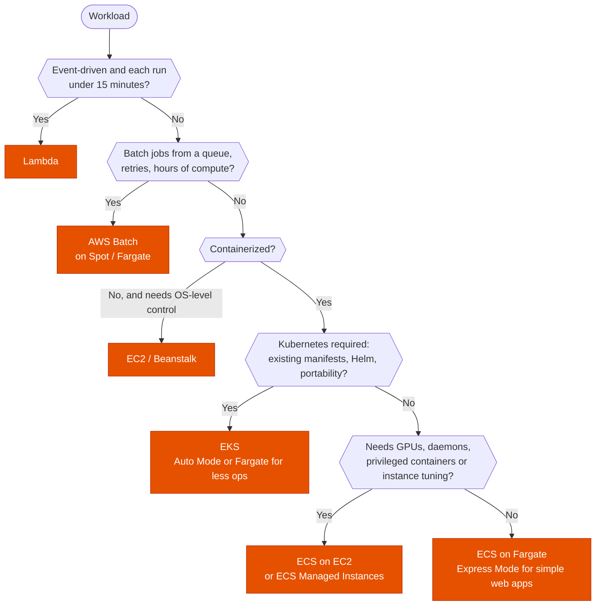

---
tags:
  - "Domain 2: New Solutions"
  - "Domain 4: Migration and Modernization"
  - Containers
  - Lambda
  - ECS
  - EKS
---

# Compute platform: Lambda, ECS, EKS, Fargate, Batch or EC2?

**The question:** an application or job needs somewhere to run. Which compute platform fits its runtime, duration, operational model and portability needs, and for containers, which launch type?

**Trigger keywords:** *"event-driven"*, *"runs for 2 hours"*, *"least operational overhead"*, *"no servers to manage"*, *"Kubernetes manifests / Helm"*, *"portable across clouds"*, *"GPU"*, *"DaemonSet / privileged containers"*, *"batch jobs with a queue"*, *"containerize a legacy app"*, *"cold starts"*, *"spiky unpredictable traffic"*.

## Fundamentals

| Platform | You manage | Limits / traits | Fits |
|---|---|---|---|
| **AWS Lambda** | Code only | **15 min** max, up to **10 GB** memory, 10 GB `/tmp`, container images up to 10 GB, scale to zero | Event-driven, spiky, short tasks |
| **ECS on Fargate** | Task definitions | No instances, per-task vCPU / memory, no GPU, no privileged containers / daemons | Containers without servers |
| **ECS on EC2** | Task definitions + instances (capacity providers) | GPUs, daemons, instance choice, Spot via capacity providers | Containers needing host control |
| **ECS Managed Instances** | Task definitions | AWS provisions and patches the EC2 instances, wider instance choice (GPU) | Between Fargate and ECS on EC2 |
| **ECS Express Mode** | A container image | ECS + ALB + scaling set up for you | Simple web apps / APIs (App Runner's successor) |
| **Amazon EKS** | Kubernetes workloads (+ nodes unless Fargate / **Auto Mode**) | Kubernetes API, Helm, operators, CNCF ecosystem | Kubernetes skills or portability |
| **AWS Batch** | Job definitions, queues | Runs on EC2 / Spot / Fargate, retries, dependencies, array jobs | Large-scale batch |
| **Elastic Beanstalk** | App code + config | Manages EC2, ASG, ALB for you | Lift a classic web app with little change |
| **EC2** | Everything | Full control | Licensing, special OS, legacy |

**App Runner** stopped accepting new customers on 30 Apr 2026; AWS points new projects to **ECS Express Mode**.

## Decision tree

## Why each branch

- **Lambda** has the least to manage and scales per request, but the **15-minute limit** and per-invocation model rule out long or stateful processing. Cold starts: **provisioned concurrency** or **SnapStart** (Java, Python, .NET).
- **Batch** when the stem talks about job queues, array jobs, dependencies and cost-efficient compute for hours: it handles scheduling and Spot interruptions.
- **ECS vs EKS:** ECS is simpler and AWS-native; EKS is the answer only when **Kubernetes itself** is a requirement (existing manifests, Helm charts, multi-cloud portability, CNCF tooling). For both, Fargate (or EKS Auto Mode) removes node management.
- **Fargate vs EC2 launch type:** Fargate unless you need **GPUs**, **daemon** workloads, privileged mode, very large tasks, or tight cost control with Reserved / Spot capacity on hosts.
- **Long-running tasks** that exceed Lambda's limit: **Fargate task** (via Step Functions or EventBridge) or Batch.

## Exam traps

!!! warning "Lambda for a 40-minute job"
    15 minutes max. → **Fargate task**, **Batch**, or split the work with **Step Functions**.

!!! warning "EKS for least operational overhead"
    Without a Kubernetes requirement, **ECS on Fargate** is less to run.

!!! warning "Fargate with GPUs or DaemonSets"
    Not supported. → **ECS on EC2 / Managed Instances**, or **EKS managed node groups**.

!!! warning "Lambda in a VPC loses internet access"
    A Lambda attached to private subnets needs a **NAT gateway** (or VPC endpoints) to reach the internet or AWS APIs.

!!! warning "App Runner as the default simple container host"
    Closed to new customers since April 2026. → **ECS Express Mode** / Fargate.

## Test yourself

??? question "1. Images uploaded to S3 must be resized within seconds; traffic is unpredictable; no servers."
    **Lambda** triggered by S3 events (or via EventBridge / SQS for buffering).

??? question "2. A video transcoding job runs 2 hours per file, thousands of files a week, cost matters."
    **AWS Batch** on **Spot** (or Fargate Spot tasks), not Lambda.

??? question "3. A team has 120 Helm charts from on-prem Kubernetes and wants to keep them."
    **Amazon EKS** (Auto Mode or managed node groups).

??? question "4. A containerized API with steady traffic; the team doesn't want to manage servers or Kubernetes."
    **ECS on Fargate** (Express Mode for the quickest setup).

??? question "5. ML inference containers need GPUs and the team wants ECS."
    **ECS on EC2 GPU instances** or **ECS Managed Instances** with GPU types.

## Related

- [Spot fleets](spot-fleets.md)
- [ASG scaling policies](asg-scaling-policies.md)
- [Deployment strategies](../deployment/deployment-strategies.md)
- [API Gateway](../integration/api-gateway.md)
- AWS docs: [Choosing an AWS container service](https://docs.aws.amazon.com/decision-guides/latest/containers-on-aws-how-to-choose/choosing-aws-container-service.html)
- AWS docs: [Lambda quotas](https://docs.aws.amazon.com/lambda/latest/dg/gettingstarted-limits.html)
- AWS docs: [App Runner availability change](https://docs.aws.amazon.com/apprunner/latest/dg/apprunner-availability-change.html)
