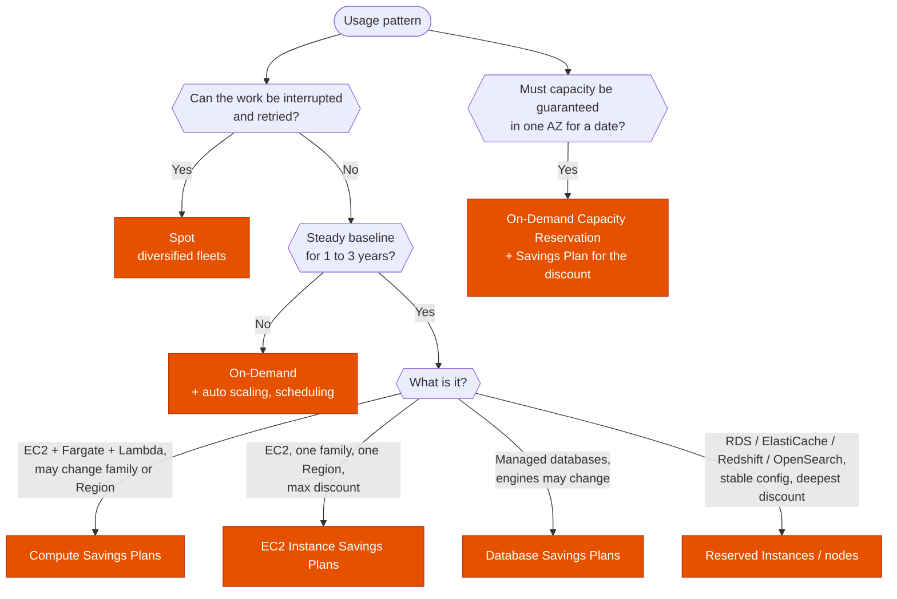

---
tags:
  - "Domain 3: Continuous Improvement"
  - Cost optimization
  - Savings Plans
---

# Cost optimization: which pricing model, and which tool finds the savings?

**The question:** a workload costs too much, or a new one must be bought at the best price. Which purchasing option fits the usage pattern (steady, flexible, interruptible), and which cost tool answers the question being asked (visibility, alerting, right-sizing, chargeback)?

**Trigger keywords:** *"most cost-effective"*, *"steady-state usage for 1 / 3 years"*, *"may change instance family or Region"*, *"interruptible batch"*, *"Fargate and Lambda too"*, *"capacity guaranteed for an event"*, *"right-size"*, *"alert when spend exceeds"*, *"stop resources automatically when over budget"*, *"unexpected spike in cost"*, *"chargeback per team"*, *"detailed billing data in Athena"*.

## Fundamentals: purchasing options

| Option | Commitment | Discount (max) | Flexibility | Covers |
|---|---|---|---|---|
| **On-Demand** | None | — | Total | Everything |
| **Compute Savings Plans** | $/hour, 1 or 3 years | ~66 % | **Any** family, size, OS, tenancy, **Region**; EC2, **Fargate, Lambda** | Compute |
| **EC2 Instance Savings Plans** | $/hour, 1 or 3 years | ~72 % | Size, OS, tenancy within **one family in one Region** | EC2 |
| **Database Savings Plans** | $/hour, 1 year | ~35 % | Engine, family, size, deployment, Region (recent generations) | Aurora, RDS, DynamoDB, ElastiCache, DocumentDB, Neptune… |
| **Standard Reserved Instances** | 1 or 3 years | ~72 % | Size within family (Regional RI); **sellable** on the RI Marketplace | EC2, and reserved nodes for RDS, ElastiCache, Redshift, OpenSearch |
| **Convertible RIs** | 1 or 3 years | ~66 % | Exchange for another family, OS, tenancy | EC2 |
| **Spot** | None | ~90 % | 2-minute interruption notice | EC2, Fargate Spot, EMR, Batch |
| **On-Demand Capacity Reservation** | None (pay while reserved) | — | Specific instance type in **one AZ** | Capacity guarantee; combine with Savings Plans for the discount |

Savings Plans and RIs **apply across the whole organization** under consolidated billing (sharing can be turned off per account).

## Fundamentals: cost tools

| Need | Tool |
|---|---|
| Explore and forecast spend, RI / SP recommendations | **Cost Explorer** |
| Most detailed billing data (per resource, per hour) for Athena / QuickSight | **Cost and Usage Report 2.0** via **Data Exports** to S3 |
| Alert on actual or forecast spend, **act** automatically (apply an SCP / IAM policy, stop EC2 or RDS) | **AWS Budgets** + budget actions |
| Detect **unusual** spend with ML, by service / account / tag | **Cost Anomaly Detection** |
| Right-sizing for EC2, ASG, EBS, Lambda, ECS on Fargate, RDS | **Compute Optimizer** |
| One list of all savings opportunities across accounts | **Cost Optimization Hub** |
| Chargeback / showback by team or project | **Cost allocation tags** (activated in the management account) + **Cost Categories** |
| Idle resources, unused EIPs, low-utilization checks | **Trusted Advisor** |

## Decision tree

## Why each branch

- **Spot whenever interruption is fine**: batch, CI, rendering, stateless web tiers in a mixed ASG. See [Spot fleets](../compute/spot-fleets.md).
- **Compute Savings Plans** are the default commitment: they follow the workload when it moves to Graviton, to another Region, or from EC2 to Fargate/Lambda. **EC2 Instance SP** only if the family and Region are certain.
- **RIs** still matter for services that Savings Plans don't cover in a given scenario, and **Standard RIs** can be resold.
- **Capacity Reservations** don't discount by themselves; they guarantee capacity. Zonal RIs also reserve capacity but lock the AZ and size.
- Commit to the **baseline** (lowest steady usage), not the peak; cover peaks with On-Demand and Spot.

## Quick wins the exam likes

| Waste | Fix |
|---|---|
| NAT gateway processing charges for S3 / DynamoDB traffic | **Gateway VPC endpoints** (free) |
| gp2 volumes | **gp3** (cheaper, IOPS independent of size) |
| x86 instances for portable code | **Graviton** |
| Dev / test running nights and weekends | **Instance Scheduler**, ASG scheduled actions |
| Unknown S3 access patterns | **S3 Intelligent-Tiering**, Storage Lens to find waste |
| Cross-AZ chatter, internet egress | Keep traffic in-AZ where possible, serve downloads through **CloudFront** |
| Over-provisioned instances | **Compute Optimizer** recommendations |

## Exam traps

!!! warning "Savings Plans reserve capacity"
    They don't. Capacity guarantee = **On-Demand Capacity Reservation** (or zonal RI).

!!! warning "EC2 Instance Savings Plans for Fargate or Lambda"
    Only **Compute** Savings Plans cover Fargate and Lambda.

!!! warning "Cost allocation tags show past costs"
    Tags appear only **after activation** in the management account, and only for costs from then on.

!!! warning "Budgets detects anomalies"
    Budgets compares to **thresholds you set**. Unexpected patterns without a threshold → **Cost Anomaly Detection**.

!!! warning "Buy RIs for the peak"
    Commitments should cover the **steady baseline**. Unused commitment is still paid.

## Test yourself

??? question "1. A company runs EC2, ECS on Fargate and Lambda, and plans to move to Graviton and add a Region next year. It wants a 3-year discount."
    **Compute Savings Plans.**

??? question "2. A Black Friday launch needs 200 c7g.4xlarge in eu-west-3a for 3 days, guaranteed."
    **On-Demand Capacity Reservation** for those days (a Savings Plan, if one exists, still applies the discount).

??? question "3. Dev accounts must stop all EC2 instances automatically when monthly spend passes $5,000."
    **AWS Budgets** with a **budget action** (stop EC2 instances, or apply a restrictive SCP).

??? question "4. Finance wants per-resource, hourly cost data queryable with SQL, and chargeback by team."
    **CUR 2.0 (Data Exports) to S3**, queried with **Athena**; **cost allocation tags** activated for `team`.

??? question "5. A private subnet's instances download terabytes from S3 every day; the NAT gateway bill is huge."
    **S3 gateway VPC endpoint**: no NAT processing charges.

## Related

- [Spot fleets](../compute/spot-fleets.md)
- [S3 storage classes](../storage/s3-storage-classes.md)
- [Multi-account foundations](../identity/multi-account.md)
- AWS docs: [Savings Plans types](https://docs.aws.amazon.com/savingsplans/latest/userguide/plan-types.html)
- AWS docs: [AWS Budgets actions](https://docs.aws.amazon.com/cost-management/latest/userguide/budgets-controls.html)
- AWS whitepaper: [Cost Optimization Pillar](https://docs.aws.amazon.com/wellarchitected/latest/cost-optimization-pillar/welcome.html)
