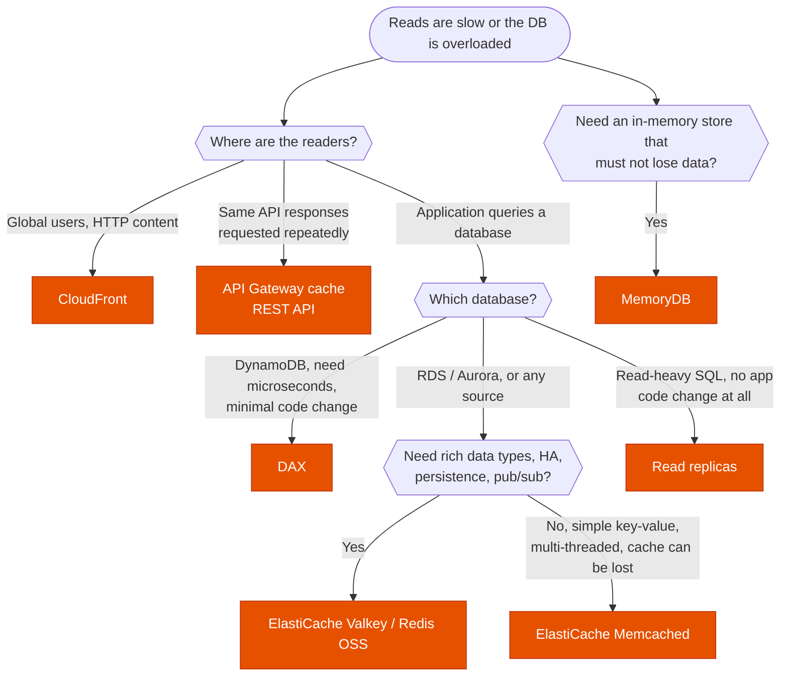

---
tags:
  - "Domain 2: New Solutions"
  - "Domain 3: Continuous Improvement"
  - ElastiCache
  - DAX
  - Caching
---

# Caching: ElastiCache, DAX, CloudFront or API Gateway cache?

**The question:** reads are too slow or the database is overloaded. Where should the cache sit (edge, API, application, in front of the database), which service implements it, and with which strategy?

**Trigger keywords:** *"microsecond latency for DynamoDB"*, *"minimal code changes"*, *"database CPU high from repeated queries"*, *"session state"*, *"leaderboard"*, *"cache static and dynamic content globally"*, *"cache API responses"*, *"durable in-memory database"*, *"multi-threaded, simple key-value"*, *"stale data"*.

## Fundamentals

| Cache | Sits | Latency | Notes |
|---|---|---|---|
| **CloudFront** | Edge, in front of anything HTTP | Lowest for users far away | Static and cacheable dynamic content; cache key = path + chosen headers / cookies / query strings |
| **API Gateway cache** | In front of the integration (**REST APIs only**) | ms | Per stage, 0.5 to 237 GB, TTL default **300 s**, max 3,600 s; clients can be allowed to invalidate |
| **ElastiCache for Valkey / Redis OSS** | Application tier | Sub-ms | Replication, **Multi-AZ** failover, persistence, pub/sub, sorted sets, Global Datastore; **Serverless** option |
| **ElastiCache for Memcached** | Application tier | Sub-ms | **Multi-threaded**, simple key-value, horizontal sharding; **no replication, no persistence** |
| **DynamoDB Accelerator (DAX)** | In front of **DynamoDB only** | **Microseconds** | **API-compatible** (swap the client), item and query caches, write-through; eventually consistent reads only (strongly consistent reads pass through) |
| **MemoryDB** | Primary database | Sub-ms reads, single-digit ms writes | Redis/Valkey-compatible and **durable** (multi-AZ transaction log). Not a cache: the system of record |
| **RDS / Aurora read replicas** | Database tier | ms | Read scaling rather than caching; no code change beyond the reader endpoint |

## Decision tree

## Why each branch

- **Cache as close to the user as possible.** A CloudFront hit never reaches the Region; an API Gateway cache hit never invokes the Lambda; an ElastiCache hit never touches the database.
- **DAX for DynamoDB** because it's a drop-in client: no cache logic in the application. It doesn't help other databases, and it doesn't speed up strongly consistent reads.
- **Valkey / Redis OSS** is the default application cache: replication with automatic failover, persistence, rich structures (sorted sets → **leaderboards**, TTL keys → **sessions**, pub/sub).
- **Memcached** only when the stem stresses multi-threaded performance and simplicity, and losing the cache is acceptable.
- **Read replicas** when the stem says *"no application changes"* and the load is read-heavy SQL; caching needs application logic (except DAX).

## Caching strategies

| Strategy | How | Good | Bad |
|---|---|---|---|
| **Lazy loading** (cache-aside) | Read cache; on a miss, read DB and populate | Only requested data cached; survives cache loss | Miss penalty (3 trips), stale until TTL |
| **Write-through** | Write DB and cache together | Cache always fresh | Writes slower; caches data never read |
| **TTL** | Expire keys | Bounds staleness | Tuning: too short = misses, too long = stale |

Usual answer: **lazy loading + TTL**, write-through for data that must be fresh.

## Exam traps

!!! warning "DAX in front of RDS"
    DAX is **DynamoDB-only**. RDS → ElastiCache or read replicas.

!!! warning "Memcached for high availability"
    No replication or failover. HA cache → **Valkey / Redis OSS with Multi-AZ**.

!!! warning "ElastiCache as the primary database"
    A cache can lose data. Durable in-memory → **MemoryDB**.

!!! warning "API Gateway caching on an HTTP API"
    Caching exists on **REST APIs** only.

!!! warning "Session state on the instances"
    Sticky sessions break on scale-in and failures. Store sessions in **ElastiCache** or **DynamoDB**.

## Test yourself

??? question "1. A DynamoDB-backed product catalog needs microsecond reads during sales; developers can't rewrite data access."
    **DAX** (swap in the DAX client).

??? question "2. An RDS PostgreSQL database hits 90 % CPU from the same queries; the team can change application code."
    **ElastiCache (Valkey / Redis OSS)** with lazy loading + TTL.

??? question "3. A gaming company needs a real-time leaderboard."
    **ElastiCache for Valkey / Redis OSS** sorted sets (or MemoryDB if it must be durable).

??? question "4. A REST API on API Gateway + Lambda returns the same exchange rates thousands of times per minute."
    **API Gateway stage cache** with a suitable TTL.

??? question "5. Web servers in an ASG lose user sessions on scale-in."
    Store sessions in **ElastiCache** (or DynamoDB) instead of local memory.

## Related

- [DynamoDB RCU / WCU](dynamodb-capacity.md)
- [RDS auto scaling](rds-auto-scaling.md)
- [Edge: CloudFront or Global Accelerator](../networking/cloudfront-global-accelerator.md)
- [API Gateway](../integration/api-gateway.md)
- AWS whitepaper: [Database caching strategies using Redis](https://docs.aws.amazon.com/whitepapers/latest/database-caching-strategies-using-redis/welcome.html)
- AWS docs: [DAX: how it works](https://docs.aws.amazon.com/amazondynamodb/latest/developerguide/DAX.concepts.html)
- AWS docs: [API Gateway caching](https://docs.aws.amazon.com/apigateway/latest/developerguide/api-gateway-caching.html)
