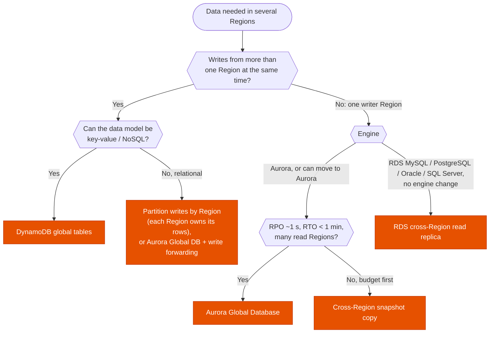

---
tags:
  - "Domain 2: New Solutions"
  - "Domain 3: Continuous Improvement"
  - Aurora
  - DynamoDB
  - RDS
  - Disaster recovery
---

# Multi-Region databases: Aurora Global Database, DynamoDB global tables or RDS cross-Region replicas?

**The question:** data must be available in more than one Region, for DR, for low-latency reads near users, or for writes from several Regions. Which replication option matches the engine, the RPO/RTO and the write pattern?

**Trigger keywords:** *"RPO of 1 second"*, *"RTO under 1 minute"*, *"read latency for users on another continent"*, *"write in multiple Regions"*, *"multi-active"*, *"last writer wins"*, *"promote the replica"*, *"MySQL / PostgreSQL on RDS"*, *"cross-Region snapshot copy"*.

## Fundamentals

| Option | Engines | Writers | Replication | Typical RPO / RTO | Notes |
|---|---|---|---|---|---|
| **RDS cross-Region read replica** | MySQL, MariaDB, PostgreSQL, Oracle, SQL Server (engine-specific) | 1 (primary Region) | Asynchronous, engine-native | Seconds to minutes / **manual promote**, minutes | Promotion breaks replication; repoint the app yourself |
| **Aurora Global Database** | Aurora MySQL, Aurora PostgreSQL | **1 primary Region**; secondaries read-only (+ **write forwarding**) | Storage-level, dedicated infra, typically **< 1 s lag** | ~1 s / **< 1 min** | **Switchover** (planned, no data loss) and **failover** (unplanned) managed; global writer endpoint |
| **DynamoDB global tables** | DynamoDB | **All Regions** (multi-active) | Asynchronous by default (**last writer wins**), seconds | Seconds / ~0 (just route elsewhere) | Optional **multi-Region strong consistency** mode for 3 Regions |
| **Backup copy** | All | — | Snapshots copied (AWS Backup, automated backup replication) | Hours / hours | Cheapest; see [DR strategy](../resilience/dr-strategy.md) |
| **ElastiCache Global Datastore** | Valkey / Redis OSS | 1 primary cluster | < 1 s typical | — | Cache layer, not the system of record |

## Decision tree

## Why each branch

- **DynamoDB global tables for multi-Region writes.** Every replica accepts writes; conflicts resolve with **last writer wins**. Apps write locally and read locally. If the scenario needs **strongly consistent reads across Regions** and zero RPO, the **multi-Region strong consistency** mode exists (three Regions, higher write latency).
- **Relational multi-writer is hard.** The exam's answer is usually to keep one writer (Aurora Global Database), use **write forwarding** from secondaries for occasional writes, or shard writes by Region at the application level.
- **Aurora Global Database for the best relational RPO/RTO.** Replication happens at the storage layer, so it doesn't load the primary's DB instances and lag stays around a second. Secondaries serve local reads and can be **headless** (storage only, no instances) to cut DR cost, which turns them into a pilot light.
- **RDS cross-Region read replicas** when the engine must stay RDS (no Aurora). Cheaper and simpler, but failover = **promote** (one-way) and update the connection string or DNS.
- **Snapshot copy** when hours of RPO are fine.

## Comparison

| | RDS cross-Region replica | Aurora Global Database | DynamoDB global tables |
|---|---|---|---|
| Multi-Region writes | ❌ | Forwarded to primary | ✅ |
| Replication lag | Seconds to minutes | ~1 s | Seconds (async mode) |
| Failover | Manual promote, breaks link | Managed switchover / failover | No failover: all active |
| Impact on primary | Uses DB instance resources | Storage-level, minimal | Managed |
| Read scaling in secondary | Replica instance | Up to 16 replicas per secondary cluster | Full table |

## Exam traps

!!! warning "Multi-AZ = multi-Region"
    RDS Multi-AZ and Aurora's 6-way storage are **inside one Region**. Region loss needs one of the options above.

!!! warning "Aurora Global Database for multi-Region writes"
    One writer. *"Users in each Region must write with local latency"* → DynamoDB global tables.

!!! warning "Promoting an RDS replica is reversible"
    Promotion makes it standalone. To fail back you must create a new replica in the original Region.

!!! warning "Global tables without a plan for conflicts"
    Concurrent updates to the same item in two Regions: last writer wins and the other write is lost. Design keys so a given item is usually written in one Region, or use strong consistency mode.

!!! warning "Encryption keys across Regions"
    Encrypted replicas need a KMS key in the destination Region. **Multi-Region keys** simplify cross-Region copies and replicas.

## Test yourself

??? question "1. A MySQL-compatible OLTP app needs RPO ≈ 1 s and RTO < 1 min for a Region failure, plus local reads in two other Regions."
    **Aurora Global Database** (primary + 2 secondaries), managed failover, global writer endpoint.

??? question "2. A shopping cart must accept writes in us-east-1, eu-west-1 and ap-southeast-1 with single-digit ms latency, and survive any Region loss."
    **DynamoDB global tables** in the three Regions.

??? question "3. RDS for PostgreSQL must have a DR copy in another Region with RPO of minutes, and the company won't migrate to Aurora."
    **RDS cross-Region read replica**, promoted on disaster.

??? question "4. Minimize DR cost for an Aurora cluster but keep RPO ~1 s; RTO of 30 min is acceptable."
    **Aurora Global Database with a headless secondary** (storage only), add instances during failover.

## Related

- [Disaster recovery strategy](../resilience/dr-strategy.md)
- [RDS auto scaling](rds-auto-scaling.md)
- [DynamoDB RCU / WCU](dynamodb-capacity.md)
- [KMS key types](../security/kms-key-types.md)
- AWS docs: [Aurora Global Database](https://docs.aws.amazon.com/AmazonRDS/latest/AuroraUserGuide/aurora-global-database.html)
- AWS docs: [DynamoDB global tables](https://docs.aws.amazon.com/amazondynamodb/latest/developerguide/GlobalTables.html)
- AWS docs: [Cross-Region read replicas](https://docs.aws.amazon.com/AmazonRDS/latest/UserGuide/USER_ReadRepl.XRgn.html)
