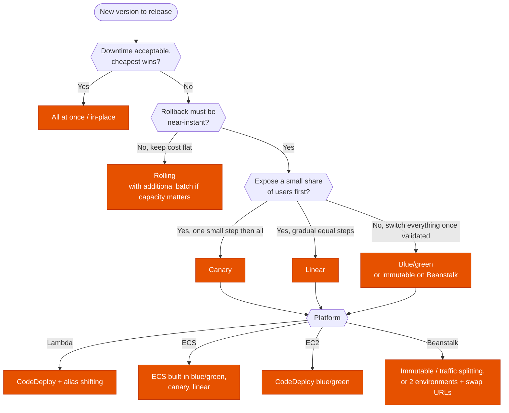

---
tags:
  - "Domain 3: Continuous Improvement"
  - Deployment
  - CodeDeploy
  - CloudFormation
---

# Deployment strategies: rolling, blue/green, canary or linear, and with which tool?

**The question:** a new version must reach production. Which strategy matches the tolerance for downtime, the rollback speed and the cost of running two versions, and which service implements it for EC2, containers, Lambda or Beanstalk? And how do you deploy infrastructure safely with CloudFormation?

**Trigger keywords:** *"zero downtime"*, *"roll back quickly"*, *"test on a small percentage of users first"*, *"10 % of traffic for 10 minutes"*, *"automatic rollback on alarm"*, *"immutable"*, *"swap environment URLs"*, *"preview the changes"*, *"prevent replacement of the database"*, *"detect manual changes"*, *"wait until the instance is configured"*.

## Fundamentals: strategies

| Strategy | How | Downtime | Rollback | Extra cost |
|---|---|---|---|---|
| **All at once / in-place** | Replace everything | Yes | Redeploy old version (slow) | None |
| **Rolling** | Batches of the existing fleet | No, reduced capacity | Redeploy (slow) | None |
| **Rolling with additional batch** | New batch first, then roll | No, full capacity | Redeploy | One batch |
| **Immutable** | New instances in a temporary ASG, then swap | No | **Terminate the new ones** (fast) | Double during deploy |
| **Blue/green** | Full new environment, switch traffic at once | No | **Switch back** (fastest) | Double |
| **Canary** | Small % first, then 100 % | No | Shift back | Small |
| **Linear** | Equal steps every N minutes | No | Shift back | Small |

## Fundamentals: who does what

| Target | Tool | Options |
|---|---|---|
| **EC2 / on-prem** | **CodeDeploy** | In-place (`OneAtATime`, `HalfAtATime`, `AllAtOnce`) or **blue/green** with a new ASG behind the ALB |
| **Lambda** | **CodeDeploy** + **alias** traffic shifting (SAM `DeploymentPreference`) | `Canary10Percent5Minutes`, `Linear10PercentEvery1Minute`, `AllAtOnce`, pre/post hooks, **CloudWatch alarm rollback** |
| **ECS** | **ECS built-in deployments** (since 2025) or CodeDeploy | Rolling (with **circuit breaker**), **blue/green**, **linear**, **canary**, lifecycle hooks, alarm rollback |
| **Elastic Beanstalk** | Beanstalk | All at once, rolling, rolling + batch, **immutable**, **traffic splitting** (canary); blue/green = second environment + **swap URLs** |
| **API Gateway** | Stage **canary release** | % of stage traffic to the new deployment |
| **ASG / AMIs** | **Instance refresh**, EC2 Image Builder for golden AMIs | Rolling replacement with min healthy % and checkpoints |
| **Any HTTP app** | ALB **weighted target groups**, Route 53 **weighted** records | DNS weighting is subject to client caching |

## Decision tree

## CloudFormation: safe infrastructure changes

| Need | Feature |
|---|---|
| See what an update will modify or **replace** before running it | **Change sets** |
| Roll back automatically if an alarm fires during or after the update | **Rollback triggers** (CloudWatch alarms) |
| Never update or replace a critical resource by accident | **Stack policy** |
| Keep the database when the stack is deleted / the resource replaced | `DeletionPolicy: Retain` or `Snapshot`, `UpdateReplacePolicy` |
| Prevent deleting the whole stack | **Termination protection** |
| Wait until instances finish bootstrapping before marking success | **`CreationPolicy`** + `cfn-signal` |
| Roll ASG instances on launch template change | **`UpdatePolicy`**: `AutoScalingRollingUpdate` or `AutoScalingReplacingUpdate` |
| Find resources changed by hand | **Drift detection** |
| Same stack in many accounts and Regions | **StackSets** |

## Exam traps

!!! warning "Route 53 weighted records for instant rollback"
    Clients and resolvers cache DNS for the TTL. For fast, precise shifting, use **ALB weighted target groups**, CodeDeploy or ECS built-in deployments.

!!! warning "Rolling for a fast rollback"
    Rolling back a rolling deployment is another rolling deployment. Fast rollback = **blue/green** or **immutable**.

!!! warning "Beanstalk blue/green as a deployment policy"
    Blue/green on Beanstalk is **two environments** and **Swap environment URLs**. *Immutable* is the in-environment policy.

!!! warning "Canary on Lambda without aliases"
    Traffic shifting works on an **alias** pointing to two **versions**. `$LATEST` can't be weighted.

!!! warning "Database inside a blue/green stack"
    Both environments must share the **same data tier** (outside the swapped stack), or you lose data at switch time.

## Test yourself

??? question "1. A Lambda function must send 10 % of traffic to the new version for 10 minutes, then 100 %, rolling back if an error alarm fires."
    **CodeDeploy** with `Canary10Percent10Minutes` on an **alias**, alarm-based rollback (SAM `DeploymentPreference`).

??? question "2. An ECS service on Fargate must validate the new version with test traffic, then switch everything at once with instant rollback."
    **ECS built-in blue/green deployment** with a test listener and lifecycle hooks (or CodeDeploy blue/green).

??? question "3. Beanstalk app: zero downtime, full capacity during deploys, and the fastest rollback if the new instances fail health checks."
    **Immutable** deployment policy.

??? question "4. An update to a production stack must never replace the RDS instance, and the team wants to see the impact first."
    **Change set** to preview, **stack policy** denying `Update:Replace` on the DB, `DeletionPolicy`/`UpdateReplacePolicy: Snapshot`.

??? question "5. EC2 instances in a stack run a long user-data script; the stack must not complete until it succeeds."
    **`CreationPolicy`** with a timeout, and **`cfn-signal`** at the end of the script.

## Related

- [ASG scaling policies](../compute/asg-scaling-policies.md)
- [Containers and serverless compute](../compute/containers-serverless.md)
- [Multi-account foundations](../identity/multi-account.md)
- AWS docs: [CodeDeploy deployment configurations](https://docs.aws.amazon.com/codedeploy/latest/userguide/deployment-configurations.html)
- AWS docs: [Amazon ECS deployment types](https://docs.aws.amazon.com/AmazonECS/latest/developerguide/deployment-types.html)
- AWS docs: [Elastic Beanstalk deployment policies](https://docs.aws.amazon.com/elasticbeanstalk/latest/dg/using-features.rolling-version-deploy.html)
- AWS docs: [CloudFormation change sets](https://docs.aws.amazon.com/AWSCloudFormation/latest/UserGuide/using-cfn-updating-stacks-changesets.html)
