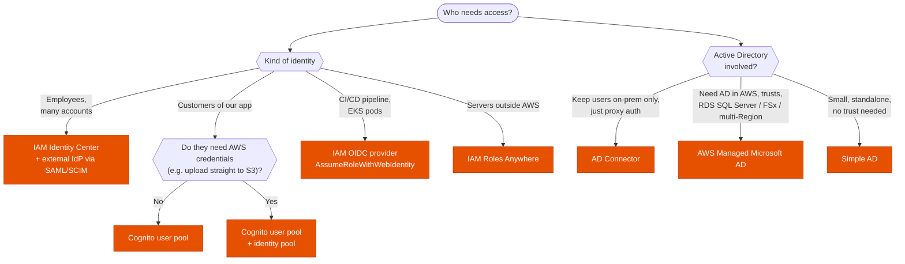

---
tags:
  - "Domain 1: Organizational Complexity"
  - IAM Identity Center
  - Cognito
  - Directory Service
---

# Federation and directories: who signs in, and with which service?

**The question:** people or workloads that live outside IAM must get access to AWS. Which federation option fits *who* they are (employees, app customers, external workloads)? And when Active Directory is involved, which **Directory Service** flavor?

**Trigger keywords:** *"employees sign in with Okta / Entra ID / ADFS"*, *"single sign-on to many accounts"*, *"mobile app users"*, *"social login"*, *"temporary credentials to upload to S3 from the app"*, *"on-prem servers need AWS credentials"*, *"GitHub Actions without access keys"*, *"existing on-prem Active Directory"*, *"trust relationship"*, *"RDS for SQL Server Windows authentication"*, *"FSx for Windows"*.

## Fundamentals: federation

| Who | Service | How |
|---|---|---|
| **Employees**, many accounts and apps | **IAM Identity Center** | Identity source: its own directory, **AD** (via Managed AD or AD Connector), or an **external IdP** (SAML 2.0 for sign-in + **SCIM** for user/group sync). **Permission sets** → roles in each account |
| Employees, one account, legacy | **IAM SAML 2.0 identity provider** | IdP assertion → `AssumeRoleWithSAML` → role |
| **App customers** (web, mobile) | **Amazon Cognito user pools** | Sign-up / sign-in, MFA, social and SAML/OIDC IdPs, JWTs for your APIs |
| App customers needing **AWS credentials** | **Cognito identity pools** | Exchange a token (user pool, Google, Apple, SAML…) for temporary credentials of an IAM role; guest access possible |
| **CI/CD and Kubernetes workloads** | **IAM OIDC identity provider** | `AssumeRoleWithWebIdentity`: GitHub Actions, GitLab, EKS service accounts (IRSA). EKS also has **Pod Identity** |
| **Servers outside AWS** (on-prem, other clouds) | **IAM Roles Anywhere** | X.509 certificate from your CA (or Private CA) → temporary credentials |

## Fundamentals: Directory Service

| Option | What it is | Trusts with on-prem AD | Typical use |
|---|---|---|---|
| **AWS Managed Microsoft AD** | A real **Windows AD** run by AWS (2+ DCs in 2 AZs), Standard or Enterprise | ✅ one-way or two-way forest trusts | AD-aware AWS services (RDS SQL Server, FSx for Windows, WorkSpaces), **multi-Region replication** (Enterprise), users that must live in AWS |
| **AD Connector** | **Proxy** to your on-prem AD, stores nothing | n/a (it *is* the on-prem AD) | Use existing users for WorkSpaces, Identity Center, console sign-in, EC2 domain join. **Needs VPN/DX**; stops working if on-prem is unreachable |
| **Simple AD** | Samba-based, AD-compatible, small (≤ 5,000 users) | ❌ | Basic, cheap, standalone directory |
| Self-managed AD on EC2 | Your DCs on EC2 | ✅ | Full control, schema extensions the managed one doesn't allow |

## Decision tree

## Why each branch

- **Identity Center** is the default for workforce access: one place to assign groups to accounts, short-lived credentials, CLI integration (`aws sso login`), **ABAC** with user attributes passed as session tags. SAML per account still works but doesn't scale.
- **Cognito user pools** are the user directory of *your* application; **identity pools** are the bridge from any identity to IAM roles. Many exam stems need both.
- **OIDC providers** remove long-lived access keys from pipelines: GitHub's OIDC token is trusted by a role whose trust policy checks the repo and branch (`token.actions.githubusercontent.com:sub`).
- **Roles Anywhere** is the answer to *"on-prem application uses access keys stored on disk"*.
- **AD Connector vs Managed AD:** AD Connector when the company says *"don't copy or sync users to AWS"*. Managed AD when services need a domain **inside** AWS that keeps working even if the link to on-prem drops, or when a **trust** is required.

## Exam traps

!!! warning "Identity Center for app customers"
    Workforce only. Millions of app users → **Cognito**.

!!! warning "Cognito user pool alone gives AWS credentials"
    A user pool issues **JWTs**. AWS credentials come from an **identity pool**.

!!! warning "Trust between Simple AD and on-prem AD"
    Simple AD doesn't support trusts. Use **Managed Microsoft AD**.

!!! warning "AD Connector caches credentials"
    It caches nothing. If the VPN/DX link or the on-prem DCs are down, authentication fails.

!!! warning "Access keys in a CI pipeline or on a server"
    Long-lived keys are the wrong answer when OIDC federation (pipelines) or **Roles Anywhere** (servers) exists.

!!! warning "Identity Center with two identity sources"
    One identity source at a time. To use both an IdP and AD, federate the IdP with AD, or move to one source.

## Test yourself

??? question "1. 3,000 employees sign in with Entra ID and need different roles in 70 accounts; groups must stay in sync."
    **IAM Identity Center** with Entra ID as external IdP: **SAML** for sign-in, **SCIM** for provisioning, permission sets assigned to groups.

??? question "2. A mobile app lets users sign in with Apple or Google and upload photos directly to their own S3 prefix."
    **Cognito user pool** (social IdPs) + **identity pool** → IAM role with `${cognito-identity.amazonaws.com:sub}` in the S3 resource ARN.

??? question "3. GitHub Actions deploys to AWS with access keys stored as secrets. Security wants them gone."
    **IAM OIDC identity provider** for GitHub, a role whose trust policy restricts `sub` to the repo and branch.

??? question "4. WorkSpaces users must log in with their on-prem AD accounts; the company refuses to replicate users to AWS."
    **AD Connector** (requires VPN or Direct Connect to the DCs).

??? question "5. RDS for SQL Server and FSx for Windows need Windows authentication for on-prem users, and must keep working if the DX link is down."
    **AWS Managed Microsoft AD** with a **trust** to the on-prem forest.

## Related

- [Multi-account foundations](multi-account.md)
- [Cross-account access](cross-account-access.md)
- [FSx](../storage/fsx.md)
- AWS docs: [IAM Identity Center identity sources](https://docs.aws.amazon.com/singlesignon/latest/userguide/manage-your-identity-source.html)
- AWS docs: [Cognito user pools and identity pools](https://docs.aws.amazon.com/cognito/latest/developerguide/what-is-amazon-cognito.html)
- AWS docs: [Which Directory Service option?](https://docs.aws.amazon.com/directoryservice/latest/admin-guide/what_is.html)
- AWS docs: [IAM Roles Anywhere](https://docs.aws.amazon.com/rolesanywhere/latest/userguide/introduction.html)
