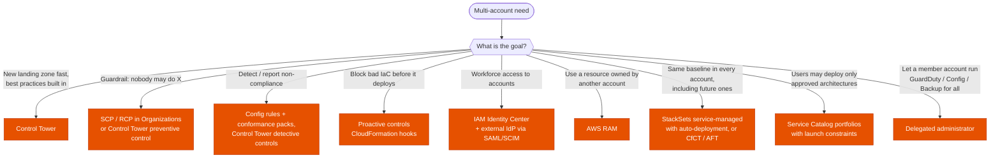

---
tags:
  - "Domain 1: Organizational Complexity"
  - AWS Organizations
  - Control Tower
  - IAM Identity Center
---

# Multi-account foundations: Organizations, Control Tower, Identity Center, RAM, StackSets?

**The question:** a company runs (or is moving to) many AWS accounts. Which service sets up the landing zone, applies guardrails, gives people access, shares resources and deploys baselines into every account, including the ones created next month?

**Trigger keywords:** *"set up a multi-account environment quickly"*, *"landing zone"*, *"guardrails"*, *"new accounts must automatically get…"*, *"single sign-on for workforce"*, *"corporate IdP / Okta / Entra ID"*, *"share subnets / Transit Gateway with other accounts"*, *"deploy to all accounts in an OU"*, *"approved products only"*, *"central billing"*.

## Fundamentals

| Service | Does | Doesn't |
|---|---|---|
| **AWS Organizations** | Accounts in **OUs**, consolidated billing, **SCPs / RCPs**, tag / backup / AI opt-out policies, **delegated administrator** for other services | Build accounts' baseline, logging, or identity |
| **AWS Control Tower** | Builds a **landing zone** on Organizations: Security OU with **Log Archive** + **Audit** accounts, org CloudTrail, Config, **controls**, **Account Factory**, dashboard of drift and compliance | Replace Organizations (it uses it) |
| **IAM Identity Center** | Workforce **SSO** to all accounts and apps; **permission sets** become roles in each account; external IdP via **SAML 2.0 + SCIM** | Customer (end-user) identities → that's **Cognito** |
| **AWS RAM** | Share resources across accounts / OUs: **subnets** (VPC sharing), **TGW**, Route 53 Resolver rules, prefix lists, License Manager configs, Lattice service networks… | Share IAM permissions |
| **CloudFormation StackSets** | Deploy one stack to many accounts and Regions; **service-managed** mode with **auto-deployment** to accounts added to an OU | Enforce anything after deployment |
| **Service Catalog** | **Portfolios** of approved products (CloudFormation / Terraform); **launch constraint** role so users deploy without broad permissions; share portfolios across the org | Organize accounts |

### Control Tower controls

| Type | Implemented with | Example |
|---|---|---|
| **Preventive** | **SCPs** / **RCPs** | Disallow deleting the org CloudTrail |
| **Detective** | **AWS Config rules** | Detect unencrypted EBS volumes |
| **Proactive** | **CloudFormation hooks** | Block a stack that creates a public S3 bucket, **before** it's provisioned |

Account customization: **Account Factory Customization (AFC)** with blueprints, **Customizations for Control Tower (CfCT)**, or **Account Factory for Terraform (AFT)**.

## Decision tree

## Why each branch

- **Control Tower for "quickly, with best practices".** It's Organizations + Identity Center + CloudTrail + Config + controls, wired together. Existing organizations can be enrolled; existing accounts can be enrolled into governed OUs.
- **SCPs for "even admins can't".** Preventive and outside the account's control. See [policy evaluation](policy-evaluation.md).
- **Identity Center for people.** One identity source, permission sets mapped to accounts, short-lived credentials, **ABAC** with user attributes. Not for customers of your app (**Cognito**), and not for workloads (IAM roles).
- **RAM to avoid copies.** One Transit Gateway shared to all accounts, one VPC whose subnets are shared, central Resolver forwarding rules. Sharing within the org can skip invitations.
- **StackSets for baselines.** Service-managed permissions with **automatic deployment**: when an account joins the target OU, the stack is deployed; when it leaves, it can be removed.
- **Service Catalog for self-service with guardrails.** End users need only Service Catalog permissions; the **launch role** creates the resources.
- **Delegated administrator** keeps day-to-day security tooling out of the management account (GuardDuty, Security Hub, Config aggregator, Backup, Firewall Manager, IAM Access Analyzer…).

## Recommended OU structure

| OU | Accounts | Why |
|---|---|---|
| **Security** | Log Archive, Audit (security tooling) | Immutable logs and read-only security access, isolated |
| **Infrastructure** | Network (TGW, DX, egress), shared services | Central networking shared with RAM |
| **Workloads** | Prod and non-prod per app or team | Blast radius, separate quotas and billing |
| **Sandbox** | Experimentation | Loose controls, budget limits |
| **Suspended** / **Policy staging** | Closing accounts / testing SCPs | Safe place for restrictive SCPs |

The **management account** runs nothing but billing and Organizations: SCPs don't apply to it.

## Exam traps

!!! warning "Identity Center for mobile app users"
    Identity Center is for the **workforce**. App end users → **Cognito user pools** (+ identity pools for AWS credentials).

!!! warning "StackSets self-managed for new accounts"
    Self-managed StackSets need you to create the execution role in each account and don't auto-deploy. *"Every new account automatically"* → **service-managed** StackSets with auto-deployment (or Control Tower customizations).

!!! warning "Config rules prevent things"
    Config is **detective**. To stop the action, use an SCP; to stop bad templates, use a **proactive** control / CloudFormation hook.

!!! warning "Sharing a VPC across organizations"
    RAM subnet sharing is limited to the **same Organization**. Across orgs: PrivateLink or TGW peering.

!!! warning "Workloads in the management account"
    SCPs don't apply there. Keep it empty except for billing and org administration.

## Test yourself

??? question "1. A company with 5 accounts wants a governed multi-account setup with central logging, an audit account and guardrails, as fast as possible."
    **AWS Control Tower** landing zone (enroll the existing accounts).

??? question "2. Every new account added to the Workloads OU must receive an IAM role and a Config rule, without manual steps."
    **CloudFormation StackSets with service-managed permissions and automatic deployment** targeting the OU (or CfCT / AFT if Control Tower is used).

??? question "3. Employees sign in with Entra ID and must reach 60 accounts with different roles per team; users and groups must stay in sync."
    **IAM Identity Center** with Entra ID as external IdP (**SAML** for sign-in, **SCIM** for provisioning), **permission sets** assigned to groups.

??? question "4. Application teams' accounts must use a central Transit Gateway owned by the network account."
    **Share the TGW with AWS RAM** to the org or OUs; teams create attachments from their accounts.

??? question "5. Developers must deploy only pre-approved RDS configurations and have no direct RDS permissions."
    **Service Catalog** product in a portfolio shared to their accounts, with a **launch constraint** role.

## Related

- [Will this request be allowed?](policy-evaluation.md)
- [Cross-account access](cross-account-access.md)
- [VPC to VPC connectivity](../networking/vpc-connectivity.md)
- AWS whitepaper: [Organizing your AWS environment using multiple accounts](https://docs.aws.amazon.com/whitepapers/latest/organizing-your-aws-environment/organizing-your-aws-environment.html)
- AWS docs: [Control Tower controls](https://docs.aws.amazon.com/controltower/latest/controlreference/controls.html)
- AWS docs: [StackSets with service-managed permissions](https://docs.aws.amazon.com/AWSCloudFormation/latest/UserGuide/stacksets-orgs-manage-auto-deployment.html)
