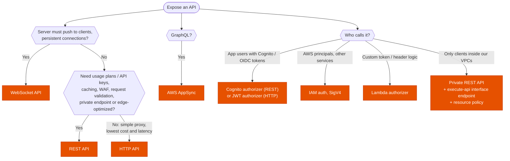

---
tags:
  - "Domain 2: New Solutions"
  - "Domain 3: Continuous Improvement"
  - API Gateway
  - Serverless
---

# API Gateway: REST, HTTP or WebSocket API, and how to secure and throttle it?

**The question:** an API must be exposed to clients. Which API Gateway type has the features the scenario needs (usage plans, caching, WAF, private access, JWT, real-time push), which authorizer fits the callers, and how are throttling and private access set up?

**Trigger keywords:** *"per-customer quotas / API keys"*, *"lowest cost and latency"*, *"JWT from Cognito / Auth0"*, *"real-time chat / push to clients"*, *"only from inside the VPC"*, *"private API"*, *"429 Too Many Requests"*, *"transform the request"*, *"cache responses"*, *"canary for a new API version"*, *"integration timeout"*, *"GraphQL"*.

## Fundamentals

| | **REST API** | **HTTP API** | **WebSocket API** |
|---|---|---|---|
| Use | Full-featured APIs | Simple, cheap proxies (up to ~70 % cheaper, lower latency) | **Two-way**, persistent connections |
| Endpoint types | **Edge-optimized**, **Regional**, **Private** | Regional | Regional |
| Auth | IAM, **Cognito user pools**, Lambda authorizer, resource policies, API keys | IAM, **JWT authorizer** (any OIDC/OAuth 2.0 IdP), Lambda authorizer | IAM, Lambda authorizer on `$connect` |
| **Usage plans + API keys** | ✅ | ❌ | ❌ |
| **Caching** | ✅ | ❌ | ❌ |
| **AWS WAF** | ✅ | ❌ | ❌ |
| Request validation, mapping templates | ✅ | Parameter mapping only | Route selection expressions |
| Private integrations (VPC link) | NLB | **ALB, NLB, Cloud Map** | NLB |
| Canary release on stage | ✅ | ❌ | ❌ |

**Limits to remember:** default account throttle **10,000 requests/s** with a **5,000** burst per Region (raisable); integration timeout **29 s** by default (REST Regional and private APIs can request more); payload **10 MB**.

## Decision tree

## Why each branch

- **REST API** whenever the stem lists one of its exclusive features: **per-customer quotas** (usage plans with API keys), **caching**, **WAF**, **private** endpoint, request validation, canary on a stage.
- **HTTP API** when none of those are needed and cost or latency is the goal; its **JWT authorizer** validates tokens from any OIDC provider without code.
- **WebSocket API** for chat, live dashboards, notifications: clients connect once; the backend pushes via the **`@connections` callback URL**.
- **Private APIs** are REST only, reached through an **interface VPC endpoint for `execute-api`**; the **resource policy** restricts by `aws:SourceVpce` or `aws:SourceVpc`. Other accounts' VPCs can use their own endpoints if the resource policy allows them.
- **Throttling layers:** account limit → stage / method limits → **usage plan** per API key. Exceeding them returns **429**.

## Exam traps

!!! warning "API keys for authentication"
    API keys identify clients for **usage plans**; they're not a security mechanism. Authenticate with IAM, Cognito, JWT or a Lambda authorizer.

!!! warning "WAF or caching on an HTTP API"
    Not supported. Use a **REST API** (or put CloudFront with WAF in front).

!!! warning "Private API reachable from on-prem without an endpoint"
    Private APIs need the **execute-api interface endpoint**; on-prem reaches it over DX/VPN (with Route 53 inbound endpoints for DNS).

!!! warning "Long-running work behind a synchronous API"
    The integration times out at 29 s by default. Return quickly and process **asynchronously** (SQS, Step Functions), or ask for a higher timeout on Regional/private REST APIs.

!!! warning "Edge-optimized endpoint with your own CloudFront distribution"
    Edge-optimized already uses an AWS-managed CloudFront. To control caching, WAF and behaviors yourself, use a **Regional** endpoint behind **your** distribution.

## Test yourself

??? question "1. A SaaS API must give each customer tier its own request quota and rate limit."
    **REST API** with **usage plans** and an **API key** per customer.

??? question "2. A mobile backend validates JWTs from Auth0 and must be as cheap and fast as possible."
    **HTTP API** with a **JWT authorizer**.

??? question "3. A chat app needs the server to push messages to connected clients."
    **WebSocket API** (`$connect`, `$disconnect`, routes; push via the connections callback URL).

??? question "4. An internal API must be reachable only from the company's VPCs, never from the internet."
    **Private REST API**, **execute-api interface endpoint** in the VPCs, resource policy with `aws:SourceVpce`.

??? question "5. Clients receive 429 errors at peak; the backend is healthy."
    Throttling: raise the **account / stage / usage-plan** limits, or add **caching** to cut calls.

## Related

- [Messaging: SQS, SNS, EventBridge, Kinesis](messaging.md)
- [Containers and serverless compute](../compute/containers-serverless.md)
- [Caching](../databases/caching.md)
- [Network protection](../security/network-protection.md)
- AWS docs: [Choosing between REST APIs and HTTP APIs](https://docs.aws.amazon.com/apigateway/latest/developerguide/http-api-vs-rest.html)
- AWS docs: [Private REST APIs](https://docs.aws.amazon.com/apigateway/latest/developerguide/apigateway-private-apis.html)
- AWS docs: [API Gateway quotas](https://docs.aws.amazon.com/apigateway/latest/developerguide/limits.html)
