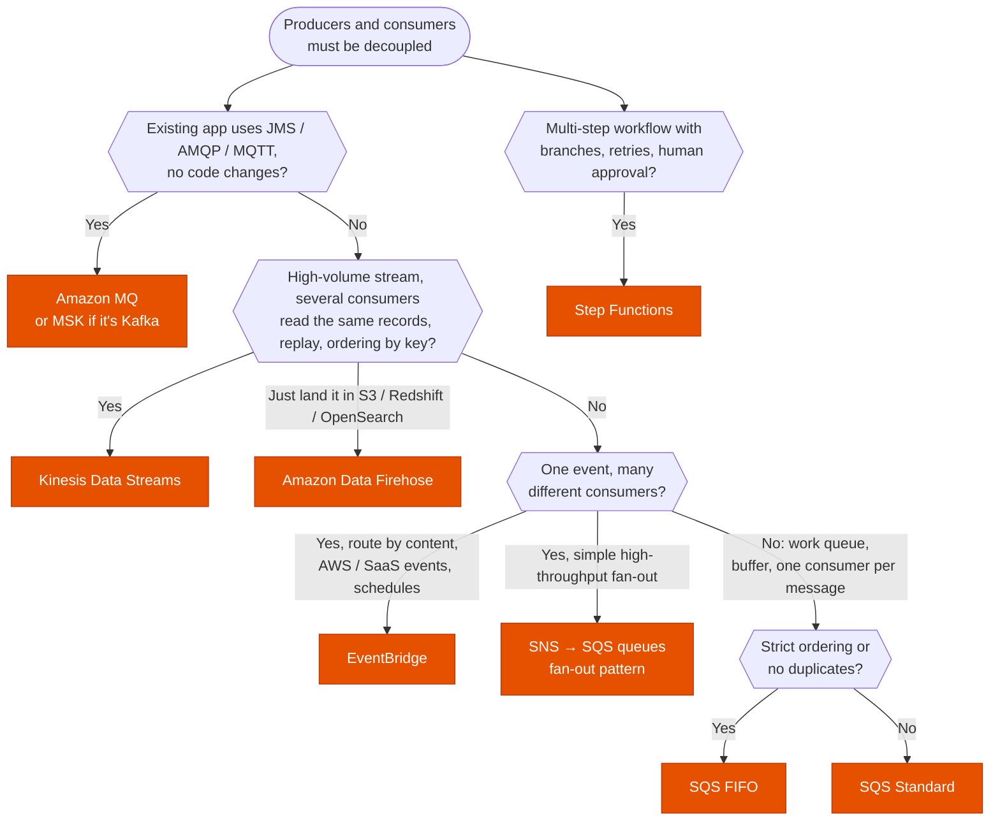

---
tags:
  - "Domain 2: New Solutions"
  - "Domain 3: Continuous Improvement"
  - SQS
  - SNS
  - EventBridge
  - Kinesis
---

# Messaging: SQS, SNS, EventBridge, Kinesis or Amazon MQ?

**The question:** two parts of a system must exchange messages or events without being tightly coupled. Which service fits the delivery model (queue, fan-out, event routing, ordered stream), the ordering needs and the existing protocols?

**Trigger keywords:** *"decouple"*, *"buffer spikes"*, *"exactly-once"*, *"in order"*, *"fan-out to several consumers"*, *"filter events by content"*, *"SaaS events (Zendesk, Datadog…)"*, *"replay events"*, *"real-time stream, multiple consumers reading the same data"*, *"deliver to S3 / Redshift / OpenSearch"*, *"JMS / AMQP / MQTT, migrate existing broker without code changes"*, *"orchestrate steps with retries"*.

## Fundamentals

| Service | Model | Ordering | Retention / replay | Consumers |
|---|---|---|---|---|
| **SQS Standard** | **Queue**, pull | Best effort, at-least-once | Up to **14 days**, no replay after delete | Competing consumers (each message processed by one) |
| **SQS FIFO** | Queue, pull | **Strict per message group**, exactly-once processing (dedup 5 min) | Up to 14 days | Competing, one in-flight batch per group |
| **SNS** (Standard / FIFO) | **Pub/sub push**, fan-out | FIFO topics only | None (push and forget, DLQ per subscription) | Many: SQS, Lambda, HTTP, email, SMS, Firehose |
| **EventBridge** | **Event bus** with rules | None | **Archive & replay** | Up to 5 targets per rule, 20+ target types, cross-account/Region buses |
| **Kinesis Data Streams** | **Ordered stream**, shards | **Per shard (partition key)** | **24 h to 365 days, replayable** | Many independent consumers, **enhanced fan-out** |
| **Amazon Data Firehose** | Managed **delivery** | n/a | Buffers (seconds to minutes) | S3, Redshift, OpenSearch, Splunk, HTTP, Iceberg tables |
| **Amazon MQ** | Managed **ActiveMQ / RabbitMQ** | Broker-defined | Broker-defined | JMS, AMQP, MQTT, STOMP, OpenWire clients |
| **Amazon MSK** | Managed **Kafka** | Per partition | Configurable | Kafka clients |

Message size: **1 MiB** for SQS and SNS (both raised from 256 KiB). Larger → **Extended Client Library** with the payload in S3.

## Decision tree

## Why each branch

- **Amazon MQ for lift-and-shift of brokers.** Standard protocols, so on-prem apps move without rewriting. Not serverless-scale; for new cloud-native apps prefer SQS/SNS.
- **Kinesis Data Streams for streams.** Records stay after being read, so **many consumers** (analytics, archiving, alerting) read the same data independently and can **replay**. Ordering per partition key. On-demand or provisioned shards.
- **Firehose when the destination is storage.** No consumers to write: buffer, optionally transform with Lambda, convert to Parquet, deliver.
- **EventBridge for event routing.** Rules with **content-based patterns**, AWS service events out of the box, **SaaS partner** sources, **schema registry**, **archive & replay**, **Pipes** (point-to-point source → enrich → target) and **Scheduler**.
- **SNS + SQS fan-out** when the same message must be processed by several independent pipelines, each with its own queue, retries and DLQ. SNS **filter policies** reduce what each queue receives.
- **SQS for work queues.** Absorbs spikes, scales consumers (ASG on `ApproximateNumberOfMessagesVisible` per instance, or Lambda). **FIFO** when order or exactly-once matters; throughput is lower but **high-throughput mode** raises it a lot.
- **Step Functions for orchestration.** When the question is about sequencing, branching, waiting and compensating, not just passing messages.

## SQS settings the exam likes

| Setting | Use |
|---|---|
| **Visibility timeout** | Longer than processing time, or messages are processed twice |
| **Long polling** (`WaitTimeSeconds` up to 20) | Fewer empty receives, lower cost |
| **Dead-letter queue** + `maxReceiveCount` | Isolate poison messages; **redrive** back later |
| **Delay queue / message timers** | Postpone delivery up to 15 min |
| **Message group ID** (FIFO) | Parallelism across groups, order within a group |

## Exam traps

!!! warning "SQS for multiple consumers of the same message"
    A message in a queue is processed by **one** consumer. Several consumers → SNS fan-out to several queues, EventBridge, or Kinesis.

!!! warning "Kinesis to decouple a simple job queue"
    Shards, checkpoints and per-shard ordering add work for no benefit. A work queue is **SQS**.

!!! warning "SNS stores messages"
    SNS pushes and retries; it doesn't keep a backlog for slow consumers. Put an **SQS queue** behind it.

!!! warning "Lambda timeout vs SQS visibility timeout"
    With SQS → Lambda, set the visibility timeout to at least **6× the function timeout**, or messages reappear while still being processed.

!!! warning "FIFO for global ordering at high throughput"
    Ordering is **per message group**. One single group means one consumer at a time. Choose a group key (customer ID, order ID) to scale.

!!! warning "EventBridge for millisecond-latency, very high throughput streams"
    EventBridge is for event routing. Sustained high-volume telemetry with replay → **Kinesis** (or MSK).

## Test yourself

??? question "1. Order events must trigger billing, shipping and analytics independently; each team handles its own retries."
    **SNS topic → one SQS queue per team** (fan-out), each with its DLQ. Or **EventBridge** if routing by content or SaaS sources matters.

??? question "2. Clickstream at 50 MB/s must feed a real-time dashboard and also be archived; analysts sometimes reprocess the last 3 days."
    **Kinesis Data Streams** (retention ≥ 3 days) with consumers for the dashboard, plus **Firehose** to S3 for the archive.

??? question "3. A Java app on-prem uses ActiveMQ with JMS. Move it to AWS with minimal code changes."
    **Amazon MQ for ActiveMQ.**

??? question "4. Payment commands for each account must be processed in order and never twice; accounts are independent."
    **SQS FIFO** with **message group ID = account ID**, deduplication on.

??? question "5. React to `CreateBucket` API calls in any account of the org and notify the security team."
    **EventBridge** rule on CloudTrail events (cross-account event bus to the security account) → SNS / Lambda.

## Related

- [ASG scaling policies](../compute/asg-scaling-policies.md)
- [IoT services](../iot/iot-services.md)
- AWS docs: [SQS message quotas](https://docs.aws.amazon.com/AWSSimpleQueueService/latest/SQSDeveloperGuide/quotas-messages.html)
- AWS docs: [EventBridge archive and replay](https://docs.aws.amazon.com/eventbridge/latest/userguide/eb-archive.html)
- AWS decision guide: [SNS, SQS or EventBridge?](https://docs.aws.amazon.com/decision-guides/latest/sns-or-sqs-or-eventbridge/sns-or-sqs-or-eventbridge.html)
