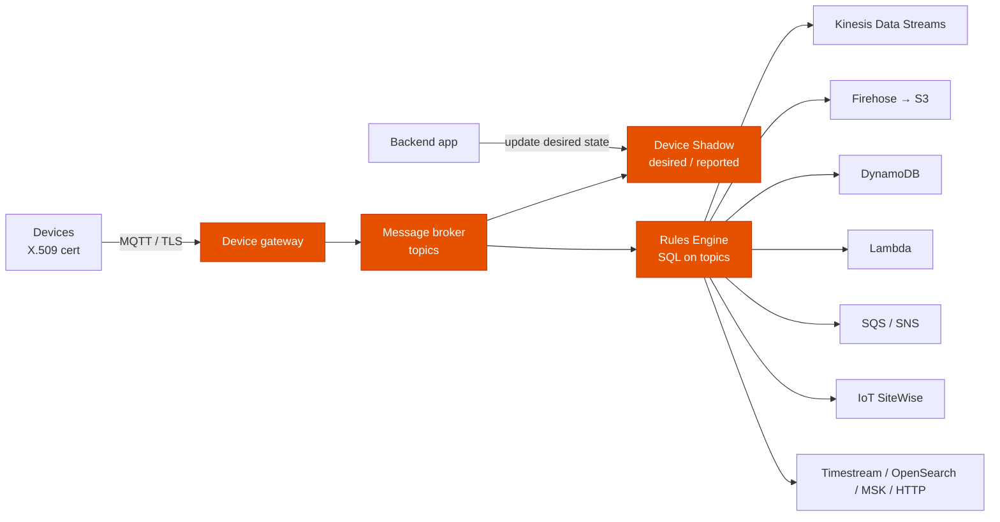
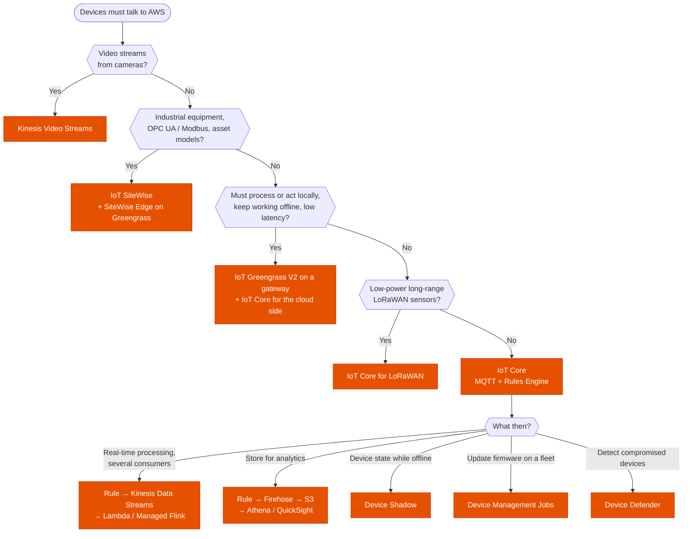
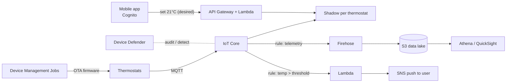
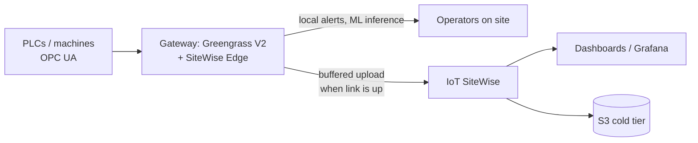
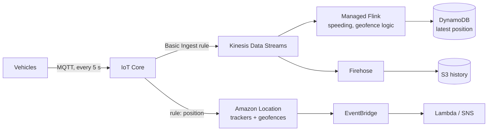

---
tags:
  - "Domain 2: New Solutions"
  - IoT
  - IoT Core
  - Greengrass
---

# IoT: which service connects, processes and manages the devices?

**The question:** devices (sensors, machines, vehicles, cameras) must send data to AWS and sometimes receive commands. Which IoT service handles connectivity, security, edge processing, fleet management and routing to the rest of AWS?

**Trigger keywords:** *"millions of devices"*, *"MQTT"*, *"device sends telemetry every second"*, *"intermittent connectivity"*, *"process data locally at the factory"*, *"OPC UA / industrial equipment"*, *"device state when offline"*, *"over-the-air update"*, *"X.509 certificates"*, *"detect a compromised device"*, *"LoRaWAN"*, *"video from cameras"*.

## The services

| Service | Role | Remember it as |
|---|---|---|
| **AWS IoT Core** | Managed **device gateway + message broker** (MQTT, MQTT over WSS, HTTPS, LoRaWAN), **Rules Engine**, **Device Shadow**, **registry**, authentication | "The front door and the router" |
| **AWS IoT Greengrass (V2)** | **Edge runtime** on your gateways: components, local MQTT, Lambda / containers, ML inference, **stream manager**, works **offline** | "AWS running on my device" |
| **AWS IoT Device Management** | Bulk provisioning, **fleet indexing**, **Jobs** (OTA updates, remote commands), **secure tunneling**, thing groups | "Fleet operations" |
| **AWS IoT Device Defender** | **Audit** device configs (shared certs, permissive policies) and **Detect** abnormal behavior (rules or ML), mitigation actions | "GuardDuty for devices" |
| **AWS IoT SiteWise** | **Industrial** data: collect from **OPC UA / Modbus** via **SiteWise Edge** (on Greengrass), **asset models**, metrics and transforms, time-series storage | "Factories and equipment" |
| **AWS IoT Core for LoRaWAN** | Connect low-power, long-range **LoRaWAN** devices and gateways without running a network server | "Fields and cities" |
| **FreeRTOS** / **IoT ExpressLink** | Real-time OS for microcontrollers / pre-certified connectivity modules | "The device itself" |
| **Amazon Kinesis Video Streams** | Ingest, store and process **video** from cameras (Rekognition Video, WebRTC) | "Cameras, not MQTT" |
| **Amazon Location Service** | Trackers and geofences for device positions | "Where is the asset?" |

!!! note "Retired or closed IoT services"
    **AWS IoT Analytics** ended on **15 Dec 2025** and **AWS IoT Events** on **20 May 2026**. **Greengrass V1** reached end of support on **7 Oct 2026**, **Fleet Hub** in Oct 2025, and **IoT FleetWise** stopped accepting new customers on 30 Apr 2026. **Timestream for LiveAnalytics** has been closed to new customers since June 2025 (use **Timestream for InfluxDB**). Older questions may still offer IoT Analytics or IoT Events as answers. Today the same jobs go to **Rules → Firehose → S3 → Athena/QuickSight** for analytics, and **Rules → Lambda / CloudWatch alarms / Step Functions** for event detection.

## How IoT Core works

- **Authentication:** each device has an **X.509 certificate**; an **IoT policy** attached to the cert says which topics it may publish / subscribe to. Policy variables like `${iot:Connection.Thing.ThingName}` let one policy fit every device. Custom authorizers and Cognito exist for app users.
- **Provisioning at scale:** **just-in-time provisioning** (device presents a cert signed by your registered CA), **fleet provisioning by claim** (shared claim cert exchanged for a unique one on first connect), or bulk registration.
- **Device Shadow:** a JSON document per thing with **desired** and **reported** state. Apps write *desired* even when the device is **offline**; the device syncs on reconnect and receives the **delta**.
- **Rules Engine:** SQL-like `SELECT … FROM 'topic/#' WHERE …` with actions to 20+ AWS services, an error action, and no servers to run. **Basic Ingest** (`$aws/rules/<rule>`) sends straight to a rule without broker messaging cost.
- **Retained messages** and **persistent sessions** handle devices that connect intermittently; **MQTT 5** is supported.

## Decision tree

## Why each branch

- **IoT Core instead of building your own MQTT broker** on EC2: it scales to billions of messages, handles mutual TLS and per-device auth, and the Rules Engine replaces glue code. *"Least operational overhead"* almost always lands here.
- **Greengrass when the cloud is too far or not always there.** Local decisions in milliseconds (stop a machine), filtering and aggregation before upload (cost), ML inference at the edge, and buffering with **stream manager** when the link is down.
- **SiteWise for industrial data models.** It understands equipment hierarchies (plant → line → machine), computes metrics such as OEE, and reads industrial protocols through the edge gateway.
- **Kinesis Data Streams behind IoT Core for heavy streams.** The broker is not a stream store: send to Kinesis for ordering per key, replay, and multiple consumers.
- **Device Defender** is the security answer specific to devices: audit (shared certificates, overly broad policies, revoked CA still active) and detect (message rate, connection attempts, unusual ports).

## Example architectures

### 1. Smart thermostats (consumer devices, millions of units)

- Users change the target temperature even when the thermostat is offline: the app writes **desired** state in the **shadow**, the device applies the delta on reconnect.
- Fleet provisioning by claim at the factory, unique cert per device on first boot.
- Firmware rollout with **Jobs** (rollout rate, abort criteria) to a thing group, starting with a canary group.

### 2. Factory floor with unreliable WAN

- Machines keep being monitored and controlled during WAN outages: logic runs in **Greengrass components**, data is buffered and forwarded later.
- **SiteWise** asset models for line → machine → sensor; metrics such as downtime and OEE computed in the cloud.

### 3. Connected vehicle telematics

- **Basic Ingest** avoids broker messaging charges for high-volume telemetry going straight to a rule.
- Kinesis gives ordering **per vehicle** (partition key = vehicle ID) and lets several consumers read the same data.

### 4. Agriculture sensors over LoRaWAN

Soil-moisture sensors run for years on batteries and reach gateways kilometers away. **IoT Core for LoRaWAN** registers gateways and devices; a **rule** decodes the payload and writes to **Timestream for InfluxDB** or S3; a Lambda opens irrigation valves by sending a downlink when moisture drops below a threshold.

### 5. Store cameras

Cameras stream to **Kinesis Video Streams**; **Rekognition Video** detects people counts; results go to **EventBridge** for alerts. MQTT/IoT Core only carries the camera's health and configuration, not the video.

## Exam traps

!!! warning "Self-managed MQTT broker on EC2"
    More operations, no per-device auth, no rules engine. *"Least operational overhead"* → **IoT Core**.

!!! warning "IoT Analytics / IoT Events as the answer"
    Both are retired. If an older question offers them, recognize the intent (analytics pipeline, event detection) and know the current equivalents: **Firehose → S3 → Athena**, **Lambda / CloudWatch alarms**.

!!! warning "Polling the device to know its state"
    Use the **Device Shadow**: the last reported state is always available, even with the device offline.

!!! warning "One certificate shared by all devices"
    A single compromised device compromises the fleet, and **Device Defender audit flags it**. One cert per device, provisioned by JITP or fleet provisioning.

!!! warning "Cloud-only processing for millisecond safety decisions"
    Round trips to the Region add latency and depend on the link. Safety logic goes to **Greengrass** at the edge.

!!! warning "Video through MQTT"
    IoT Core messages are small (128 KB max). Video → **Kinesis Video Streams**.

## Test yourself

??? question "1. A startup must connect 2 million sensors publishing every minute, with per-device authentication and the least operations."
    **IoT Core** with one **X.509 certificate per device**, IoT policies with thing-name variables, provisioning by claim or JITP.

??? question "2. A mobile app must set a device's mode even when the device is asleep; the device applies it when it wakes."
    **Device Shadow**: the app updates **desired**, the device receives the **delta** on reconnect and reports back.

??? question "3. A mine site has a satellite link that drops for hours. Equipment alerts must fire within 100 ms, and data must reach AWS eventually."
    **Greengrass V2** on a local gateway (local logic, **stream manager** buffering), IoT Core / SiteWise in the cloud.

??? question "4. Telemetry from 50,000 trucks must feed real-time anomaly detection and an S3 archive; both must see every message in order per truck."
    IoT Core **rule → Kinesis Data Streams** (partition key = truck ID) → Managed Flink for detection, **Firehose** → S3 for the archive.

??? question "5. The security team wants to be alerted when a device suddenly opens connections to unusual ports or publishes 100× its normal rate."
    **Device Defender Detect** (rules or ML Detect) with SNS alerts and mitigation actions (move to a quarantine thing group).

??? question "6. A plant wants equipment hierarchies, OEE metrics, and to read data from OPC UA servers on site."
    **IoT SiteWise** with **SiteWise Edge** (on Greengrass) at the plant.

## Related

- [Messaging: SQS, SNS, EventBridge, Kinesis](../integration/messaging.md)
- [Security services](../security/security-services.md)
- AWS docs: [What is AWS IoT Core](https://docs.aws.amazon.com/iot/latest/developerguide/what-is-aws-iot.html)
- AWS docs: [Device Shadow service](https://docs.aws.amazon.com/iot/latest/developerguide/iot-device-shadows.html)
- AWS docs: [AWS IoT Greengrass V2](https://docs.aws.amazon.com/greengrass/v2/developerguide/what-is-iot-greengrass.html)
- AWS docs: [IoT Analytics end of support](https://docs.aws.amazon.com/iotanalytics/latest/userguide/iotanalytics-end-of-support.html)
- AWS docs: [IoT Events end of support](https://docs.aws.amazon.com/iotevents/latest/developerguide/iotevents-end-of-support.html)
