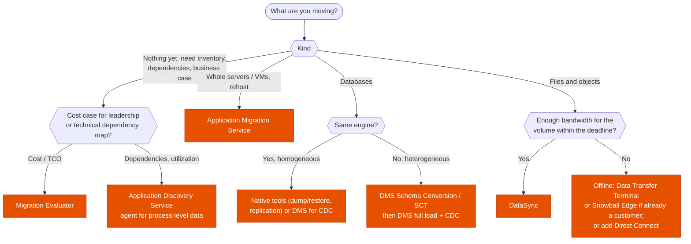

---
tags:
  - "Domain 4: Migration and Modernization"
  - Migration
  - MGN
  - DMS
  - DataSync
---

# Migration tools: Discovery, MGN, DMS/SCT, DataSync or offline transfer?

**The question:** a migration has been planned (see [the 7 Rs](seven-rs.md)). Which AWS tool discovers the estate, builds the business case, moves servers, moves databases, and moves files, given the time window and the bandwidth?

**Trigger keywords:** *"inventory of on-prem servers and dependencies"*, *"TCO / business case"*, *"lift-and-shift hundreds of VMs"*, *"minimal downtime cutover"*, *"Oracle to Aurora PostgreSQL"*, *"ongoing replication / CDC"*, *"NFS / SMB file shares to EFS / FSx / S3"*, *"limited bandwidth"*, *"petabytes"*, *"VMware"*.

## Fundamentals

| Phase | Tool | What it does |
|---|---|---|
| **Assess** | **Migration Evaluator** | Collects utilization, builds a **TCO / business case** (right-sized, licensing) |
| **Assess** | **AWS Application Discovery Service** | Inventory, performance and **network dependencies**: **Agentless Collector** (VMware vCenter) or **Discovery Agent** (per server, process and connection data) |
| **Plan / track** | **AWS Transform** (successor of Migration Hub) | Wave planning, strategy recommendations, tracking; also agentic modernization (.NET, mainframe, VMware) |
| **Migrate servers** | **AWS Application Migration Service (MGN)** | **Rehost**: continuous **block-level replication** into a staging area, non-disruptive **test** launches, **cutover** in minutes |
| **Migrate databases** | **AWS DMS** | Full load + **CDC** (ongoing replication), homogeneous or heterogeneous; DMS Serverless |
| **Convert schemas** | **DMS Schema Conversion** / **AWS SCT** | Convert schema and code (stored procedures) for **heterogeneous** moves (Oracle → PostgreSQL) |
| **Migrate files** | **AWS DataSync** | Online, agent-based, to/from **S3, EFS, FSx**; scheduling, filtering, verification, bandwidth throttling |
| **Offline** | **AWS Data Transfer Terminal** | Bring storage devices to an AWS facility for high-speed upload |
| **Offline (existing customers)** | **Snowball Edge** | Ruggedized device shipped to you, **closed to new customers since Nov 2025** |

!!! note "Service changes since many courses were recorded"
    **Migration Hub** stopped accepting new customers on **7 Nov 2025** (→ AWS Transform). **Snowball Edge** closed to new customers on **7 Nov 2025**; **Snowcone** and **Snowmobile** are gone. Exam questions may still expect *Snowball* for "petabytes over a slow link": recognize it, but know the current options.

## Decision tree

## Why each branch

- **Migration Evaluator vs Discovery Service.** Evaluator answers *"how much will it cost?"*; Discovery answers *"what talks to what, and how busy is it?"*. Agentless collection gives VM-level data; the **agent** adds **processes and network connections**, which is what dependency mapping needs.
- **MGN for rehost.** The replication agent copies disks continuously, so the cutover window is minutes. You launch **test instances** first, then cut over and finalize. It replaced SMS and CloudEndure Migration.
- **DMS keeps the source live.** Full load, then **CDC** until cutover, so downtime is a switch of connection strings. Heterogeneous moves first need schema and code conversion (**DMS Schema Conversion** or **SCT**); SCT also has **data extraction agents** for data warehouses.
- **DataSync for file data.** Faster than scripts (parallel, compressed, verified), preserves metadata, can run on a schedule for incremental syncs before the final cutover.
- **Offline when the network can't do it.** Rule of thumb: 100 TB over 1 Gbps ≈ **9–10 days** at full use. If the deadline is shorter, go offline or increase bandwidth.

## Bandwidth math

| Data | 100 Mbps | 1 Gbps | 10 Gbps |
|---|---|---|---|
| 10 TB | ~9 days | ~1 day | ~2.5 h |
| 100 TB | ~3 months | ~9 days | ~1 day |
| 1 PB | years | ~3 months | ~9 days |

(At full utilization; real throughput is lower.)

## Exam traps

!!! warning "DMS converts the schema"
    DMS moves **data**. Heterogeneous migrations need **schema conversion** first (DMS Schema Conversion / SCT).

!!! warning "MGN for databases with tight RPO"
    MGN replicates disks, so a database can come along in a rehost. But to **change engine** or to move to **RDS/Aurora**, the tool is DMS.

!!! warning "DataSync for database migration"
    DataSync moves files and objects, not live transactional databases.

!!! warning "Snowball for a few TB on a good link"
    Shipping takes days. A few TB over 1 Gbps is hours online. DataSync wins.

!!! warning "Discovery agentless for dependency mapping"
    The Agentless Collector gives VM inventory and performance. **Process-level dependencies** need the **Discovery Agent**.

## Test yourself

??? question "1. CIO wants a cost comparison of running 800 on-prem VMs on AWS, including license optimization, before any technical work."
    **Migration Evaluator.**

??? question "2. 300 VMware VMs to rehost with a cutover window of under one hour per wave."
    **AWS Application Migration Service** (continuous replication, test launches, quick cutover).

??? question "3. Oracle 19c OLTP to Aurora PostgreSQL, downtime of minutes."
    **DMS Schema Conversion (or SCT)** for schema and PL/SQL, then **DMS full load + CDC**, cut over when replication lag is near zero.

??? question "4. 40 TB of NFS shares to EFS over a 1 Gbps link in two weeks, with a final incremental sync during the cutover."
    **DataSync** (initial copy, then scheduled incremental tasks).

??? question "5. Before migrating, the team must know which servers talk to each other and on which ports."
    **Application Discovery Service with the Discovery Agent** on the servers.

## Related

- [The 7 Rs](seven-rs.md)
- [DataSync vs Transfer Acceleration vs gateways](../storage/data-transfer.md)
- [Storage Gateway](../storage/storage-gateway.md)
- AWS docs: [Application Migration Service](https://docs.aws.amazon.com/mgn/latest/ug/what-is-application-migration-service.html)
- AWS docs: [DMS Schema Conversion](https://docs.aws.amazon.com/dms/latest/userguide/CHAP_SchemaConversion.html)
- AWS docs: [Migration Hub availability change](https://docs.aws.amazon.com/migrationhub/latest/ug/migrationhub-availability-change.html)
- AWS docs: [Snowball Edge availability change](https://docs.aws.amazon.com/snowball/latest/developer-guide/snowball-edge-availability-change.html)
