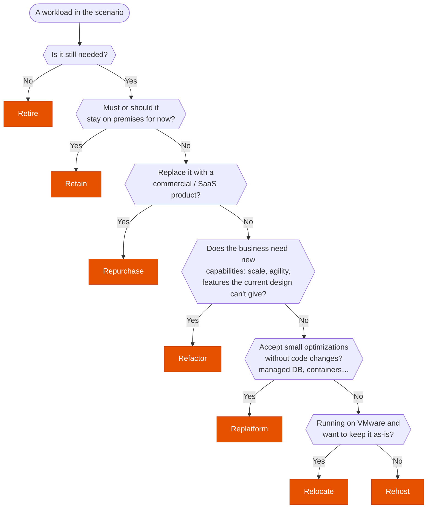

---
tags:
  - "Domain 4: Migration and Modernization"
  - Migration
  - MGN
  - DMS
---

# The 7 Rs: which migration strategy?

**The question:** a scenario describes one or more workloads to move (or not). Which strategy fits: retire, retain, relocate, rehost, replatform, repurchase or refactor?

**Trigger keywords:** *"as quickly as possible"*, *"minimal changes"*, *"no code changes"*, *"VMware"*, *"reduce operational overhead"*, *"managed database"*, *"SaaS"*, *"licensing"*, *"cloud-native"*, *"scale independently"*, *"no longer used"*, *"compliance keeps it on premises"*.

## Fundamentals

Think of the Rs as a scale: **how much does the application change?**

| Strategy | What changes | Typical move | AWS tooling |
|---|---|---|---|
| **Retire** | It disappears | Decommission an unused app | Discovery data shows no traffic |
| **Retain** | Nothing, stays on premises (for now) | Recently upgraded, compliance, hard dependency | — |
| **Relocate** | Nothing, not even the hypervisor | vSphere VMs → **VMware Cloud on AWS** | VMware HCX |
| **Rehost** (lift & shift) | Only where it runs | Server → **EC2**, same OS and app | **MGN** (Application Migration Service) |
| **Replatform** (lift, tinker & shift) | The platform, not the code | Self-managed DB → **RDS/Aurora**, app → **Beanstalk** / containers | **DMS** (+ SCT if the engine changes) |
| **Repurchase** (drop & shop) | The product itself | On-prem CRM/HR/email → **SaaS** | AWS Marketplace |
| **Refactor** (re-architect) | The code and architecture | Monolith → microservices, **Lambda**, event-driven | — |

**Before choosing:** Migration Evaluator (business case), Application Discovery Service (inventory, dependencies), Migration Hub (tracking) and Migration Hub Strategy Recommendations (suggests an R per app).

## Decision tree

## How to read the scenario

Look for **two signals**: the **driver** (why migrate) and the **constraint** (what you're allowed to change).

| The stem says… | Strategy |
|---|---|
| *no longer used*, *duplicate*, *low usage found during discovery* | **Retire** |
| *recently upgraded / depreciation*, *regulation requires on premises*, *mainframe not ready*, *migrate later* | **Retain** |
| *VMware*, *keep existing VMware tools and skills*, *no change to VMs*, *exit data center fast* | **Relocate** |
| *data center lease ends*, *as fast as possible*, *minimal changes*, *large number of servers*, *no code changes* | **Rehost** |
| *reduce operational overhead* / *stop managing DB patching and backups* + *minimal code changes* | **Replatform** |
| *licensing costs*, *end-of-support product*, *move to a SaaS*, *replace with a commercial off-the-shelf solution* | **Repurchase** |
| *cloud-native*, *serverless*, *microservices*, *scale components independently*, *improve agility / release faster*, *monolith can't scale* | **Refactor** |

## Why each branch

- **Speed vs benefit.** The further down the table (rehost → refactor), the more effort and the more long-term benefit. *"Fastest"* pushes up the scale, *"long-term agility / scalability"* pushes down.
- **Rehost vs replatform: who manages the database afterwards?** If it's still *your* DB on EC2, it's rehost. If it lands on **RDS/Aurora** (or the OS moves to a managed service) without rewriting the app, it's replatform.
- **Replatform vs refactor: is the code rewritten?** Changing the connection string or packaging into a container = replatform. Splitting into services, moving to Lambda, changing the data model = refactor.
- **Relocate vs rehost: is VMware kept?** Relocate moves the VMs **with their hypervisor** (VMware Cloud on AWS). Rehost converts them into EC2 instances (MGN).
- **Repurchase isn't migration of the app.** You migrate the **data** to a new product; the old app is then retired.
- **Many apps, one deadline:** usually rehost first, optimize later ("migrate, then modernize"). The exam likes this two-step answer.

## Comparison

| | Rehost | Replatform | Refactor |
|---|---|---|---|
| Code changes | None | Minimal | Significant |
| Time to migrate | Shortest | Medium | Longest |
| Ops overhead after | Same as before | Lower | Lowest |
| Cloud benefit | Low | Medium | High |
| Exam phrase | *"quickly, minimal changes"* | *"less overhead, minimal changes"* | *"cloud-native, agility"* |

## Exam traps

!!! warning "\"Minimal changes\" doesn't always mean rehost"
    *"Minimal code changes **and** reduce operational overhead"* → **replatform** (e.g. to RDS). Rehost keeps the overhead. Read the **second** requirement.

!!! warning "Refactor when the deadline is tight"
    Refactor sounds best but takes the longest. With a data center exit date, it's almost never right for the whole estate. Rehost now, refactor later.

!!! warning "Rehost a VMware estate with MGN"
    Works, but if the stem stresses *keeping VMware tools, skills or operations*, or *no conversion of VMs*, the answer is **relocate** to VMware Cloud on AWS.

!!! warning "Replatform with SCT"
    Same engine (Oracle on premises → RDS for Oracle) needs only **DMS**. **SCT** is for a **different** engine (Oracle → Aurora PostgreSQL), which usually also means code changes: closer to refactor.

## Test yourself

??? question "1. The data center lease ends in 4 months. 300 Linux and Windows servers must move with no application changes."
    **Rehost** with **MGN**: fastest, no code changes, scales to many servers.

??? question "2. A three-tier app runs its own MySQL on a VM. The team wants to stop patching and backing up the DB but can only change configuration."
    **Replatform**: MySQL → **RDS/Aurora MySQL** with **DMS**; only the connection string changes.

??? question "3. The company runs 2,000 VMs on vSphere and wants to leave its data center quickly while keeping its VMware admin tools."
    **Relocate** to **VMware Cloud on AWS**.

??? question "4. An on-premises CRM is near end of support and its licenses are expensive. Leadership wants to stop maintaining it."
    **Repurchase**: move to a **SaaS** CRM, migrate the data, retire the old app.

??? question "5. Discovery shows 15% of the servers have had no connections in 6 months."
    **Retire** them: no migration cost, and they cut licensing and the scope of the project.

??? question "6. A monolithic order system can't handle seasonal peaks; the business wants to scale checkout independently and release weekly."
    **Refactor** into services (e.g. containers or Lambda + SQS), because the requirement is a new capability, not just moving.

??? question "7. A mainframe app is tightly coupled to systems not yet migrated; it will be reviewed next year."
    **Retain** for now, and revisit.

## Related

- [Keywords → answers](../../keywords.md)
- AWS docs: [Migration strategies (7 Rs)](https://docs.aws.amazon.com/prescriptive-guidance/latest/large-migration-guide/migration-strategies.html)
- AWS docs: [AWS Application Migration Service](https://docs.aws.amazon.com/mgn/latest/ug/what-is-application-migration-service.html)
