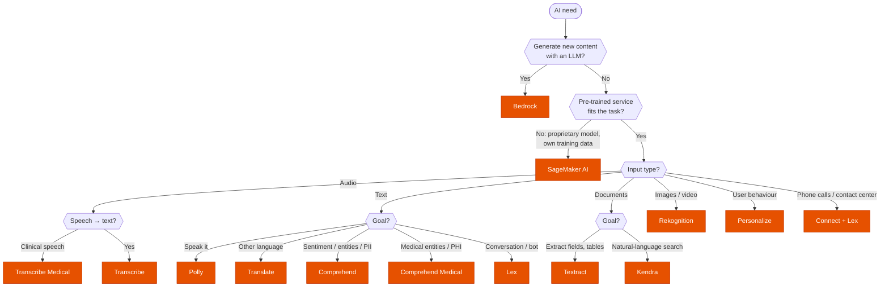

---
tags:
  - "Domain 2: New Solutions"
  - "Domain 4: Migration and Modernization"
  - Machine Learning
  - AI
---

# AI services: which one does the job?

**The question:** a scenario needs an AI capability (understand speech, read documents, analyse images, chat, search, recommend, generate). Which managed AI service does it with the **least effort**, and when do you need SageMaker or Bedrock instead?

**Trigger keywords:** *"no ML expertise"*, *"chatbot"*, *"call center"*, *"text to speech / speech to text"*, *"subtitles in several languages"*, *"extract fields from scanned forms / invoices"*, *"sentiment"*, *"detect PII / PHI"*, *"content moderation"*, *"face detection"*, *"natural-language search over internal documents"*, *"product recommendations"*, *"generative AI / foundation model"*, *"custom model"*.

## Fundamentals

The **AI services** are pre-trained, fully managed APIs: no model to train, pay per request. The exam tests **matching the need to the service** and chaining them into pipelines.

| Service | Input → output | Typical clue |
|---|---|---|
| **Rekognition** | Images / video → labels, faces, celebrities, unsafe content, PPE, text in scenes | *"moderate user-uploaded images"*, *"face search"*, *"detect people in video"* |
| **Textract** | Scanned docs / PDFs → text, **forms (key-value)**, **tables**, invoices, IDs | *"extract data from forms / invoices / receipts"* |
| **Transcribe** | Audio → text (PII redaction, custom vocabulary, language ID). **Transcribe Medical** for clinical speech | *"transcribe calls"*, *"generate subtitles"* |
| **Polly** | Text → lifelike speech (SSML, lexicons, neural voices) | *"read articles aloud"*, *"voice for an app"* |
| **Translate** | Text → text in another language (custom terminology) | *"localize content"*, *"multilingual support"* |
| **Comprehend** | Text → sentiment, entities, key phrases, language, **PII**, topics, custom classification | *"analyse customer feedback / reviews"* |
| **Comprehend Medical** | Clinical text → medical entities, **PHI**, ICD-10 / RxNorm codes | *"extract diagnoses / medications from doctor notes"* |
| **Lex** | Voice / text conversation → intents + slots (Alexa tech), Lambda fulfilment | *"chatbot"*, *"conversational interface"*, *"IVR"* |
| **Connect** | Cloud **contact center** (phone, chat, routing, agents); Contact Lens for call analytics | *"call center"*, *"customer service phone line"* |
| **Kendra** | Documents (S3, SharePoint, Confluence…) → **natural-language search** answers | *"employees ask questions in plain English over internal docs"* |
| **Personalize** | User-item interactions → **real-time recommendations** (Amazon.com tech) | *"recommend products / content"* |
| **SageMaker AI** | Your data → **custom** model: build, train, tune, deploy, MLOps | *"data scientists"*, *"proprietary model"*, *"train on our own data"* |
| **Bedrock** | Prompt → **foundation model** output via API; Knowledge Bases (RAG), Agents, Guardrails, fine-tuning | *"generative AI"*, *"summarize"*, *"chat over company data with an LLM"* |
| **Augmented AI (A2I)** | Low-confidence predictions → **human review** workflow | *"human must review uncertain results"* |

Legacy: **Forecast**, **Fraud Detector** and the **Lookout** family are closed to new customers. If they show up, the modern equivalent is SageMaker (Canvas for no-code forecasting).

### Classic pipelines

- **Call center analytics:** Connect → **Contact Lens** (built on Transcribe + Comprehend), or recordings in S3 → **Transcribe** → **Comprehend** (sentiment) → Athena / QuickSight.
- **Multilingual subtitles / dubbing:** **Transcribe** → **Translate** → (**Polly** for dubbed audio).
- **Document processing:** S3 → **Textract** → **Comprehend** (or Comprehend Medical) → DynamoDB / OpenSearch, with **A2I** for low-confidence fields.
- **Live video analysis:** **Kinesis Video Streams** → **Rekognition Video** stream processor.
- **Chatbot / IVR:** **Lex** bot (Lambda fulfilment) inside **Connect** for the phone channel.
- **Q&A over internal docs (GenAI):** **Bedrock Knowledge Bases** (or **Kendra** as the retriever) + an FM.

## Decision tree

Then ask: **does a human need to check low-confidence results?** → add **A2I**.

## Why each branch

- **Pre-trained AI service first.** *"No ML expertise"* or *"least operational overhead"* rules out SageMaker. Only go custom when the task is specific to the company's data (e.g. predict churn from internal metrics).
- **Bedrock vs SageMaker.** Bedrock = use (and optionally fine-tune) existing foundation models through an API, serverless. SageMaker = build and host your own models, full control, more ops.
- **Textract vs Rekognition for text.** Textract reads **documents** (forms, tables, structure). Rekognition `DetectText` reads short text **in scenes** (signs, licence plates).
- **Comprehend vs Comprehend Medical.** Generic NLP and PII vs clinical vocabulary, PHI and medical ontologies (HIPAA-eligible).
- **Lex vs Connect.** Lex is the bot brain (intents, slots); Connect is the phone/chat contact center that hosts it. A call center usually needs both.
- **Kendra vs OpenSearch.** Kendra understands **questions** in natural language and ships enterprise connectors; OpenSearch is keyword / log search you tune yourself.
- **Personalize** beats building a recommender in SageMaker when the data is user-item interactions and the ask is speed of delivery.

## Comparison

| Need | Wrong but tempting | Right |
|---|---|---|
| Fields from scanned invoices | Rekognition, Comprehend | **Textract** |
| Sentiment of support tickets | Kendra, Lex | **Comprehend** |
| Diagnoses from doctor notes | Comprehend | **Comprehend Medical** |
| Search policies in plain English | OpenSearch | **Kendra** (or Bedrock Knowledge Bases) |
| Phone line with self-service bot | Lex alone | **Connect + Lex** |
| Detect inappropriate images | Custom SageMaker model | **Rekognition** content moderation |
| Summarize documents | Comprehend | **Bedrock** |
| Recommend products | SageMaker from scratch | **Personalize** |

## Exam traps

!!! warning "Reaching for SageMaker"
    If a pre-trained service does the job, SageMaker is the high-overhead distractor. Pick it only for genuinely custom models.

!!! warning "Rekognition for documents"
    Scanned forms, invoices, tables → **Textract**. Rekognition is for photos and video.

!!! warning "Comprehend for medical text"
    PHI, diagnoses, medications → **Comprehend Medical**. Similarly, clinical dictation → **Transcribe Medical**.

!!! warning "Lex as the call center"
    Lex has no phone numbers, queues or agents. That's **Connect**.

!!! warning "Comprehend to summarize or generate"
    Comprehend classifies and extracts; it doesn't write text. Generation → **Bedrock**.

!!! warning "Polly vs Transcribe"
    Polly **speaks** text; Transcribe **writes** speech. Easy to swap under time pressure.

## Test yourself

??? question "1. An insurer receives thousands of scanned claim forms daily and must extract policy numbers and amounts into a database; uncertain values go to a human reviewer."
    **Textract** (forms / queries) → database, with **Augmented AI (A2I)** for low-confidence results.

??? question "2. A media company wants Spanish and German subtitles for English videos, and optionally dubbed audio, with minimal effort."
    **Transcribe** → **Translate** → (**Polly** for dubbing).

??? question "3. A bank wants a 24/7 phone line where customers check their balance by voice before reaching an agent."
    **Amazon Connect** with a **Lex** bot (Lambda fulfilment to look up the balance).

??? question "4. A hospital needs to extract medications and dosages from clinicians' free-text notes."
    **Comprehend Medical**.

??? question "5. A social app must block explicit images uploaded by users, without ML expertise."
    **Rekognition** content moderation (S3 event → Lambda → Rekognition), optionally A2I for borderline cases.

??? question "6. Employees should ask questions like 'how many vacation days do I get?' and get answers from documents in SharePoint and S3."
    **Kendra** (connectors + natural-language answers), or **Bedrock Knowledge Bases** if a generated answer is wanted.

??? question "7. A retailer analyses recorded customer calls for negative sentiment trends."
    **Transcribe** → **Comprehend** sentiment (or **Connect Contact Lens** if calls run through Connect).

??? question "8. A company wants a support assistant that drafts answers from its product manuals using a large language model, without managing infrastructure."
    **Bedrock** with a **Knowledge Base** (RAG over the manuals in S3), plus **Guardrails**.

## Related

- [Redshift: is it the right engine, and which feature fixes the problem?](../analytics/redshift.md)
- AWS docs: [Machine learning on AWS — AI services](https://aws.amazon.com/ai/services/)
- AWS docs: [Amazon Bedrock](https://docs.aws.amazon.com/bedrock/latest/userguide/what-is-bedrock.html)
