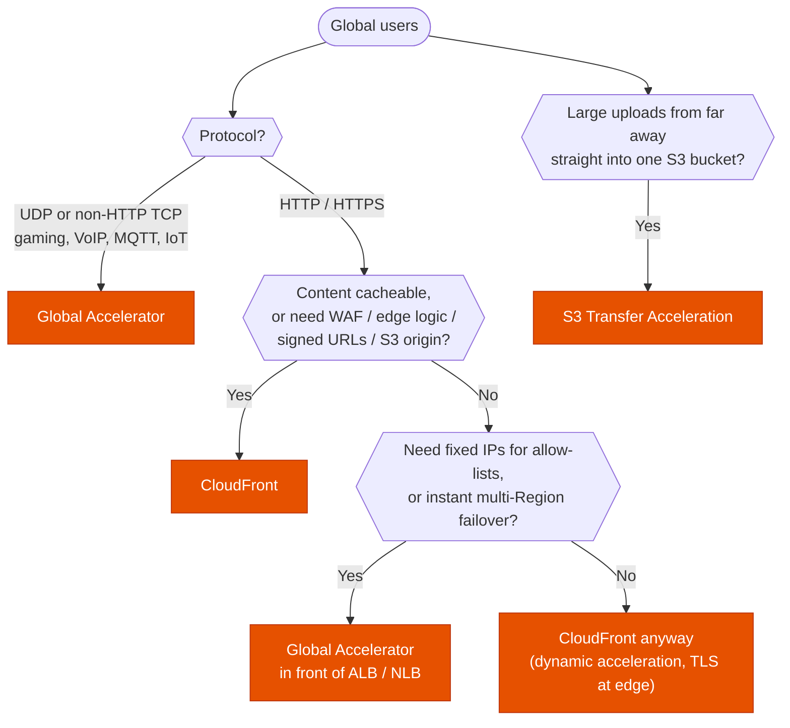

---
tags:
  - "Domain 2: New Solutions"
  - "Domain 3: Continuous Improvement"
  - CloudFront
  - Global Accelerator
  - Networking
---

# Edge: CloudFront or Global Accelerator?

**The question:** users around the world reach an application in one or a few Regions. Should traffic enter AWS through **CloudFront**, **Global Accelerator**, or neither (Route 53 alone, S3 Transfer Acceleration)?

**Trigger keywords:** *"cache static content"*, *"reduce latency for global users"*, *"static IP addresses"*, *"allow-list IPs in the customer firewall"*, *"UDP"*, *"gaming"*, *"VoIP"*, *"fast regional failover without DNS caching"*, *"restrict S3 access to CloudFront"*, *"signed URLs"*, *"geo-restriction"*, *"run code at the edge"*.

## Fundamentals

| | **CloudFront** | **Global Accelerator** |
|---|---|---|
| What it is | **CDN**: caches and proxies HTTP(S) at 600+ edge locations | **Anycast network entry**: 2 static IPs, traffic rides the AWS backbone to the best healthy endpoint |
| Protocols | **HTTP / HTTPS / WebSocket** (plus gRPC) | **TCP and UDP**, any application |
| Caching | ✅ | ❌ |
| IPs | Many, changing (DNS name) | **2 static anycast IPv4** (or your BYOIP), dual-stack option |
| Origins / endpoints | S3, ALB, EC2, API Gateway, Lambda function URLs, any HTTP server, **origin groups** for failover | ALB, NLB, EC2, Elastic IP, in one or more Regions, weighted by **traffic dials** and endpoint weights |
| Failover | Origin group failover on error codes (GET, HEAD, OPTIONS) | Health-checked, **sub-minute**, no DNS TTL involved |
| Edge compute | **CloudFront Functions** (light, viewer events) and **Lambda@Edge** (heavier, origin events too) | ❌ |
| Security | **WAF**, Shield, **OAC** for S3, signed URLs/cookies, geo-restriction, field-level encryption | Shield, client IP preservation (ALB/EC2) |

## Decision tree

## Why each branch

- **CloudFront whenever HTTP content can be cached** or the edge must do something: authenticate (signed URLs/cookies), rewrite headers, block countries, run WAF. It also speeds up **dynamic** HTTP (persistent connections to the origin, TLS termination close to users) and accepts uploads (`PUT`/`POST`).
- **Global Accelerator for everything that isn't HTTP**, and for HTTP apps that need **static IPs** or **deterministic, fast failover** between Regions. Clients keep the same two IPs; GA moves traffic when health checks fail, so DNS caching doesn't delay recovery.
- **Route 53 latency routing vs GA:** both send users to the nearest Region, but Route 53 depends on resolvers honoring TTLs and uses the public internet to the Region. GA enters the backbone at the closest edge.
- **S3 Transfer Acceleration** is specifically for long-distance **uploads to S3**, using edge locations.
- **Custom routing accelerators** map users to a **specific EC2 instance and port** (multiplayer game sessions), unlike standard accelerators which load-balance.

## Comparison: who answers which stem

| Stem | Answer |
|---|---|
| *Cache images and videos worldwide* | CloudFront |
| *Customers must allow-list two IPs in their firewalls* | Global Accelerator |
| *UDP game servers in 3 Regions, lowest latency* | Global Accelerator |
| *S3 bucket must only be reachable through the CDN* | CloudFront + **Origin Access Control** (bucket policy on the distribution) |
| *Premium content for paying users only* | CloudFront **signed URLs** (one file) / **signed cookies** (many files) |
| *Rewrite URLs / A/B test at the edge, sub-ms* | **CloudFront Functions** |
| *Call an external service or read the body at the edge* | **Lambda@Edge** |
| *Blue/green between Regions by percentage* | GA **traffic dials** (or Route 53 weighted) |

## Exam traps

!!! warning "Global Accelerator caches"
    It doesn't. It's a network path optimizer. Caching = CloudFront.

!!! warning "CloudFront for UDP"
    CloudFront is HTTP(S)/WebSocket only. UDP → Global Accelerator.

!!! warning "Origin Access Identity"
    OAI is legacy. The current answer is **Origin Access Control (OAC)**, which also supports SSE-KMS buckets and all Regions.

!!! warning "Origin failover for writes"
    CloudFront origin groups fail over only for **GET, HEAD and OPTIONS**. Write traffic needs a different design (multi-Region app + Route 53 / GA).

!!! warning "Signed URL vs pre-signed S3 URL"
    A CloudFront signed URL goes through the CDN (key group, caching, OAC). An S3 pre-signed URL bypasses CloudFront and needs direct bucket access.

!!! warning "Geo-restriction for compliance"
    CloudFront geo-restriction works at **country** level. Finer rules (or combining with IP lists) → **AWS WAF** geo match rules.

## Test yourself

??? question "1. A multiplayer game uses UDP on EC2 in us-east-1, eu-west-1 and ap-northeast-1. Players must reach the closest healthy Region with minimal jitter."
    **Global Accelerator** with endpoint groups in the three Regions.

??? question "2. B2B clients can only open outbound traffic to fixed IPs. The API runs behind an ALB in two Regions."
    **Global Accelerator** (two static anycast IPs) with the two ALBs as endpoints.

??? question "3. A static website on S3 must be served over HTTPS with a custom domain, and the bucket must not be public."
    **CloudFront** + **OAC**, ACM certificate in **us-east-1**, bucket policy allowing only the distribution.

??? question "4. Users in Asia upload multi-GB files to a bucket in eu-west-3 and complain about speed."
    **S3 Transfer Acceleration** (plus multipart upload).

??? question "5. An app must redirect mobile users to a different path based on a header, with the lowest latency and cost."
    **CloudFront Functions** on the viewer request.

## Related

- [Route 53: which routing policy?](route53-routing-policies.md)
- [Cross-zone load balancing](elb-cross-zone.md)
- [Disaster recovery strategy](../resilience/dr-strategy.md)
- AWS docs: [Global Accelerator: how it works](https://docs.aws.amazon.com/global-accelerator/latest/dg/introduction-how-it-works.html)
- AWS docs: [Restricting access to an S3 origin with OAC](https://docs.aws.amazon.com/AmazonCloudFront/latest/DeveloperGuide/private-content-restricting-access-to-s3.html)
- AWS docs: [CloudFront Functions vs Lambda@Edge](https://docs.aws.amazon.com/AmazonCloudFront/latest/DeveloperGuide/edge-functions-choosing.html)
