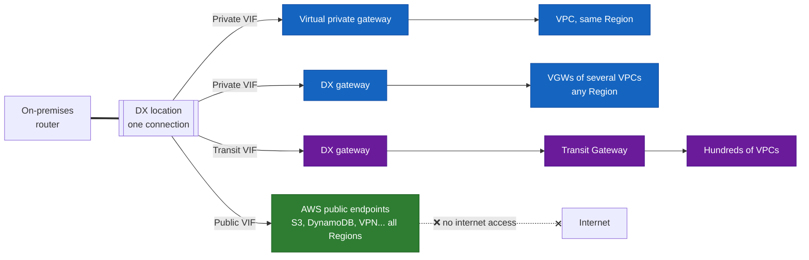
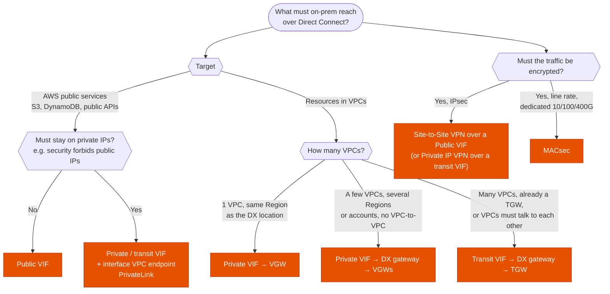

---
tags:
  - "Domain 1: Organizational Complexity"
  - "Domain 2: New Solutions"
  - Direct Connect
  - Networking
  - Hybrid
---

# Direct Connect: which virtual interface (VIF), and how to make it resilient?

**The question:** an on-premises network is linked to AWS with Direct Connect. To reach what it needs, which VIF: **private**, **public** or **transit**? With or without a Direct Connect gateway? How to encrypt it and survive a failure?

**Trigger keywords:** *"dedicated private connection"*, *"consistent network performance"*, *"access S3 / DynamoDB from on-premises without the internet"*, *"many VPCs in several Regions"*, *"Transit Gateway"*, *"encrypt traffic over Direct Connect"*, *"maximum resiliency"*, *"backup connection"*, *"BGP"*, *"active/passive"*.

## Fundamentals

**The connection** is the physical link (a cross-connect at a **DX location**). **A VIF** is a VLAN + a BGP session on that link. One connection can carry several VIFs of different types.

| Connection | Speeds | From | VIFs |
|---|---|---|---|
| **Dedicated** | 1, 10, 100, 400 Gbps | AWS directly | Several, you create them |
| **Hosted** | 50 Mbps to 25 Gbps | A DX partner | **One** VIF per hosted connection |

A dedicated connection carries up to 50 public/private VIFs and 4 transit VIFs.

Ordering takes **weeks**: *"needed this week"* → Site-to-Site VPN first.

### The three VIF types: the one table to remember

| VIF | Reaches | Addresses | Attaches to | Remember it as |
|---|---|---|---|---|
| **Private** | Resources **inside a VPC** (EC2, RDS, interface endpoints…) | **Private** IPs | A **virtual private gateway** (1 VPC, same Region) or a **DX gateway** (many VPCs, any Region) | "into my VPC" |
| **Public** | **AWS public endpoints** (S3, DynamoDB, SQS, STS, VPN endpoints…) in **all Regions** | **Public** IPs (yours or provided by AWS), AWS advertises all its public prefixes | Nothing: AWS's public network | "AWS public services, **not** the internet" |
| **Transit** | VPCs attached to a **Transit Gateway** | Private IPs | A **DX gateway** associated with **Transit Gateways** | "into my TGW" |

### Direct Connect gateway (DXGW)

- A **global** object: one private or transit VIF reaches VPCs in **any Region** (except China), and VGWs from **other accounts**.
- **No transit through it:** VPC A can't reach VPC B via the DXGW, and two on-prem sites can't talk through it (that's **SiteLink**).
- **Allowed prefixes** on each association control which VPC CIDRs are advertised to on-prem.
- Limits: up to **20 VGWs** or **6 Transit Gateways** per DXGW.

## Decision tree

## Why each branch

- **Public VIF for S3 and other public services.** S3, DynamoDB and the other regional APIs live on **public IPs**. A public VIF gives a private path to those IPs in every Region, with consistent latency and lower data transfer cost than the internet. It does **not** give internet access.
- **Private IPs only → endpoint behind a private VIF.** If public IPs are forbidden, create an **interface endpoint** (PrivateLink) for S3 or the service in a VPC and reach it with a private or transit VIF. **Gateway endpoints** (S3, DynamoDB) **don't work from on-prem**: they only apply to the VPC's route tables.
- **One VPC → private VIF to its VGW.** Simplest, but the VPC must be in the **same Region** as the DX location.
- **Several VPCs / Regions → DX gateway.** One VIF, many VGWs, any Region, other accounts. No traffic between those VPCs.
- **Many VPCs or a TGW → transit VIF.** The TGW does the routing between VPCs and with on-prem. It scales to thousands of VPCs and centralizes inspection.
- **Encryption.** Direct Connect is private but **not encrypted**. IPsec: run a **Site-to-Site VPN over a public VIF** (the VPN endpoints are public AWS IPs), or a **Private IP VPN** over a transit VIF to a TGW. Line-rate layer-2 encryption: **MACsec** on dedicated connections.

## Resilience

| Level | Setup | Survives |
|---|---|---|
| **Development** | 1 connection, 1 location | Nothing |
| **Cheap backup** | 1 DX + **Site-to-Site VPN** as backup | DX failure (at VPN bandwidth) |
| **High resiliency** | 2 connections at **2 DX locations** | A location failure |
| **Maximum resiliency** | 2 connections at **each** of **2 DX locations** (4 total) on separate devices | A location failure **and** a device failure |

- Failover relies on **BGP**: enable **BFD** for fast detection.
- From AWS to on-prem, for the same prefix, **Direct Connect is preferred over VPN**. Longest prefix still wins first.
- Active/passive between two DX connections: **local preference BGP communities** (`7224:7100` low, `7200` medium, `7300` high) on what you advertise, or **AS_PATH prepending**.
- **LAG**: bundles up to 4 connections (2 at 100 Gbps) of the **same speed at the same location** into one logical link. More bandwidth, not location resilience.

## Comparison

| | Private VIF + VGW | Private VIF + DXGW | Transit VIF + DXGW + TGW | Public VIF |
|---|---|---|---|---|
| Reaches | 1 VPC | Several VPCs, any Region | Many VPCs via TGW | AWS public endpoints |
| VPC-to-VPC routing | n/a | ❌ | ✅ (TGW) | n/a |
| IPs | Private | Private | Private | Public |
| Max MTU | 9001 | 9001 | 8500 | 1500 |
| Typical answer for | Small single-VPC setup | Multi-Region without TGW | Large multi-account network | S3 / DynamoDB, VPN over DX |

## Exam traps

!!! warning "Public VIF = internet access"
    No. It reaches **AWS public prefixes only**. On-prem internet traffic still goes through your own ISP.

!!! warning "Private VIF to reach S3"
    A private VIF lands in a VPC. S3 isn't in your VPC. Either a **public VIF**, or a private VIF plus an **S3 interface endpoint** in the VPC.

!!! warning "S3 gateway endpoint from on-prem"
    Gateway endpoints are route-table entries in the VPC: on-prem traffic **can't use them**. From on-prem, only **interface endpoints** work.

!!! warning "Direct Connect is encrypted"
    It's private, not encrypted. *"Encrypt data in transit over DX"* → **VPN over a public VIF** (or Private IP VPN on a transit VIF), or **MACsec** on dedicated connections.

!!! warning "DX gateway for VPC-to-VPC traffic"
    A DXGW only connects on-prem to VPCs. VPCs talking to each other → **Transit Gateway** (transit VIF) or peering.

!!! warning "LAG for resilience"
    A LAG lives in **one** DX location. Losing that location loses the whole LAG. Resilience = connections in **2 locations**.

!!! warning "Second DX at the same location for maximum resiliency"
    Protects against a device failure only. Maximum resiliency = **two locations**, two devices in each.

!!! warning "Hosted connection with several VIFs"
    A hosted connection carries **one** VIF. Several VIFs on a partner link → several hosted connections, or a dedicated connection.

!!! warning "BGP session drops after adding routes"
    A private or transit VIF accepts **100 prefixes** from on-prem by default (raisable to 1,000 with prefix controls; public VIF: 1,000). Above the limit, the BGP session goes **down**. **Summarize** the routes.

!!! warning "Direct Connect needed next week"
    DX takes weeks to provision. Use **Site-to-Site VPN** now, DX later (keep the VPN as backup).

## Test yourself

??? question "1. On-prem servers upload terabytes to S3 every night. The company wants consistent throughput and not to use the internet. Which VIF?"
    **Public VIF.** S3 is a public endpoint; a public VIF reaches it over Direct Connect without going through the internet.

??? question "2. Same scenario, but the security team forbids any public IP on the path. What now?"
    Private (or transit) VIF into a VPC, plus an **S3 interface endpoint** (PrivateLink). On-prem resolves the endpoint's DNS name to private IPs. A gateway endpoint wouldn't work from on-prem.

??? question "3. A company has one DX connection in Frankfurt and needs to reach 6 VPCs in eu-central-1, eu-west-1 and us-east-1, in 3 accounts. VPCs don't need to talk to each other."
    **Private VIF → Direct Connect gateway**, associated with the **VGWs** of the 6 VPCs (cross-Region, cross-account).

??? question "4. 300 VPCs are attached to Transit Gateways in two Regions. On-prem must reach all of them over DX."
    **Transit VIF → DX gateway → the Transit Gateways.**

??? question "5. Compliance requires IPsec encryption for all traffic between the data center and the VPC, over the existing DX."
    **Site-to-Site VPN over a public VIF** (to the VGW or TGW VPN endpoints), or a **Private IP VPN** to a TGW over a transit VIF.

??? question "6. Critical workload, budget allows it: what's the AWS recommendation for maximum resiliency?"
    **Two DX locations**, with **two connections on separate devices** at each, plus BFD. Cheaper alternative: one DX plus a **VPN backup**.

??? question "7. A company wants a DX connection to be the backup of another one, not active/active. How?"
    Influence BGP: **local preference communities** (`7224:7300` on the primary, `7224:7100` on the backup) or **AS_PATH prepending** on the backup.

## Related

- [Route 53: which routing policy?](route53-routing-policies.md)
- [Cross-account access](../identity/cross-account-access.md)
- AWS docs: [Direct Connect virtual interfaces](https://docs.aws.amazon.com/directconnect/latest/UserGuide/WorkingWithVirtualInterfaces.html)
- AWS docs: [Direct Connect gateways](https://docs.aws.amazon.com/directconnect/latest/UserGuide/direct-connect-gateways-intro.html)
- AWS docs: [Resiliency recommendations](https://aws.amazon.com/directconnect/resiliency-recommendation/)
- AWS docs: [Direct Connect quotas](https://docs.aws.amazon.com/directconnect/latest/UserGuide/limits.html)
