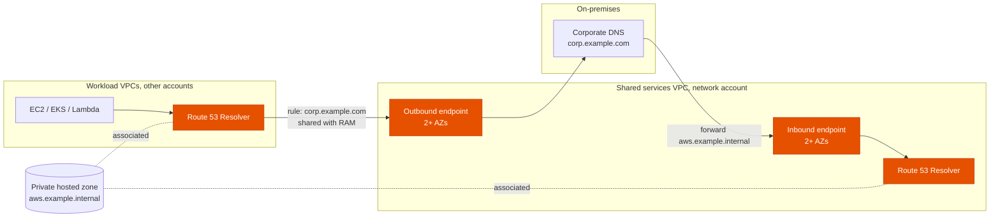
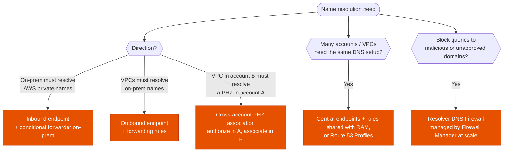

---
tags:
  - "Domain 1: Organizational Complexity"
  - Route 53
  - Networking
  - Hybrid
---

# Hybrid DNS: Resolver endpoints, forwarding rules and private hosted zones

**The question:** on-premises networks and many VPCs (often in many accounts) must resolve each other's private names. Which Route 53 Resolver pieces go where, and how is the configuration shared across accounts?

**Trigger keywords:** *"on-premises servers must resolve names in a private hosted zone"*, *"EC2 instances must resolve corp.example.com"*, *"conditional forwarding"*, *"centralize DNS for all VPCs"*, *"share DNS rules with other accounts"*, *"private hosted zone in another account"*, *"block DNS queries to malicious domains"*, *"split-horizon DNS"*.

## Fundamentals

| Piece | Direction | What it is |
|---|---|---|
| **Route 53 Resolver** (VPC+2, also `169.254.169.253`) | Inside the VPC | Default DNS for every VPC: answers public names, **private hosted zones** associated with the VPC, and VPC internal names. **Only reachable from inside the VPC** |
| **Inbound endpoint** | **On-prem → AWS** | ENIs with private IPs in your VPC (≥ 2 AZs). On-prem DNS servers **forward** AWS zones to these IPs |
| **Outbound endpoint** | **AWS → on-prem** | ENIs the Resolver uses to send queries out |
| **Forwarding rule** | AWS → on-prem | "Queries for `corp.example.com` go to `10.1.0.10`, `10.1.0.11` via this outbound endpoint". Associated with VPCs, **shareable with RAM** |
| **Private hosted zone (PHZ)** | — | Zone visible only to the VPCs associated with it, any account (cross-account association via authorization) |
| **Route 53 Profiles** | — | Bundle PHZ associations, Resolver rules and DNS Firewall rule groups, share with RAM, apply to many VPCs at once |
| **Resolver DNS Firewall** | Outbound queries from VPCs | Allow / block / alert on domain lists (managed threat lists included) |

Each endpoint IP handles about **10,000 queries per second**; add IPs to scale.

## Architecture

- Endpoints live **once**, in a central VPC (network or shared services account), reachable over **DX / VPN / Transit Gateway**.
- **Forwarding rules** are created there and **shared via RAM**; each workload account **associates** them with its VPCs. The spoke VPCs' queries then leave through the hub's outbound endpoint.
- PHZs are associated with the **hub VPC** (so inbound queries from on-prem can resolve them) and with each spoke that needs them. Route 53 **Profiles** make this one association per VPC instead of dozens.

## Decision tree

## Why each branch

- **Inbound for on-prem → AWS.** On-prem servers can't query VPC+2: it isn't routable from outside the VPC. The inbound endpoint gives them real IPs to forward to.
- **Outbound + rules for AWS → on-prem.** Instances keep using the default Resolver (no custom DNS servers to run); rules decide which domains are forwarded. **System rules** (for example, keep `aws.example.internal` local) override broader forwarding rules.
- **Cross-account PHZ.** The PHZ owner runs `create-vpc-association-authorization`, the VPC owner runs `associate-vpc-with-hosted-zone`. API / CLI only, not the console.
- **Centralize and share.** One pair of endpoints for the whole organization is cheaper (endpoints are billed per ENI-hour) and simpler. Rules shared with RAM follow the same OU-based sharing as the TGW.
- **DNS Firewall** stops DNS-based exfiltration and known bad domains at the Resolver. It filters **domains**, not IPs or packets (that's Network Firewall).

## Exam traps

!!! warning "Point on-prem DNS at the VPC+2 address"
    Not reachable from outside the VPC, even over DX. Use an **inbound endpoint**.

!!! warning "Run BIND / Unbound on EC2 as forwarders"
    It works, but it's servers to patch and scale. *"Least operational overhead"* → **Resolver endpoints and rules**.

!!! warning "Custom DHCP options set pointing to on-prem DNS"
    Then VPC instances stop using the Resolver: **private hosted zones and VPC names no longer resolve** unless those servers forward back. Keep `AmazonProvidedDNS` and use forwarding rules.

!!! warning "Forwarding rules work across Regions"
    A rule uses an outbound endpoint **in the same Region** as the VPCs it's associated with. Multi-Region → endpoints in each Region.

!!! warning "PHZ requires DNS settings"
    The VPC needs **`enableDnsSupport`** and **`enableDnsHostnames`** turned on for private hosted zones to work.

!!! warning "Security groups on endpoints"
    Endpoint ENIs need security groups allowing **TCP and UDP 53** from the on-prem resolvers (inbound) or to them (outbound).

## Test yourself

??? question "1. On-prem applications must resolve `db.aws.example.internal`, a record in a PHZ associated with a shared services VPC reached over DX."
    **Inbound endpoint** in the shared services VPC; on-prem DNS **conditional forwarder** for `aws.example.internal` → the endpoint IPs.

??? question "2. 80 VPCs in 30 accounts must resolve `corp.example.com` from on-prem DNS. Minimize cost and operations."
    **One outbound endpoint** in the network account, a **forwarding rule** for `corp.example.com`, **shared with RAM** to the OUs; each account associates the rule with its VPCs (or use a **Route 53 Profile**).

??? question "3. A VPC in account B must resolve a private hosted zone owned by account A."
    In A: **create a VPC association authorization** for B's VPC. In B: **associate the VPC with the hosted zone** (CLI / API).

??? question "4. The security team wants to block DNS lookups to known malware domains from every VPC in the organization."
    **Route 53 Resolver DNS Firewall** with AWS managed domain lists, deployed org-wide with **Firewall Manager**.

??? question "5. `app.example.com` must resolve to a private IP inside the VPCs and to a public IP on the internet."
    **Split-horizon**: a **public** and a **private** hosted zone with the same name; the VPCs associated with the PHZ get the private answer.

## Related

- [Route 53 routing policies](route53-routing-policies.md)
- [Direct Connect: VIFs & resiliency](direct-connect.md)
- [VPC to VPC connectivity](vpc-connectivity.md)
- [Multi-account foundations](../identity/multi-account.md)
- AWS docs: [Resolving DNS queries between VPCs and your network](https://docs.aws.amazon.com/Route53/latest/DeveloperGuide/resolver.html)
- AWS docs: [Route 53 Profiles](https://docs.aws.amazon.com/Route53/latest/DeveloperGuide/profiles.html)
- AWS docs: [Associating a VPC with a PHZ in another account](https://docs.aws.amazon.com/Route53/latest/DeveloperGuide/hosted-zone-private-associate-vpcs-different-accounts.html)
