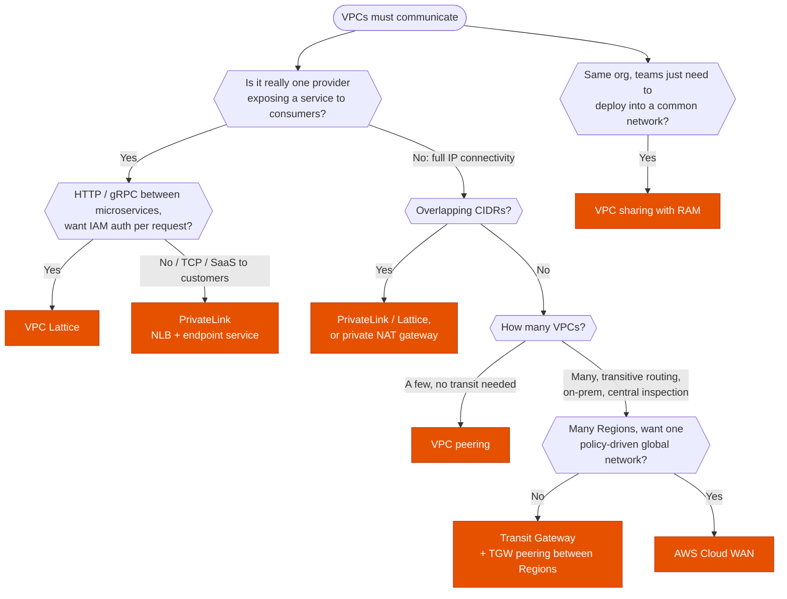

---
tags:
  - "Domain 1: Organizational Complexity"
  - "Domain 2: New Solutions"
  - Networking
  - Transit Gateway
  - PrivateLink
---

# VPC to VPC: peering, Transit Gateway, PrivateLink or VPC Lattice?

**The question:** workloads in several VPCs (often several accounts) must talk to each other. Which connectivity option fits the number of VPCs, the routing needs, overlapping CIDRs and the direction of traffic?

**Trigger keywords:** *"hundreds of VPCs"*, *"hub-and-spoke"*, *"transitive routing"*, *"overlapping CIDR ranges"*, *"expose a service to other accounts"*, *"SaaS provider"*, *"only one-way access"*, *"centralized inspection / egress"*, *"service-to-service with IAM auth"*, *"share subnets"*.

## Fundamentals

| Option | Layer | Shape | Overlapping CIDRs | Transitive | Cost model |
|---|---|---|---|---|---|
| **VPC peering** | 3 (IP) | 1:1 links, full mesh at scale | ❌ | ❌ | Data transfer only (free within the same AZ) |
| **Transit Gateway (TGW)** | 3 (IP) | Hub-and-spoke, Regional; TGW peering across Regions | ❌ (on routed paths) | ✅ with route tables | Per attachment-hour + per GB |
| **PrivateLink** (interface endpoint → endpoint service on **NLB** / GWLB) | 4 (TCP) | **One service** → many consumers, **one-way** | ✅ | n/a | Per endpoint-hour + per GB |
| **VPC Lattice** | 7 (HTTP, HTTPS, gRPC) + TCP resources | **Service network** of services across VPCs/accounts | ✅ | n/a | Per service-hour + per GB + per request |
| **VPC sharing** (RAM) | — | Several accounts deploy into **subnets of one VPC** | n/a | n/a | No connectivity cost |
| **Cloud WAN** | 3 | **Global** managed network with policy-defined segments | ❌ | ✅ | Per core network edge + attachments |

## Decision tree

## Why each branch

- **Peering for a handful of VPCs.** Lowest latency, no bandwidth bottleneck, no hourly charge. But it's **not transitive** (A↔B and B↔C doesn't give A↔C), there's **no edge-to-edge routing** (A can't use B's IGW, NAT, VPN or DX), and CIDRs can't overlap. At *n* VPCs a full mesh needs *n(n-1)/2* links.
- **Transit Gateway once you have many VPCs or need transit.** One hub per Region; **route tables** on the TGW segment traffic (prod can't reach dev, everyone reaches shared services). Also terminates **VPN** (with ECMP for more bandwidth) and **Direct Connect** (transit VIF), and is the anchor for **centralized egress** and **inspection** (Network Firewall or GWLB in an inspection VPC, with **appliance mode** on the attachment for symmetric flows). Shared to other accounts with **RAM**.
- **PrivateLink for one-way access to a service.** The consumer gets an **interface endpoint** (ENI with private IPs in its own VPC); the provider fronts the service with an **NLB**. No routing between the VPCs, so **overlapping CIDRs are fine** and the consumer sees nothing but the service. The classic SaaS pattern.
- **VPC Lattice for application-to-application.** Services (EC2, ECS, EKS, Lambda, ALB targets) register in a **service network** associated with VPCs; Lattice handles discovery, routing (path, header, weighted), and **auth policies** using IAM (SigV4). Overlapping CIDRs are fine. Resource configurations extend it to TCP resources such as databases.
- **VPC sharing to avoid connectivity altogether.** A central network account owns the VPC and **shares subnets** with workload accounts; their resources land in the same VPC and talk locally. Participants can't modify the VPC, route tables or NACLs.
- **Cloud WAN when the network is global.** Define segments and attachment rules in a **core network policy**; AWS builds and peers the TGW-like edges in each Region.

## Comparison

| | Peering | Transit Gateway | PrivateLink | VPC Lattice |
|---|---|---|---|---|
| Scale | Tens | Thousands of attachments | Thousands of consumers per service | Many services and VPCs |
| Direction | Bidirectional | Bidirectional | **Consumer → provider only** | Client → service |
| Overlapping CIDRs | ❌ | ❌ | ✅ | ✅ |
| On-prem via VPN/DX | ❌ (no edge-to-edge) | ✅ | ✅ (endpoint reachable over DX/VPN) | Via VPC resources |
| Typical exam answer for | 2–3 VPCs, cheapest | Hub-and-spoke, inspection, hybrid | SaaS, expose one service, overlapping CIDRs | Microservices across accounts with IAM auth |

## Exam traps

!!! warning "Peering is transitive"
    It isn't. Three VPCs that must all talk need three peering connections, or a TGW.

!!! warning "Reach the internet through a peered VPC's NAT"
    No edge-to-edge routing over peering. Centralized egress = **Transit Gateway** + egress VPC with NAT gateways.

!!! warning "Overlapping CIDRs with TGW or peering"
    Routing can't work when two VPCs use the same range. Use **PrivateLink**/**Lattice** for the service, or a **private NAT gateway** to translate.

!!! warning "PrivateLink in front of an ALB"
    Endpoint services front an **NLB** (or GWLB). For an ALB, put the ALB as a target of the NLB (ALB-type target group).

!!! warning "Asymmetric traffic through firewalls on TGW"
    Stateful appliances behind a TGW drop return traffic that comes back through another AZ. Enable **appliance mode** on the inspection VPC attachment.

!!! warning "VPC sharing across organizations"
    Subnet sharing works only between accounts **in the same AWS Organization**.

## Test yourself

??? question "1. 3 VPCs in one account, all must reach each other, minimal cost and operations."
    **Three VPC peering connections** (full mesh). A TGW adds hourly and per-GB charges for no benefit at this scale.

??? question "2. 150 VPCs across 40 accounts plus two data centers over DX. Dev must never reach prod; everyone reaches shared services."
    **Transit Gateway** shared with RAM, **separate TGW route tables** for prod, dev and shared, **transit VIF** to the DX gateway.

??? question "3. A SaaS vendor must let 500 customers call its API privately; many customers use 10.0.0.0/16."
    **PrivateLink**: NLB + endpoint service; each customer creates an interface endpoint. Overlapping CIDRs don't matter.

??? question "4. Dozens of teams' microservices on ECS, EKS and Lambda across accounts must call each other over HTTPS, with per-service IAM authorization and no network plumbing."
    **VPC Lattice** service network shared with RAM, auth policies on services.

??? question "5. All outbound internet traffic from 80 VPCs must go through one inspected egress point."
    **TGW** with a default route to an **inspection/egress VPC** (Network Firewall or GWLB appliances, then NAT gateways); **appliance mode** on that attachment.

## Related

- [Direct Connect: VIFs & resiliency](direct-connect.md)
- [Multi-account foundations](../identity/multi-account.md)
- AWS whitepaper: [Building a scalable and secure multi-VPC network infrastructure](https://docs.aws.amazon.com/whitepapers/latest/building-scalable-secure-multi-vpc-network-infrastructure/welcome.html)
- AWS docs: [VPC Lattice](https://docs.aws.amazon.com/vpc-lattice/latest/ug/what-is-vpc-lattice.html)
- AWS docs: [Transit Gateway appliance mode](https://docs.aws.amazon.com/vpc/latest/tgw/transit-gateway-appliance-scenario.html)
