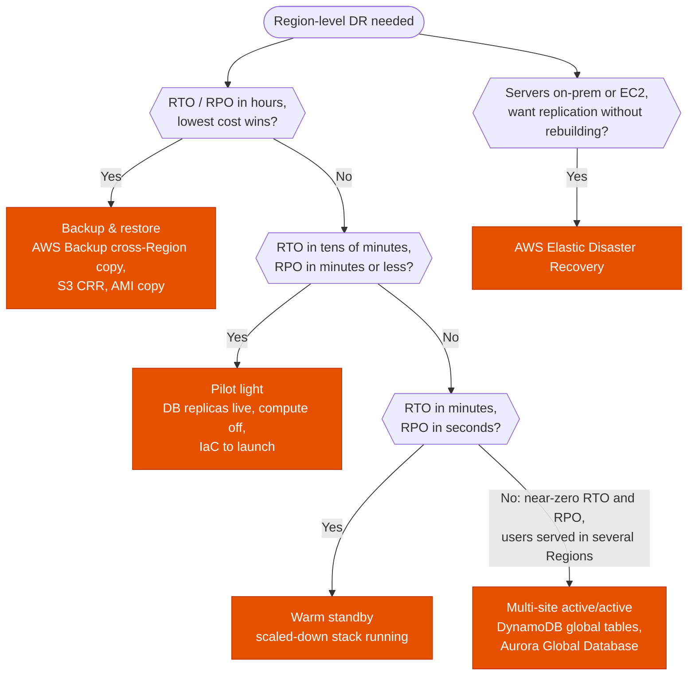

---
tags:
  - "Domain 2: New Solutions"
  - "Domain 3: Continuous Improvement"
  - Disaster recovery
  - Resilience
---

# Disaster recovery: which strategy for this RTO and RPO?

**The question:** a workload must survive the loss of a Region (or a data center). Given the **RTO**, the **RPO** and the budget, which strategy: backup & restore, pilot light, warm standby or multi-site active/active? And which service implements it?

**Trigger keywords:** *"RTO of X hours / minutes"*, *"RPO of X minutes / seconds"*, *"most cost-effective DR"*, *"minimal data loss"*, *"Region failure"*, *"core services always running"*, *"scaled-down copy"*, *"zero downtime"*, *"replicate on-premises servers to AWS"*.

## Fundamentals

- **RPO** (Recovery Point Objective): how much **data** you can lose, measured backwards from the disaster. Driven by **how data is copied** (backups every 24 h → RPO up to 24 h; continuous replication → seconds).
- **RTO** (Recovery Time Objective): how long until the service is **back**. Driven by **how much infrastructure already runs** in the recovery site.

| Strategy | What runs in the DR Region | Typical RPO | Typical RTO | Cost |
|---|---|---|---|---|
| **Backup & restore** | Nothing but **backups** (snapshots, AMIs, S3 copies) | Hours (backup interval) | Hours to a day | $ |
| **Pilot light** | **Data layer live** (replicas), compute **off** or not created. IaC ready | Seconds to minutes | Tens of minutes to hours | $$ |
| **Warm standby** | A **full but scaled-down** copy of the stack, serving or able to serve | Seconds | Minutes | $$$ |
| **Multi-site active/active** | Full stack at **full size** in each Region, all serving traffic | Near zero | Near zero | $$$$ |

**Pilot light vs warm standby, the one-liner:** in a pilot light you must **turn on / create** compute before you can serve. In a warm standby you only **scale up** something that is already handling requests.

## Decision tree

## Why each branch

- **Backup & restore when hours are acceptable.** You pay only for storage. Recovery means restoring data and **creating** the whole stack (CloudFormation / Terraform), which is slow. Use **AWS Backup** plans with cross-Region (and cross-account) copy, S3 replication, AMI copies.
- **Pilot light when data must be fresh but compute can wait.** The **data** is the slow, irreplaceable part, so it's replicated continuously (RDS cross-Region read replica, Aurora Global Database, DynamoDB global tables, S3 CRR). Compute is cheap to launch from AMIs and IaC. Failover = **promote** the replica, launch the app tier, switch DNS.
- **Warm standby when minutes matter.** Everything is already running at a small size, so failover = **scale up** (ASG desired capacity, Aurora instance class) and shift traffic. You can test it continuously because it serves.
- **Active/active when no downtime is acceptable.** Every Region serves users. Needs a **multi-writer** or partitioned data layer: **DynamoDB global tables** (multi-active) or careful write routing. Aurora Global Database has **one writer Region**, so on its own it gives active/passive writes with active reads.
- **Elastic Disaster Recovery (DRS)** for servers: continuous **block-level replication** of on-prem or EC2 servers into a low-cost staging area, launch recovery instances in minutes (RPO seconds, RTO minutes). It's the DR sibling of **MGN**.

## Building blocks

| Layer | Backup & restore | Pilot light / warm standby | Active/active |
|---|---|---|---|
| Objects | S3 CRR, AWS Backup copy | **S3 CRR** (+ **Replication Time Control**: 99.99 % of objects in 15 min) | S3 CRR both ways, **Multi-Region Access Points** |
| Relational | Snapshot copy | **RDS cross-Region read replica**, **Aurora Global Database** | Aurora Global Database (+ write forwarding) |
| NoSQL | AWS Backup / PITR copy | **DynamoDB global tables** | **DynamoDB global tables** |
| Compute | AMI copy + IaC | AMIs + IaC (pilot) / small ASG (warm) | Full ASGs, ECS/EKS in each Region |
| Traffic | DNS change | **Route 53 failover** records + health checks, or **ARC** routing controls | Route 53 latency / geolocation, **Global Accelerator** |

**Route 53 Application Recovery Controller (ARC):** readiness checks (is the standby really ready?) and **routing controls**, on/off switches backed by a highly available data plane, to fail over without depending on the control plane of the impaired Region. **Zonal shift** moves traffic away from one AZ.

## Exam traps

!!! warning "Pilot light with a backup"
    If the database must be **restored from a snapshot** during the event, it's backup & restore, not pilot light. Pilot light keeps the data layer **live and replicating**.

!!! warning "Warm standby vs pilot light"
    *"Scaled-down but fully functional"* = warm standby. *"Core components only, app servers started during failover"* = pilot light.

!!! warning "Aurora Global Database is active/active"
    One primary (writer) Region; secondaries are read-only (write forwarding just sends writes to the primary). For multi-Region **writes**, the answer is DynamoDB global tables.

!!! warning "Failing over by editing DNS from the impaired Region"
    Control planes can be impaired during a Regional event. Prefer **data-plane** mechanisms: Route 53 health checks, ARC routing controls, Global Accelerator. Don't plan on calling APIs in the failed Region.

!!! warning "AMIs and snapshots are Regional"
    A backup & restore plan that never **copies** AMIs and snapshots to the DR Region doesn't survive a Region loss. Same for KMS: use **multi-Region keys** or re-encrypt with a key in the DR Region.

!!! warning "Multi-AZ is DR"
    Multi-AZ is **high availability** inside a Region. Region-level DR needs a second Region.

!!! warning "Service quotas in the DR Region"
    Warm standby that must scale to full size needs **quotas raised in advance** in the DR Region (EC2 vCPU, etc.).

## Test yourself

??? question "1. RPO 24 h, RTO 24 h, minimize cost. Workload: EC2 + RDS + S3."
    **Backup & restore.** AWS Backup plan with **cross-Region copy** of EC2 and RDS backups, S3 replication or Backup copy, CloudFormation to rebuild.

??? question "2. RPO 5 min, RTO 2 h, minimize cost. MySQL on RDS, app on EC2."
    **Pilot light.** **RDS cross-Region read replica** (seconds of lag), AMIs copied, ASG with 0 instances or IaC ready. Failover: promote the replica, scale the ASG, Route 53 failover.

??? question "3. RTO 15 min, RPO 1 min, the DR site must be testable at any time."
    **Warm standby**: a small but complete stack in the DR Region, Aurora Global Database secondary. Scale up and shift traffic on failover.

??? question "4. Users in Europe and the US must keep writing during the loss of either Region, near-zero RPO."
    **Active/active** with **DynamoDB global tables** (multi-active writes), app stacks in both Regions, Route 53 latency routing with health checks.

??? question "5. 200 on-prem Windows and Linux servers need DR to AWS with RPO of seconds and minimal idle cost."
    **AWS Elastic Disaster Recovery**: block-level continuous replication to a low-cost staging subnet, launch full-size recovery instances only when needed.

??? question "6. During a Regional outage the team couldn't update Route 53 records because the tooling depended on the impaired Region. What design fixes it?"
    **Route 53 ARC routing controls** (or health-check-based failover records), which flip on the highly available data plane, not a control-plane API in the failed Region.

## Related

- [Backup: DLM vs AWS Backup vs native](../storage/backup-strategy.md)
- [Route 53: which routing policy?](../networking/route53-routing-policies.md)
- [Multi-Region databases](../databases/multi-region-databases.md)
- AWS whitepaper: [Disaster recovery of workloads on AWS](https://docs.aws.amazon.com/whitepapers/latest/disaster-recovery-workloads-on-aws/disaster-recovery-options-in-the-cloud.html)
- AWS docs: [Elastic Disaster Recovery](https://docs.aws.amazon.com/drs/latest/userguide/what-is-drs.html)
- AWS docs: [Route 53 Application Recovery Controller](https://docs.aws.amazon.com/r53recovery/latest/dg/what-is-route53-recovery.html)
