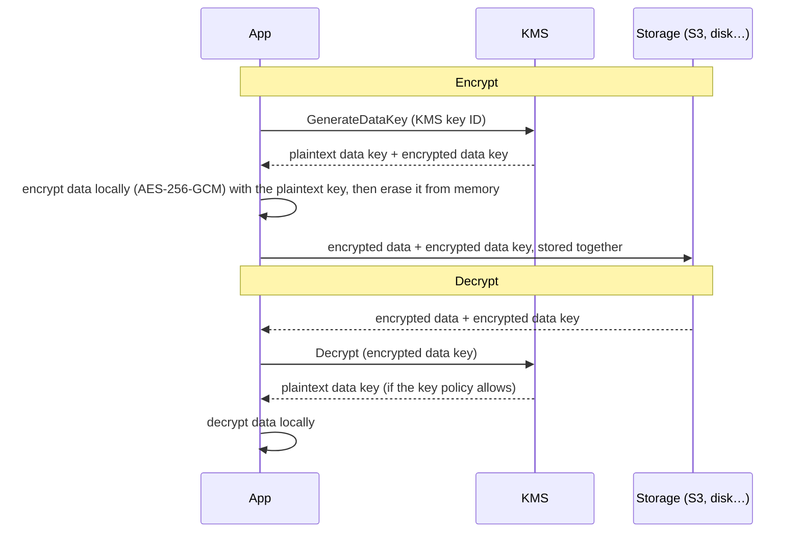
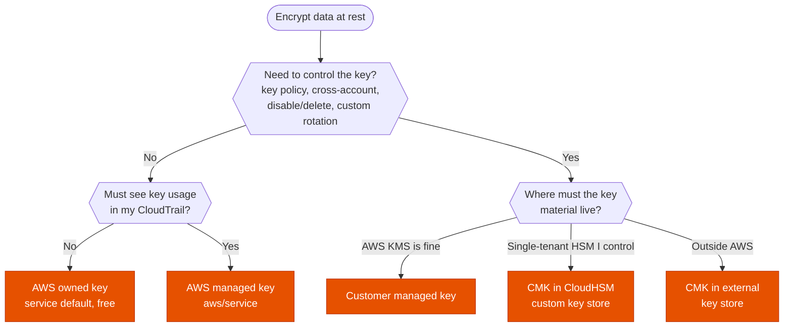

---
tags:
  - "Domain 1: Organizational Complexity"
  - "Domain 2: New Solutions"
  - KMS
  - Security
---

# KMS key types: AWS owned, AWS managed or customer managed?

**The question:** data must be encrypted at rest. Is the service's default key enough, or do you need a customer managed key (and where should its key material live)?

**Trigger keywords:** *"control the key policy"*, *"share encrypted snapshots with another account"*, *"rotate the key every 90 days"*, *"audit every use of the key"*, *"disable the key to revoke access"*, *"keys must stay in a dedicated HSM"*, *"keys must stay outside AWS"*, *"no extra cost"*, *"encrypt large files"*, *"data key"*, *"KMS throttling / ThrottlingException"*, *"reduce KMS request costs"*, *"client-side encryption"*.

## Fundamentals

| KMS key | Customer managed key | AWS managed key | AWS owned key |
|---|---|---|---|
| Example | A key you create, alias of your choice | `aws/s3`, `aws/ebs`, `aws/rds`… | SSE-S3, default DynamoDB and SQS encryption |
| Can view metadata? | ✅ | ✅ | ❌ |
| Can manage? (key policy, enable/disable, delete) | ✅ | ❌ | ❌ |
| Used only for my AWS account? | ✅ | ✅ | ❌ shared across accounts |
| Usage visible in my CloudTrail? | ✅ | ✅ | ❌ |
| Cross-account use | ✅ via the key policy | ❌ policy can't be edited | ❌ |
| Automatic rotation | Optional: **90 – 2560 days** (365 default) | **Required, every year** | Varies, managed by AWS |
| On-demand rotation | ✅ | ❌ | ❌ |
| Cost | $1/month per key + requests | No monthly fee, requests charged | Free |

- **Rotation keeps the key ID and ARN.** KMS keeps the old key material to decrypt older data, so nothing has to be re-encrypted. Automatic rotation applies to **symmetric keys with KMS-generated material**. Asymmetric, HMAC and imported keys are rotated manually: create a new key and move the **alias**.
- **Key stores:** a customer managed key can live in the default KMS store, in a **CloudHSM custom key store** (single-tenant HSM you control), or in an **external key store (XKS)** whose material never leaves your own HSM outside AWS.

## Envelope encryption

A KMS key **never leaves KMS**, and `Encrypt` accepts at most **4 KB**. So anything bigger is encrypted with a **data key**, and only the data key is encrypted by the KMS key. That's envelope encryption, and it's what S3, EBS, RDS and the AWS Encryption SDK do under the hood.

| API | Returns | Use it for |
|---|---|---|
| `Encrypt` / `Decrypt` | Ciphertext / plaintext | Small secrets **≤ 4 KB** (passwords, tokens) |
| `GenerateDataKey` | Plaintext **and** encrypted data key | Encrypt data **now** |
| `GenerateDataKeyWithoutPlaintext` | Encrypted data key only | A component that will encrypt **later** (it calls `Decrypt` when needed) |
| `GenerateDataKeyPair` | Asymmetric key pair, private key also encrypted | Client-side signing or encryption outside AWS |
| `ReEncrypt` | Ciphertext under another KMS key | Change key without exposing plaintext to the caller |

Why it matters:

- **Performance and size:** bulk data is encrypted locally, only a few bytes travel to KMS.
- **Blast radius:** each object or volume has its own data key. Leaking one exposes one object.
- **Access control stays in KMS:** whoever can't call `Decrypt` on the KMS key can't unwrap any data key. Disabling the KMS key makes all its data unreadable.
- **Rotation is cheap:** rotating the KMS key doesn't re-encrypt data keys. KMS keeps the old material to decrypt them.
- **Encryption context:** non-secret key-value pairs bound to the ciphertext (additional authenticated data). The same context is required to decrypt, it shows in **CloudTrail**, and key policies can require it with `kms:EncryptionContext:<key>` conditions.

### Cutting KMS calls (cost and throttling)

KMS has a per-account, per-Region **request quota** (thousands of requests per second, shared by all cryptographic calls). Above it: `ThrottlingException`.

| Fix | How |
|---|---|
| **S3 Bucket Keys** | S3 gets a short-lived bucket-level key from KMS and derives the per-object data keys from it. Up to **99% fewer KMS calls**. CloudTrail then shows the **bucket ARN** as encryption context, not each object |
| **Data key caching** (AWS Encryption SDK) | Reuse a data key for a limited time / number of messages |
| Request a quota increase | Service Quotas, when the calls are genuinely needed |

## Decision tree

## Why each branch

- **No control needed → service default.** AWS owned keys cost nothing and need nothing. AWS managed keys add visibility: you see the key and its use in CloudTrail, but you can't change it.
- **Control → customer managed key.** It's the only type whose **key policy** you write. That's what makes cross-account access, separation of duties (admins vs users), revoking access by disabling the key, and a custom rotation period possible.
- **Compliance on the key material → custom key store.** *"FIPS 140 Level 3 HSM we control"* or *"single tenant"* points to CloudHSM. *"Keys must never leave our data center"* points to an external key store. Both keep the KMS API, so integrated services still work.

## Exam traps

!!! warning "Sharing snapshots encrypted with an AWS managed key"
    EBS or RDS snapshots encrypted with `aws/ebs` or `aws/rds` can't be shared with another account: that key's policy can't be edited. Copy the snapshot with a **customer managed key**, then share both. Same trap as [cross-account backup copies](../storage/backup-strategy.md).

!!! warning "Rotation doesn't need re-encryption"
    *"Rotate the key yearly with the least effort"*: turn on automatic rotation. Old data stays readable, no re-encryption job is needed.

!!! warning "Rotating every 90 days"
    AWS managed keys rotate yearly and can't be changed. A shorter period means a **customer managed key** with a custom rotation period.

!!! warning "Imported key material"
    Automatic rotation isn't available for imported key material. Rotate by creating a new key and moving the alias.

!!! warning "Calling KMS `Encrypt` on a large file"
    `Encrypt` takes **4 KB** max. Large data → `GenerateDataKey` and encrypt locally (or use the **AWS Encryption SDK**, which does envelope encryption for you).

!!! warning "Storing the plaintext data key"
    Keep only the **encrypted** data key next to the data. The plaintext copy is used in memory and discarded. Storing it defeats the whole scheme.

!!! warning "SSE-KMS at high request rates"
    *"ThrottlingException"* or *"KMS costs too high"* on a busy S3 bucket → enable **S3 Bucket Keys**. Not a new key per prefix, not SSE-S3 (unless the KMS controls aren't needed).

!!! warning "Deleting vs disabling the key"
    Deleting a KMS key (7–30 day waiting period) makes **every data key it wrapped undecryptable, forever**. To cut access reversibly, **disable** it or edit the key policy.

!!! warning "Encrypted data copied to another Region"
    KMS keys are regional: the encrypted data key can't be decrypted in the other Region by the same key. Re-encrypt with a key there (S3 replication and snapshot copies do it), or use a **multi-Region key** (same key ID and material in several Regions) for client-side encrypted data.

## Test yourself

??? question "1. A company wants to share encrypted AMIs with a partner account. The EBS volumes use the default EBS encryption key. What must change?"
    The default key is the AWS managed `aws/ebs`, which can't be shared. Copy the AMI re-encrypted with a **customer managed key**, grant the partner account in its key policy, then share the AMI.

??? question "2. Security must be able to cut off all access to an S3 dataset immediately, even for admins with full S3 permissions. Which key type?"
    **Customer managed key** (SSE-KMS). Disabling the key, or removing grants from the key policy, makes the objects unreadable.

??? question "3. A regulator requires keys in a single-tenant, FIPS 140-3 Level 3 HSM controlled by the company, while still using SSE-KMS on S3. Design?"
    **Customer managed key in a CloudHSM custom key store.** S3 keeps calling KMS as usual.

??? question "4. A startup wants encryption at rest on DynamoDB at no extra cost and with no key management. What does it pick?"
    The **AWS owned key** (the DynamoDB default).

??? question "5. An app must encrypt 2 GB video files client-side before upload, with keys under the company's control in KMS. How?"
    **Envelope encryption**: `GenerateDataKey` with a customer managed key, encrypt the file locally with the plaintext data key, store the **encrypted data key** with the file (e.g. as metadata), discard the plaintext key. The **AWS Encryption SDK** or S3 Encryption Client does this for you.

??? question "6. After a traffic spike, uploads to an SSE-KMS bucket fail with `ThrottlingException`. Cheapest fix that keeps KMS control?"
    Enable **S3 Bucket Keys** on the bucket. Far fewer KMS requests, same customer managed key.

??? question "7. A batch job creates encrypted files at 2 a.m. but must not hold plaintext keys before then. Which API does the scheduler use to prepare the keys in advance?"
    `GenerateDataKeyWithoutPlaintext`. The job calls `Decrypt` on each encrypted data key when it actually runs.

## Related

- [Cross-account access](../identity/cross-account-access.md)
- [Backup: DLM vs AWS Backup vs native](../storage/backup-strategy.md)
- AWS docs: [AWS KMS keys](https://docs.aws.amazon.com/kms/latest/developerguide/concepts.html#kms_keys)
- AWS docs: [Envelope encryption](https://docs.aws.amazon.com/kms/latest/developerguide/kms-cryptography.html#enveloping)
- AWS docs: [S3 Bucket Keys](https://docs.aws.amazon.com/AmazonS3/latest/userguide/bucket-key.html)
- AWS docs: [Rotating AWS KMS keys](https://docs.aws.amazon.com/kms/latest/developerguide/rotate-keys.html)
