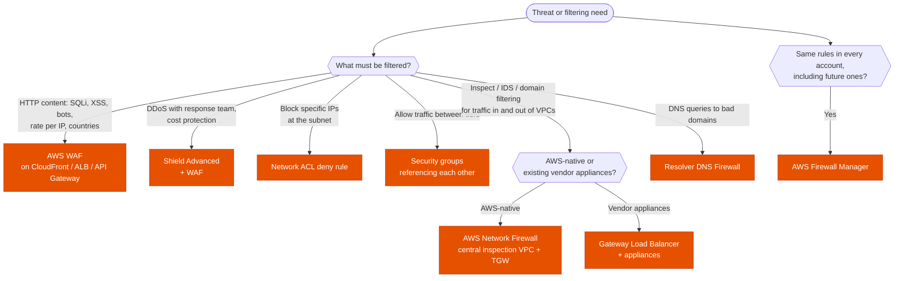

---
tags:
  - "Domain 1: Organizational Complexity"
  - "Domain 2: New Solutions"
  - Security
  - WAF
  - Network Firewall
---

# Network protection: security groups, NACLs, WAF, Shield, Network Firewall or Firewall Manager?

**The question:** traffic must be filtered or an attack absorbed. Which control works at the right **layer** and the right **place** in the traffic path, and how is it rolled out across all accounts?

**Trigger keywords:** *"SQL injection / XSS"*, *"rate-limit requests per IP"*, *"block a country"*, *"DDoS"*, *"cost protection during an attack"*, *"24/7 DDoS response team"*, *"inspect all traffic leaving the VPCs"*, *"allow outbound only to approved domains"*, *"IDS / IPS"*, *"block a specific IP range"*, *"enforce the same rules in every account"*, *"third-party firewall appliances"*.

## Fundamentals

| Control | Layer | Where | Stateful | Notes |
|---|---|---|---|---|
| **Security group** | 3–4 | **ENI** | ✅ | **Allow rules only**; can reference other SGs |
| **Network ACL** | 3–4 | **Subnet** | ❌ (return traffic needs ephemeral ports) | **Allow and deny**, numbered rules, first match wins |
| **AWS WAF** | **7** (HTTP) | CloudFront, ALB, API Gateway (REST), AppSync, Cognito user pools, App Runner, Verified Access | — | Managed rule groups, SQLi/XSS, **rate-based rules**, geo match, IP sets, bot control, CAPTCHA |
| **Shield Standard** | 3–4 | Automatic, all customers, free | — | Common volumetric DDoS |
| **Shield Advanced** | 3–4 and 7 | CloudFront, Route 53, Global Accelerator, ELB, EC2 Elastic IPs | — | **Shield Response Team**, **cost protection**, automatic L7 mitigation with WAF, health-based detection; per-org subscription, 1-year commitment |
| **AWS Network Firewall** | 3–7 | **VPC** (firewall endpoints in dedicated subnets, or centrally behind a TGW) | ✅ | Suricata rules, **domain allow/deny lists** (SNI / Host), IDS/IPS, TLS inspection |
| **Gateway Load Balancer** | 3 | VPC | — | Insert **third-party appliances** (GENEVE, port 6081) transparently |
| **Route 53 Resolver DNS Firewall** | DNS | VPC Resolver | — | Block queries to bad domains |
| **AWS Firewall Manager** | — | **Organization** | — | Central policies for WAF, Shield Advanced, SGs, Network Firewall, DNS Firewall, third-party firewalls; auto-applies to new accounts and resources |

WAF **Classic** is retired: everything is AWS WAF (v2) now.

## Decision tree

## Why each branch

- **WAF for layer 7.** Only WAF reads HTTP requests. Put it as far out as possible (**CloudFront**) so bad traffic is dropped at the edge. **Rate-based rules** answer *"one IP sends thousands of requests"*.
- **Shield Advanced** when the stem mentions the **DDoS response team**, **reimbursement of scaling costs**, or protecting non-HTTP endpoints (Global Accelerator, EIPs) from sophisticated attacks. It includes WAF at no extra charge for protected resources.
- **NACL to deny an IP range.** Security groups can't deny. For HTTP traffic behind CloudFront, block at **WAF** instead: NACLs see CloudFront's IPs, not the client's.
- **Network Firewall for VPC traffic inspection.** Egress filtering by **domain name**, IDS/IPS signatures, east-west inspection between VPCs through a TGW (with **appliance mode**).
- **GWLB** when the company already runs Palo Alto, Fortinet, Check Point… and wants to keep them.
- **Firewall Manager** is the multi-account answer. Prerequisites: **AWS Organizations**, a Firewall Manager **administrator account**, and **AWS Config** enabled in the accounts.

## Exam traps

!!! warning "Security group to block one malicious IP"
    Security groups only **allow**. Deny → **NACL** (or WAF IP set for HTTP).

!!! warning "NACL to block a client behind CloudFront or an ALB"
    The subnet sees the **load balancer's or CloudFront's** IPs. Use **WAF** (it sees the client IP or `X-Forwarded-For`).

!!! warning "WAF on an NLB or a Global Accelerator"
    WAF doesn't attach to NLB or GA. Put **CloudFront** or an **ALB** in front, or use **Shield Advanced** for L3/4.

!!! warning "Shield Standard for cost protection"
    Only **Shield Advanced** offers cost protection and the SRT.

!!! warning "Network Firewall without routing changes"
    Traffic must be **routed through** the firewall endpoints (route tables of IGW, subnets or TGW). Deploying it alone filters nothing.

!!! warning "Forgetting ephemeral ports on NACLs"
    NACLs are stateless: allow return traffic on **1024–65535** or responses are dropped.

## Test yourself

??? question "1. An e-commerce site behind CloudFront and an ALB sees SQL injection attempts and one IP sending 20,000 requests per minute."
    **AWS WAF** on the CloudFront distribution: AWS managed SQLi rule group + a **rate-based rule**.

??? question "2. A company wants DDoS experts on call during attacks and refunds for the EC2 and CloudFront costs an attack causes."
    **Shield Advanced** on the protected resources (with WAF web ACLs for L7 mitigation).

??? question "3. Outbound traffic from 60 VPCs may only reach a list of approved domains, and must pass IDS signatures."
    **AWS Network Firewall** in a central **inspection VPC** behind the **Transit Gateway**, stateful domain allow list + managed threat signatures.

??? question "4. Every ALB and CloudFront distribution in the organization, including future ones, must have the corporate WAF rules."
    **Firewall Manager** WAF policy scoped to the OUs (Organizations + Config enabled).

??? question "5. A known bad /24 range must be blocked from reaching EC2 instances in a public subnet."
    **NACL deny rule** on the subnet.

## Related

- [Security services: GuardDuty, Inspector, Security Hub…](security-services.md)
- [VPC to VPC connectivity](../networking/vpc-connectivity.md)
- [Hybrid DNS](../networking/hybrid-dns.md)
- [Edge: CloudFront or Global Accelerator](../networking/cloudfront-global-accelerator.md)
- AWS docs: [AWS WAF, Shield and Firewall Manager](https://docs.aws.amazon.com/waf/latest/developerguide/what-is-aws-waf.html)
- AWS docs: [Network Firewall deployment models](https://docs.aws.amazon.com/network-firewall/latest/developerguide/architectures.html)
- AWS whitepaper: [AWS Best Practices for DDoS Resiliency](https://docs.aws.amazon.com/whitepapers/latest/aws-best-practices-ddos-resiliency/welcome.html)
