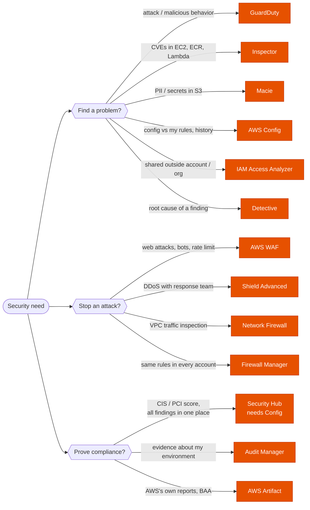
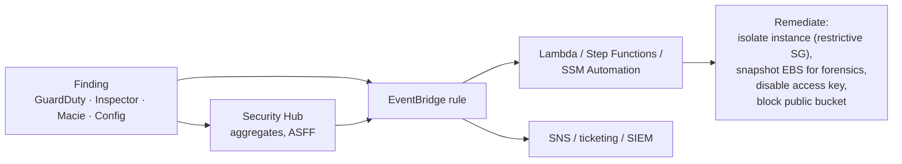

---
tags:
  - "Domain 1: Organizational Complexity"
  - "Domain 2: New Solutions"
  - "Domain 3: Continuous Improvement"
  - GuardDuty
  - Inspector
  - Security Hub
  - Security
---

# Security services: GuardDuty, Inspector, Macie, Security Hub… which one?

**The question:** a scenario wants to detect threats, find vulnerabilities, discover sensitive data, check compliance, investigate an incident or block attacks. Which AWS security service does that job, and how do you run it across all accounts?

**Trigger keywords:** *"malicious activity"*, *"compromised instance / credentials"*, *"crypto-mining"*, *"vulnerabilities / CVEs"*, *"container images"*, *"PII in S3"*, *"single pane of glass"*, *"CIS benchmark / PCI DSS"*, *"security posture score"*, *"root cause of a finding"*, *"configuration compliance"*, *"evidence for auditors"*, *"SOC report"*, *"shared with an external account"*, *"across all accounts in the organization"*.

## Fundamentals

### Detect and assess

| Service | Answers | Looks at | Agent? |
|---|---|---|---|
| **GuardDuty** | *Is someone attacking me / behaving maliciously?* (threat detection) | CloudTrail management events, VPC Flow Logs, DNS logs: **nothing to enable**. Optional protection plans: S3 data events, EKS, Runtime Monitoring (EC2/ECS/EKS), Malware Protection (EBS, S3 uploads), RDS logins, Lambda | No (agent only for Runtime Monitoring) |
| **Inspector** | *Which workloads have known vulnerabilities?* | **EC2** (packages, network reachability), **ECR images**, **Lambda** functions and code | SSM agent on EC2 (or agentless scan) |
| **Macie** | *Where is sensitive data (PII, credentials) in S3?* | **S3 objects** only | No |
| **Security Hub** (CSPM) | *Am I following best practices / CIS / PCI? Show me all findings in one place.* | Its own checks (via **AWS Config** rules) + findings from GuardDuty, Inspector, Macie, Access Analyzer, partners | No, but **needs AWS Config** |
| **AWS Config** | *What does each resource look like, how did it change, is it compliant with my rules?* | Resource configurations and history | No |
| **IAM Access Analyzer** | *What is shared outside my account / org? Which permissions are unused?* | Resource and IAM policies | No |
| **Detective** | *What happened around this finding?* (investigation, root cause) | Graph built from CloudTrail, Flow Logs, GuardDuty findings, EKS audit logs | No |

### Protect

| Service | Blocks |
|---|---|
| **AWS WAF** | Layer 7 web attacks (SQLi, XSS, bots, rate limits) on CloudFront, ALB, API Gateway, AppSync, Cognito |
| **Shield Standard / Advanced** | DDoS. Standard: free, L3/L4. Advanced: response team (SRT), cost protection, L7 with WAF |
| **Network Firewall** | Stateful VPC traffic inspection, domain filtering, IPS (Suricata rules) |
| **Firewall Manager** | Nothing itself: **enforces** WAF, Shield Advanced, security groups, Network Firewall, DNS Firewall policies **across all accounts** |

### Govern, audit, centralize

| Service | Use it for |
|---|---|
| **Audit Manager** | Continuously **collect evidence** from your accounts and map it to a framework (PCI DSS, HIPAA, GDPR, SOC 2) → audit-ready reports |
| **AWS Artifact** | Download **AWS's own** compliance reports (SOC, ISO, PCI) and accept agreements (e.g. **HIPAA BAA**) |
| **Security Lake** | Centralize security logs from AWS, on-prem and SaaS into an S3 data lake in **OCSF** format, for a SIEM or analytics |
| **CloudTrail** | Who did what, when: see [CloudTrail: react, alert or keep the logs?](cloudtrail.md) |

!!! note "Security Hub naming"
    In 2025 AWS renamed the posture-check service **Security Hub CSPM** and launched a broader **Security Hub** on top of it that correlates GuardDuty, Inspector, Macie and CSPM signals. Exam questions use plain *"Security Hub"* for the aggregation and compliance-check role described here.

## Decision tree

## Why each branch

- **GuardDuty = behavior.** It analyzes activity (API calls, network flows, DNS queries) with threat intelligence and ML: crypto-mining, calls from known bad IPs, credentials used from an unusual place, data exfiltration from S3. It reads the logs from its own independent stream: you don't enable Flow Logs or a trail for it.
- **Inspector = known flaws in software.** It compares installed packages, container image layers and Lambda dependencies against CVE databases, and flags EC2 instances reachable from the internet on risky ports. It scans continuously and re-scans when a new CVE is published.
- **Macie = data.** Machine learning and pattern matching on S3 object contents. Also flags buckets that are public, unencrypted or shared outside the account.
- **Config = configuration, by resource.** Inventory, change timeline and rules (managed or custom Lambda), with automatic remediation through SSM Automation. Conformance packs bundle rules for a framework.
- **Security Hub = aggregation + scorecard.** It runs standards (AWS Foundational Security Best Practices, CIS, PCI DSS, NIST 800-53) as controls, mostly built on Config rules, and collects findings from the other services into one format (ASFF). It doesn't detect threats itself.
- **Detective = after the alert.** It builds a behavior graph over up to a year of data to answer *"what else did this role / IP / instance do?"*. It investigates; it doesn't raise the first alarm.
- **Artifact vs Audit Manager.** Artifact gives you AWS's paperwork about **AWS**. Audit Manager gathers evidence about **your** environment.

## Running them across the organization

- **Delegated administrator:** in AWS Organizations, make the **security tooling account** the administrator for GuardDuty, Inspector, Macie, Security Hub, Detective, Config (aggregator) and Firewall Manager. Not the management account.
- **Auto-enable** for new member accounts, so nothing joins the org unprotected.
- **These services are Regional.** Enable GuardDuty (and Security Hub, Config…) in **every Region**, including unused ones: attackers like Regions you don't watch. Security Hub **cross-Region aggregation** brings findings into one Region.
- **Security Hub central configuration** applies the same standards and controls to all accounts and Regions from the administrator.

### Automated response

All these services **emit findings to EventBridge**. Security Hub **custom actions** let an analyst send a chosen finding to EventBridge with one click; **automation rules** update or suppress findings automatically.

## Comparison

| | GuardDuty | Inspector | Macie | Security Hub | Config | Detective |
|---|---|---|---|---|---|---|
| Type | Threat detection | Vulnerability scan | Sensitive data discovery | Posture + aggregation | Config compliance | Investigation |
| Scope | Account activity, network, DNS (+ S3, EKS, runtime, RDS, Lambda plans) | EC2, ECR, Lambda | S3 | All of the left + standards | Any supported resource | Findings + logs |
| Typical stem | *"compromised instance"*, *"unusual API calls"* | *"CVEs"*, *"vulnerable packages"*, *"image scanning"* | *"PII in buckets"* | *"CIS score"*, *"single dashboard"* | *"track changes"*, *"non-compliant resources"* | *"root cause"*, *"investigate"* |
| Prerequisite | None | SSM agent (EC2) | None | **AWS Config** | Recorder on | GuardDuty |

## Exam traps

!!! warning "GuardDuty blocks attacks"
    No: it **detects** and reports. Blocking or remediation is your EventBridge → Lambda / SSM automation, or WAF / Network Firewall.

!!! warning "Enable VPC Flow Logs and CloudTrail so GuardDuty can work"
    Not needed. GuardDuty reads CloudTrail management events, Flow Logs and DNS logs from **its own independent stream** as soon as it's enabled. (S3 data events, EKS audit logs, runtime and malware scanning are optional protection plans.)

!!! warning "Custom DNS resolvers hide DNS findings"
    GuardDuty only sees DNS queries that go through the **Amazon-provided resolver** (Route 53 Resolver). Instances using their own DNS servers produce no DNS-based findings.

!!! warning "Security Hub shows no control results"
    Most Security Hub controls run as **AWS Config** rules. If Config isn't recording in that account and Region, the standards produce little or nothing.

!!! warning "Enabling only in the Regions you use"
    GuardDuty and Security Hub are Regional. A threat actor will launch resources in a Region you don't watch. Enable everywhere, with a delegated admin and auto-enable.

!!! warning "Inspector to find PII, or Macie to find CVEs"
    Inspector = **software vulnerabilities** in EC2, ECR, Lambda. Macie = **data** in S3. Easy to swap under time pressure.

!!! warning "Inspector Classic"
    Assessment templates, assessment runs and a dedicated Inspector agent are the legacy **Inspector Classic**. Today's Inspector scans continuously with the **SSM agent** and needs no assessment runs.

!!! warning "Detective to raise alerts"
    Detective doesn't generate the first alert. It helps investigate findings from GuardDuty (and others).

!!! warning "Scan uploaded files for malware"
    *"Files uploaded by users to S3 must be scanned for malware before processing"* → **GuardDuty Malware Protection for S3**. No need to run your own antivirus on EC2.

!!! warning "AWS Artifact for evidence about my workloads"
    Artifact holds **AWS's** reports and agreements. Evidence about **your** controls → **Audit Manager** (and Config / Security Hub).

!!! warning "Firewall Manager without prerequisites"
    It needs **AWS Organizations**, a Firewall Manager **administrator account**, and **AWS Config** enabled in the accounts.

## Test yourself

??? question "1. A company wants to know if any EC2 instance is communicating with known crypto-mining pools or command-and-control servers, with the least effort. Which service?"
    **GuardDuty.** Enable it (delegated admin, all Regions, auto-enable); it analyzes Flow Logs and DNS logs on its own.

??? question "2. The security team must continuously scan all container images pushed to ECR and all EC2 instances for CVEs, across 50 accounts."
    **Amazon Inspector**, with the security account as **delegated administrator** and auto-enable for new accounts. EC2 instances need the SSM agent (or agentless scanning).

??? question "3. Auditors want proof that the S3 buckets of the data lake don't contain unmasked credit card numbers."
    **Amazon Macie** sensitive data discovery jobs (or automated discovery) on those buckets.

??? question "4. Management wants one dashboard with a compliance score against the CIS AWS Foundations Benchmark for every account, plus GuardDuty and Inspector findings. Security Hub is enabled but shows almost no control results. Why?"
    **AWS Config** isn't enabled/recording. Security Hub runs most controls as Config rules. Enable Config in every account and Region (e.g. via StackSets or Control Tower).

??? question "5. When GuardDuty reports a compromised EC2 instance, it must be isolated automatically and its disk preserved for forensics."
    **EventBridge rule** on the GuardDuty finding → **Lambda / Step Functions / SSM Automation**: replace the security groups with an isolation SG, snapshot the EBS volumes, tag the instance.

??? question "6. After a GuardDuty finding about unusual API calls by a role, the analyst needs to see everything that role and its source IPs did over the last weeks."
    **Amazon Detective.**

??? question "7. A healthcare company needs AWS's SOC 2 report and must sign a Business Associate Agreement with AWS."
    **AWS Artifact.**

??? question "8. Every account in the organization must have the same AWS WAF rules on its ALBs, including accounts created next month."
    **AWS Firewall Manager** WAF policy scoped to the OU, with Organizations and Config enabled.

## Related

- [CloudTrail: react, alert or keep the logs?](cloudtrail.md)
- [Will this request be allowed?](../identity/policy-evaluation.md)
- [KMS key types](kms-key-types.md)
- AWS docs: [GuardDuty foundational data sources](https://docs.aws.amazon.com/guardduty/latest/ug/guardduty_data-sources.html)
- AWS docs: [What is Amazon Inspector?](https://docs.aws.amazon.com/inspector/latest/user/what-is-inspector.html)
- AWS docs: [What is Security Hub CSPM?](https://docs.aws.amazon.com/securityhub/latest/userguide/what-is-securityhub.html)
- AWS docs: [AWS Security Reference Architecture](https://docs.aws.amazon.com/prescriptive-guidance/latest/security-reference-architecture/welcome.html)
