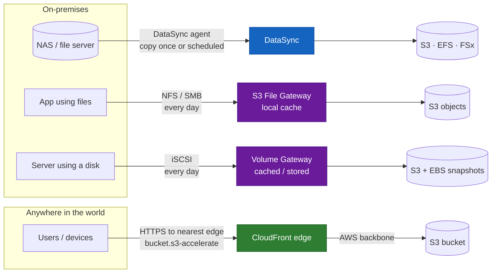
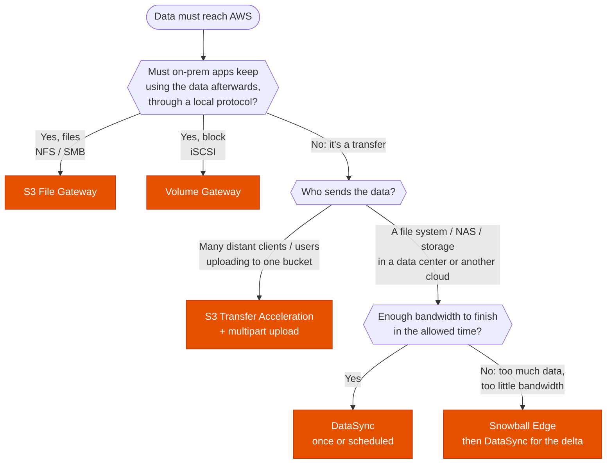

---
tags:
  - "Domain 2: New Solutions"
  - "Domain 4: Migration and Modernization"
  - DataSync
  - Storage Gateway
  - S3
  - Storage
  - Hybrid
---

# DataSync, S3 Transfer Acceleration, File Gateway or Volume Gateway?

**The question:** data must get from somewhere outside AWS into AWS storage. Is it a **copy** (once or on a schedule), **fast uploads from far away**, or **ongoing access** by on-prem apps through a file or block protocol?

**Trigger keywords:** *"migrate / copy / move X TB"*, *"one-time migration"*, *"replicate every night"*, *"preserve permissions and timestamps"*, *"verify data integrity"*, *"users around the world upload to a central bucket"*, *"long distance"*, *"on-premises applications keep using the data"*, *"NFS / SMB share backed by S3"*, *"iSCSI"*, *"low-latency local access"*.

## Fundamentals

The one question that separates them: **what happens after the data is in AWS?**

| Service | What it is | Data flow | After the transfer |
|---|---|---|---|
| **DataSync** | Managed **copy job** (agent VM on-prem) | Push: on-prem → AWS, AWS → AWS, other clouds → AWS. **Once or scheduled** | The source can be retired. Apps use the AWS copy |
| **S3 Transfer Acceleration** | A **faster route to S3** for distant clients | Client → nearest **CloudFront edge** → AWS backbone → bucket | Nothing special: it's a normal S3 upload/download, just quicker |
| **S3 File Gateway** | On-prem **NFS/SMB share** whose files are S3 objects | Continuous, cache on-prem | On-prem apps **keep working on the share** |
| **Volume Gateway** | On-prem **iSCSI disk** backed by S3, snapshots as EBS | Continuous, cache or full copy on-prem | On-prem servers **keep using the disk**. Restore as EBS in AWS |

### DataSync in a nutshell

- **Agent** (VM on VMware, Hyper-V, KVM, or EC2) reads NFS, SMB, HDFS or self-managed object storage. **No agent** needed between AWS services (e.g. EFS → EFS in another Region, S3 → FSx).
- **Destinations:** S3 (any storage class, including Glacier classes), **EFS**, **FSx** (Windows, Lustre, ONTAP, OpenZFS). Works **in both directions** (AWS → on-prem too).
- **Incremental:** after the first run, only changes are copied. **Schedule** tasks (hourly, daily…).
- **Preserves metadata**: POSIX permissions, timestamps, **NTFS ACLs** (SMB → FSx for Windows).
- **Verifies** integrity with checksums, encrypts in transit (TLS), **bandwidth throttling**, include/exclude filters.
- Over the internet, or over **Direct Connect** with a **VPC interface endpoint** for DataSync (stays private).

### S3 Transfer Acceleration in a nutshell

- A **bucket setting**. Clients use the endpoint `<bucket>.s3-accelerate.amazonaws.com`.
- Traffic enters AWS at the **nearest edge location** and crosses the AWS backbone instead of the public internet.
- Helps when clients are **far from the bucket's Region**. Little gain close to the Region. You're charged only when it's faster.
- Works with **multipart upload** (combine both for big files). Bucket name must be DNS-compliant (**no dots**).

## Decision tree

## Why each branch

- **Ongoing local access → a gateway.** A gateway is not a migration tool, it's a **hybrid** tool: the on-prem app keeps its share or disk, and AWS holds the data. Files → File Gateway; disks → Volume Gateway.
- **Copy a file system → DataSync.** It's built for this: parallel, incremental, verified, scheduled, keeps permissions. Much faster and more reliable than `aws s3 sync` or rsync scripts. Also the answer for **AWS → AWS** copies (EFS across Regions, S3 → EFS, etc.).
- **Distant clients → Transfer Acceleration.** The source isn't one data center but users or devices all over the world. They upload directly to S3; acceleration only shortens the network path.
- **Not enough bandwidth → Snowball.** Rough math: **100 Mbps moves ~1 TB per day**. 100 TB on 100 Mbps ≈ 3 months: ship a Snowball. Then DataSync copies what changed in the meantime.

## Comparison

| | DataSync | Transfer Acceleration | S3 File Gateway | Volume Gateway |
|---|---|---|---|---|
| Purpose | Copy / migrate / replicate | Faster S3 uploads over distance | Files on-prem, stored in S3 | Disks on-prem, stored in S3 |
| On-prem component | Agent VM | None | Gateway VM + cache | Gateway VM + cache / full copy |
| Protocol on-prem | Reads NFS, SMB, HDFS, object | HTTPS (S3 API) | NFS, SMB | iSCSI |
| Destinations | S3, EFS, FSx | S3 only | S3 only | S3 (hidden) + EBS snapshots |
| Timing | Once or scheduled | Each upload | Continuous | Continuous |
| Keeps metadata / ACLs | ✅ | ❌ (objects) | POSIX / SMB ACLs on objects | Block level |
| Typical stem | *"migrate 50 TB from NAS to EFS"* | *"users on 5 continents upload videos"* | *"on-prem app writes files, analytics in AWS"* | *"iSCSI volumes, backup to AWS, restore as EBS"* |

## Exam traps

!!! warning "File Gateway for a one-time migration"
    It works, but it's the wrong tool: the data goes through a cache, nothing is verified, and you're left running a gateway. *"Migrate"*, *"one-time"*, *"then decommission the NAS"* → **DataSync**.

!!! warning "DataSync when apps must keep running on-prem"
    DataSync copies, it doesn't serve files. If on-prem apps must keep reading and writing the data **after** it's in AWS, the answer is a **gateway** (or a shared file system reachable over DX/VPN). Both together is common: DataSync migrates the archive, File Gateway serves the active data.

!!! warning "Transfer Acceleration from the data center next door"
    Acceleration helps with **distance**, not with a slow local uplink. A data center in the same Region with a saturated link needs more bandwidth (DX), DataSync with parallel streams, or Snowball.

!!! warning "Transfer Acceleration to EFS or FSx"
    It's an **S3-only** feature. Copying to EFS or FSx → **DataSync**.

!!! warning "Transfer Acceleration with a dotted bucket name"
    `my.bucket.name` can't be accelerated. Use a bucket name without dots.

!!! warning "DataSync to an EBS volume"
    DataSync doesn't write to EBS. Block data that must end up as EBS → **Volume Gateway** snapshots (or copy into a file system on the instance).

!!! warning "Private DataSync over Direct Connect"
    *"Must not traverse the internet"* → DataSync agent with a **VPC interface endpoint** for DataSync, reached over a **private VIF**. See [Direct Connect](../networking/direct-connect.md).

!!! warning "S3 sync scripts"
    `aws s3 sync` or rsync cron jobs are the *"high operational overhead"* option: no verification, no retries at scale, no metadata for EFS/FSx. **DataSync** is the managed answer.

!!! warning "SFTP partners"
    Partners who send files over **SFTP/FTPS** to S3 or EFS → **AWS Transfer Family**, not DataSync or a gateway.

## Test yourself

??? question "1. A company wants to move 40 TB from an on-prem NFS NAS to Amazon EFS over its 1 Gbps link, preserve permissions, then shut down the NAS."
    **DataSync** with an agent on-prem, destination EFS. ~40 TB at 1 Gbps ≈ 4 days, fine. Metadata is preserved, transfer verified.

??? question "2. Field teams on four continents upload large drone videos to one S3 bucket in us-east-1. Uploads from Asia are very slow."
    **S3 Transfer Acceleration** on the bucket, with **multipart upload** in the client.

??? question "3. An on-prem app writes daily reports to an SMB share. Analysts must query them with Athena. The app can't change."
    **S3 File Gateway** with an SMB share: the app keeps writing to a share, each file is an S3 object Athena can read.

??? question "4. On-prem database servers use iSCSI SAN volumes. The company wants off-site backups in AWS and to be able to start the servers in EC2 after a disaster."
    **Volume Gateway** (stored mode for full local performance). Snapshots are **EBS snapshots** → create volumes and attach to EC2 in a disaster.

??? question "5. A file share must be copied every night to FSx for Windows File Server in AWS, keeping NTFS ACLs, until the cutover next month."
    **DataSync** scheduled task, SMB source → FSx for Windows. Incremental each night, ACLs preserved.

??? question "6. 500 TB must move to S3 within 3 weeks. The link is 500 Mbps."
    500 Mbps ≈ 5 TB/day → ~100 days. Too slow: **Snowball Edge** devices, then **DataSync** for the changes made during shipping.

??? question "7. An EFS file system in eu-west-1 must be copied to us-east-1 every week for DR."
    **DataSync** between the two EFS file systems (no agent). (EFS replication is the alternative if a continuously updated read-only copy is wanted.)

## Related

- [Storage Gateway: which gateway type for a hybrid workload?](storage-gateway.md)
- [The 7 Rs: which migration strategy?](../migration/seven-rs.md)
- [Direct Connect: which VIF, and how to make it resilient?](../networking/direct-connect.md)
- AWS docs: [What is AWS DataSync?](https://docs.aws.amazon.com/datasync/latest/userguide/what-is-datasync.html)
- AWS docs: [S3 Transfer Acceleration](https://docs.aws.amazon.com/AmazonS3/latest/userguide/transfer-acceleration.html)
