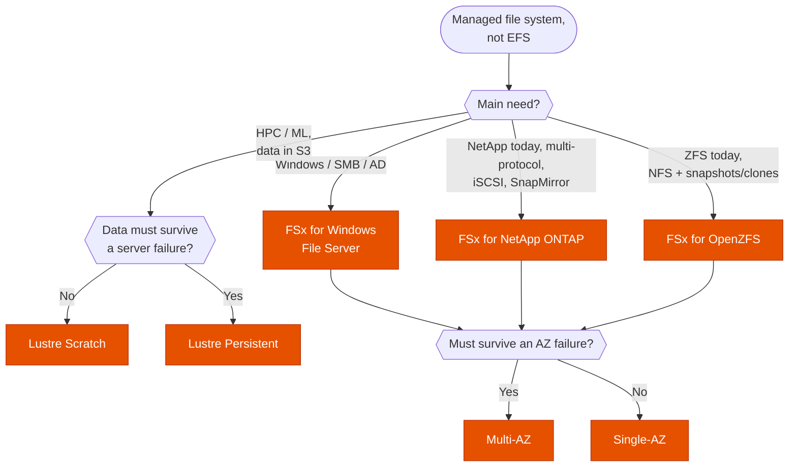

---
tags:
  - "Domain 2: New Solutions"
  - "Domain 3: Continuous Improvement"
  - "Domain 4: Migration"
  - FSx
  - Storage
---

# FSx: which flavor, which deployment, and what not to touch?

**The question:** a workload needs a managed file system that EFS doesn't fit (Windows/SMB, HPC, NetApp, ZFS). Which FSx flavor, Single-AZ or Multi-AZ, and how do you operate it (failover, scaling, DR) without breaking it?

**Trigger keywords:** *"SMB"*, *"Windows file shares"*, *"Active Directory"*, *"DFS"*, *"HPC"*, *"ML training reads from S3"*, *"sub-millisecond"*, *"NetApp"*, *"SnapMirror"*, *"NFS and SMB on the same data"*, *"iSCSI"*, *"ZFS"*, *"test failover"*, *"keep the existing file server name"*, *"access from on-premises / peered VPC"*.

## Fundamentals

| Flavor | Protocols | Clients | Typical use | AZ options |
|---|---|---|---|---|
| **Windows File Server** | SMB | Windows (+ Linux via SMB) | Home dirs, shares, SQL Server, AD integration | Single-AZ · **Multi-AZ** |
| **Lustre** | Lustre (POSIX) | Linux | HPC, ML training, video rendering. **S3 data repository** | Single-AZ only |
| **NetApp ONTAP** | NFS, SMB, iSCSI, NVMe/TCP | Linux, Windows, macOS | Lift-and-shift NetApp, multi-protocol, SnapMirror, FlexClone | Single-AZ · **Multi-AZ** |
| **OpenZFS** | NFS | Linux, macOS, Windows | Lift-and-shift ZFS, low latency, snapshots/clones | Single-AZ · Multi-AZ |

### Multi-AZ (Windows, ONTAP, OpenZFS)

- An **active** file server in the preferred subnet and a **standby** in another AZ, with synchronous replication.
- **Automatic failover** (usually within ~30 s) when the AZ or the active server fails, or during maintenance. Clients use the **DNS name**, so they follow without changes.
- **Throughput changes** and some maintenance on Multi-AZ make FSx **fail over to the standby and back**. On Single-AZ they cause a **short outage**.

### Lustre deployment types

| | Scratch | Persistent |
|---|---|---|
| Replication | ❌ none: a failed server loses data | ✅ within the AZ |
| Backups | ❌ | ✅ |
| For | Short-lived, re-creatable jobs, cheapest | Long-running jobs, data that must survive |

**Data repository association (DRA):** links a Lustre file system to an S3 prefix. Files are **lazy-loaded** from S3 on first read, and changes can be **exported back** to S3 automatically.

## Decision tree

## Why each branch

- **SMB + AD → Windows File Server.** Native NTFS ACLs, AD (AWS Managed AD or self-managed), DFS namespaces, shadow copies, deduplication. EFS is NFS-only, so it's never the answer for Windows shares.
- **HPC on S3 data → Lustre.** Hundreds of GB/s, sub-ms latency, and the DRA turns an S3 bucket into a fast POSIX file system for the duration of the job. Scratch when the results go back to S3 anyway; Persistent when the file system itself must be durable.
- **Already on NetApp → ONTAP.** Same tooling: **SnapMirror** replication from on-prem or across Regions, FlexClone, dedup/compression, automatic tiering to a cheap capacity pool. Also the answer when **one data set must be served over NFS and SMB** at once, or when you need **iSCSI** block storage.
- **Already on ZFS → OpenZFS.** Lift-and-shift without changing NFS clients, instant snapshots and clones.
- **AZ failure must not stop access → Multi-AZ.** Single-AZ is cheaper but goes down with the AZ and during maintenance.

## Exam traps

!!! warning "Testing failover by modifying the ENIs"
    FSx creates and manages the ENIs in your subnets. AWS warns **never to modify or delete them**: it can **permanently break connectivity** to the file system. You also can't stop or reboot the file servers. The supported way to test a Multi-AZ failover is to **change the throughput capacity**: FSx fails over to the standby, updates the preferred server, then fails back.

    General rule: test a managed service's failover with **the action AWS provides** (RDS reboot with failover, Aurora `failover-db-cluster`, FSx throughput change), never by breaking the infrastructure underneath.

!!! warning "Throughput change on Single-AZ in business hours"
    On Multi-AZ, it's a brief failover. On **Single-AZ**, the file system is **unavailable** during the change. Schedule it in a maintenance window.

!!! warning "Shrinking storage or changing the deployment type"
    Storage capacity can only **increase** (and at most once every 6 hours). You can't switch Single-AZ to Multi-AZ in place either. Both mean a **new file system** and copying the data (**DataSync**, or Robocopy for Windows).

!!! warning "Two Single-AZ file systems + DFS Replication for HA"
    That was the pattern before Multi-AZ existed. Today, *"highly available Windows file share with least operational overhead"* → **Multi-AZ** FSx for Windows. DFS **Namespaces** are still useful to group several file systems under one path.

!!! warning "Keeping the old server name after migration"
    Users and scripts reference `\\fileserver01\share`. Don't rewrite them all: add a **DNS alias** on FSx for Windows and point a CNAME at the file system.

!!! warning "ONTAP Multi-AZ from a peered VPC or on-premises"
    Multi-AZ ONTAP uses **floating IPs outside the VPC CIDR** (the endpoint IP address range). VPC peering doesn't route them: you need a **Transit Gateway** (or access from inside the VPC). Single-AZ doesn't have this issue.

!!! warning "Lustre Scratch for data that must survive"
    Scratch has no replication and no backups. *"Durable"*, *"long-running"*, *"must not lose data"* → **Persistent**.

!!! warning "Lustre for Windows, or Multi-AZ Lustre"
    Lustre is **Linux-only** and **single-AZ**. For durability it relies on Persistent replication within the AZ and on S3 as the system of record.

!!! warning "Cross-Region DR"
    Windows / Lustre / OpenZFS: **AWS Backup** with **cross-Region copy**. ONTAP: **SnapMirror** to a file system in the other Region (lower RPO than backups).

## Test yourself

??? question "1. A company runs FSx for Windows File Server Multi-AZ. The DR team wants to prove clients survive a failover, without risking the file system. How?"
    **Increase (or change) the throughput capacity.** FSx fails over to the standby and back. Don't touch the ENIs, security groups or subnets.

??? question "2. 500 Windows users will move from an on-prem file server to AWS. Shares must stay highly available and the UNC paths in scripts must not change."
    **FSx for Windows Multi-AZ**, joined to AD, data copied with **DataSync**, and a **DNS alias** with the old server name.

??? question "3. A genomics pipeline runs nightly for 4 hours over 200 TB in S3 and writes results back to S3. Cheapest fast file system?"
    **FSx for Lustre Scratch** with a **data repository association** to the bucket (lazy load, export results). Data lives in S3, so losing the file system is acceptable.

??? question "4. A NetApp shop wants to replicate on-prem volumes to AWS for DR and serve the same data to Linux (NFS) and Windows (SMB) clients."
    **FSx for NetApp ONTAP** with **SnapMirror** from on-prem.

??? question "5. Clients in a peered VPC can't reach a Multi-AZ ONTAP file system; clients in its own VPC can. Fix?"
    Multi-AZ ONTAP endpoints are floating IPs outside the VPC CIDR, which peering doesn't route. Connect through a **Transit Gateway** with routes to the endpoint IP range.

## Related

- [EFS: performance mode, throughput mode and storage class](efs-performance-storage.md)
- [Backup: DLM vs AWS Backup vs native](backup-strategy.md)
- AWS docs: [Choosing an Amazon FSx file system](https://aws.amazon.com/fsx/when-to-choose-fsx/)
- AWS docs: [FSx for Windows: availability and durability (testing failover)](https://docs.aws.amazon.com/fsx/latest/WindowsGuide/high-availability-multiAZ.html)
- AWS docs: [FSx for ONTAP: accessing data from outside the VPC](https://docs.aws.amazon.com/fsx/latest/ONTAPGuide/supported-fsx-clients.html)
- AWS docs: [FSx for Lustre deployment options](https://docs.aws.amazon.com/fsx/latest/LustreGuide/using-fsx-lustre.html)
