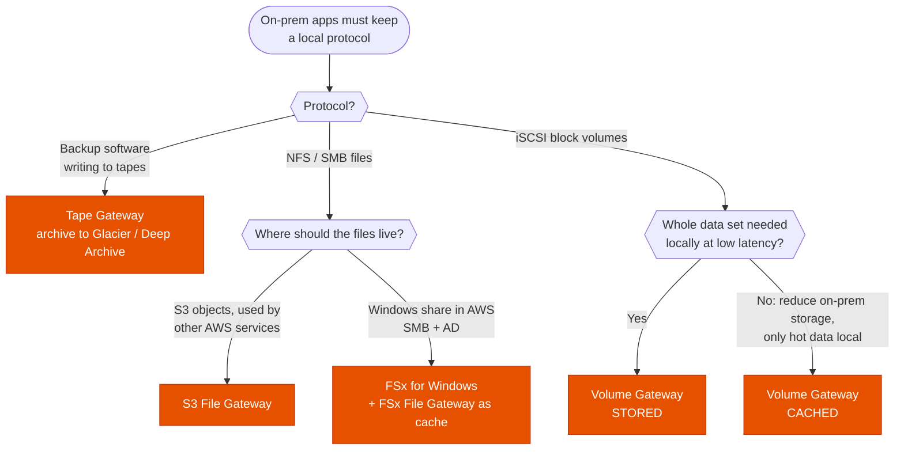

---
tags:
  - "Domain 2: New Solutions"
  - "Domain 4: Migration and Modernization"
  - Storage Gateway
  - Storage
  - Hybrid
---

# Storage Gateway: which gateway type for a hybrid workload?

**The question:** on-premises servers must keep using local protocols (NFS, SMB, iSCSI, tape) while the data lives in AWS. Which gateway type, which mode, and what are the limits?

**Trigger keywords:** *"on-premises applications"*, *"hybrid"*, *"NFS / SMB share backed by S3"*, *"iSCSI"*, *"low-latency access to frequently used data"*, *"replace physical tapes"*, *"existing backup software"*, *"virtual tape library"*, *"reduce on-premises storage"*, *"keep the full data set locally"*, *"EBS snapshots of on-prem volumes"*.

## Fundamentals

Storage Gateway is a **VM on-premises** (VMware ESXi, Hyper-V, KVM), or an **EC2 instance**, that speaks a local protocol and stores the data in AWS. It keeps a **local cache** for low-latency access to recent data and uploads asynchronously.

| Type | Protocol | Data lands in | Typical use |
|---|---|---|---|
| **S3 File Gateway** | NFS, SMB | **S3 objects**, one file = one object, readable by other AWS services | File shares backed by S3, data lake ingestion, backups as files |
| **FSx File Gateway** | SMB | **FSx for Windows File Server** | Low-latency local cache for a Windows share in AWS. *No longer offered to new customers (2024), but still in older questions* |
| **Volume Gateway, cached** | iSCSI | S3 (managed by AWS, not visible as objects) | Block volumes, **primary data in AWS**, only hot data cached locally |
| **Volume Gateway, stored** | iSCSI | **Full copy on-prem**, async backup to S3 as **EBS snapshots** | Block volumes, **whole data set local**, low latency, cloud backup/DR |
| **Tape Gateway** | iSCSI VTL | Virtual tapes in S3, archived to **Glacier Flexible Retrieval or Deep Archive** | Replace physical tapes **without changing the backup software** (Veeam, NetBackup, Backup Exec…) |

Common to all:

- Connects over the **internet, Direct Connect or a VPC interface endpoint** (PrivateLink).
- Data encrypted in transit (TLS) and at rest (SSE-S3 by default, **SSE-KMS** possible).
- **Bandwidth throttling** schedule to protect the WAN during business hours.
- Monitoring with **CloudWatch** metrics (cache hit %, upload buffer); file share **audit logs** to CloudWatch Logs.

## Decision tree

## Why each branch

- **Tapes → Tape Gateway.** The backup application sees a tape library (VTL) and keeps its jobs and retention. Tapes go to S3, then to Glacier or Deep Archive when ejected. No more tape handling or off-site trucks.
- **Files that other AWS services must read → S3 File Gateway.** Each file is a plain S3 object, so Athena, Lambda, EMR or SageMaker can use it directly. Storage class per share: S3 Standard, Standard-IA, One Zone-IA or Intelligent-Tiering, then lifecycle rules.
- **Windows share in AWS → FSx for Windows.** Branch offices that need a local cache used FSx File Gateway. For new designs, mount FSx directly over Direct Connect/VPN, or use S3 File Gateway with SMB.
- **Block, whole data set local → stored.** The app gets local-disk latency for everything; AWS holds point-in-time **EBS snapshots** for backup and DR.
- **Block, minimize on-prem storage → cached.** The primary copy is in AWS; only the working set stays local. If the WAN goes down, uncached data is unreachable.

## Comparison

| | S3 File | Volume cached | Volume stored | Tape |
|---|---|---|---|---|
| Protocol | NFS / SMB | iSCSI | iSCSI | iSCSI VTL |
| Primary copy | S3 | S3 | **On-prem** | S3 / Glacier |
| Local storage | Cache | Cache | **Full data set** | Cache |
| Data visible as S3 objects | ✅ | ❌ | ❌ | ❌ |
| Restore in AWS as | Objects | EBS volume (from snapshot) | EBS volume (from snapshot) | Retrieve tape to the gateway |
| Max size | Unlimited (S3) | 32 volumes × 32 TiB | 32 volumes × 16 TiB | 1,500 tapes / 1 PiB per gateway |

## Exam traps

!!! warning "Files written directly to S3 don't show up on the share"
    The File Gateway caches the bucket listing. Objects added to the bucket by something else (another gateway, an app, a replication rule) appear on the share only after a **cache refresh**: call **`RefreshCache`** (e.g. from EventBridge + Lambda on a schedule or on S3 events), or enable the **automated cache refresh** timer on the share.

!!! warning "Several sites writing to the same bucket through File Gateways"
    S3 File Gateway has **no locking across gateways**: two gateways writing the same file overwrite each other. Use one writer per prefix and the others read-only, or a real shared file system (FSx for Windows / ONTAP) for multi-site collaboration.

!!! warning "Lifecycle rule moves files to Glacier"
    Objects in S3 Glacier Flexible Retrieval or Deep Archive **can't be read through the File Gateway** until they are **restored** in S3. Lifecycle to Glacier only for files nobody opens from the share.

!!! warning "Storage Gateway for a one-time bulk migration"
    It's a **hybrid** service for ongoing access. To move a data set once: **DataSync** (online) or **Snowball** (offline, little bandwidth). Storage Gateway is right when on-prem apps keep using the data afterwards.

!!! warning "Cached volumes when the WAN is unreliable"
    With cached volumes, data not in the cache is only in AWS. *"Must keep working during network outages"* or *"low latency to the entire data set"* → **stored** volumes.

!!! warning "Stored vs cached reversed"
    Stored = **stored** locally (full copy on-prem). Cached = only a **cache** locally (primary copy in AWS). The names describe what's on-prem.

!!! warning "Rewriting backup jobs to target S3"
    *"Without changing the existing backup software / processes"* → **Tape Gateway**. Writing the backup software's output to S3 File Gateway works too, but the VTL keeps the jobs and tape retention unchanged.

!!! warning "Tape retention for compliance"
    Use **Tape Retention Lock** (governance or compliance mode) and archive to **Deep Archive** for the cheapest long-term storage. Deep Archive retrieval takes up to 12 hours.

!!! warning "No virtualization on-site"
    Storage Gateway needs a hypervisor. A small site without one used the **hardware appliance**. In the cloud, run the gateway on **EC2** (e.g. to read on-prem volumes' snapshots in DR, or for testing).

!!! warning "DR from Volume Gateway"
    Volume snapshots are **EBS snapshots**: in a disaster, create **EBS volumes** from them and attach to EC2 instances. That's the classic *"recover on-prem volumes in AWS"* answer. Catch: a snapshot of a cached volume **over 16 TiB** can't become an EBS volume (EBS limit), only a gateway volume again.

## Test yourself

??? question "1. A media company's on-prem editors save files over SMB. The files must also be processed by Lambda and queried with Athena. Which gateway?"
    **S3 File Gateway** (SMB share): each file becomes an S3 object that Lambda and Athena can use directly.

??? question "2. An app on-prem uses iSCSI volumes and needs low-latency access to the full 10 TB data set, with backups in AWS. Which gateway and mode?"
    **Volume Gateway, stored mode.** Full data local, asynchronous EBS snapshots in AWS.

??? question "3. A company wants to stop buying on-prem SAN capacity for a 200 TB iSCSI data set, of which only 5 TB is active."
    **Volume Gateway, cached mode** with a cache sized for the ~5 TB working set. Primary data in AWS.

??? question "4. A bank must replace its physical tape library, keep its NetBackup jobs, and retain backups for 10 years at the lowest cost."
    **Tape Gateway**, tapes archived to **S3 Glacier Deep Archive**, with **Tape Retention Lock** if they must be immutable.

??? question "5. A partner uploads CSVs straight to the S3 bucket behind a File Gateway. On-prem users can't see them on the share. Fix?"
    Run **`RefreshCache`** on the file share (automate with EventBridge + Lambda) or enable **automated cache refresh**.

??? question "6. On-prem volumes are backed up with Volume Gateway. The data center burns down. How do you bring the app back in AWS?"
    Create **EBS volumes from the gateway's snapshots** and attach them to EC2 instances running the app.

## Related

- [DataSync, S3 Transfer Acceleration, File Gateway or Volume Gateway?](data-transfer.md)
- [FSx: which flavor, which deployment, and what not to touch?](fsx.md)
- [S3: which storage class and lifecycle?](s3-storage-classes.md)
- [Backup: DLM vs AWS Backup vs native](backup-strategy.md)
- AWS docs: [What is AWS Storage Gateway?](https://docs.aws.amazon.com/storagegateway/latest/userguide/WhatIsStorageGateway.html)
- AWS docs: [Refreshing the S3 bucket object cache](https://docs.aws.amazon.com/filegateway/latest/files3/refresh-cache.html)
- AWS docs: [Volume Gateway: cached and stored volumes](https://docs.aws.amazon.com/storagegateway/latest/vgw/StorageGatewayConcepts.html)
